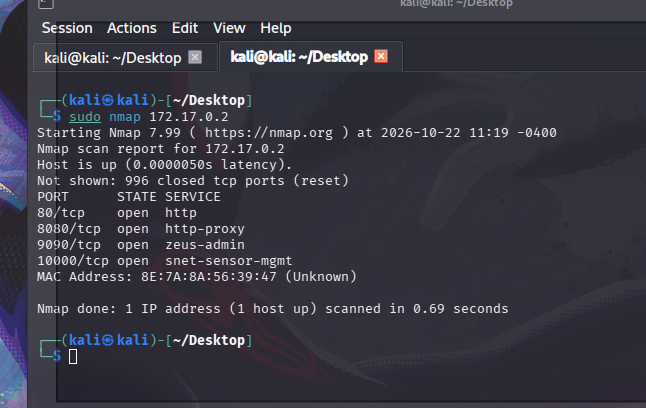
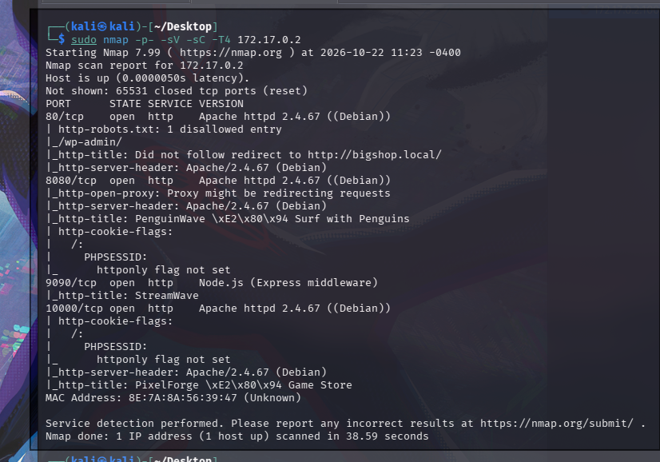
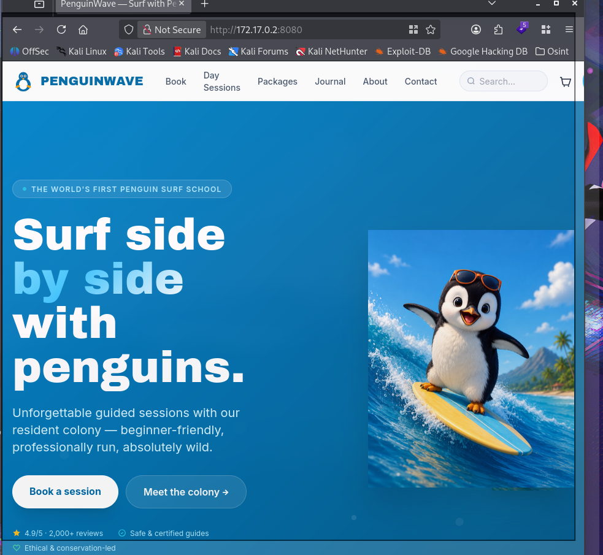

# 🔍 Reconocimiento general

⬅ [Volver al README principal](../README.md)

Sin más dato que la IP del cliente, el primer paso es identificar qué expone de cara a la red.

**Escaneo de puertos (rápido):**

```bash
sudo nmap 172.17.0.2
```



Cuatro puertos TCP abiertos, los cuatro HTTP — encaja con las 4 aplicaciones del laboratorio.

**Escaneo completo con detección de versión:**

```bash
sudo nmap -p- -sV -sC -T4 172.17.0.2
```



| Puerto | App | Stack |
|---|---|---|
| **80** | **WordPress** (vhost `bigshop.local`) | Apache 2.4.67 + WordPress 7.1.4 |
| **8080** | **PenguinWave** | Apache 2.4.67 + PHP |
| 9090 | StreamWave (*pendiente*) | Node.js (Express) |
| **10000** | **PixelForge** | Apache 2.4.67 + PHP |

Empezamos por el **8080 — PenguinWave**, una (ficticia) escuela de surf con pingüinos.



---

➡️ Continúa por app: [PenguinWave](penguinwave/README.md) · [PixelForge](pixelforge/README.md) · [WordPress](wordpress/README.md)
