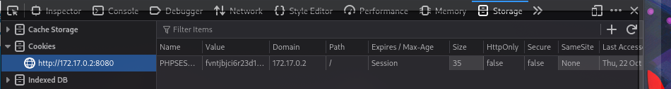

# 🍪 F-001 — Cookie de sesión sin atributos de seguridad

   

> [!IMPORTANT]
> La cookie de sesión `PHPSESSID` de PenguinWave no tiene ninguno de los atributos de seguridad habituales (`HttpOnly`, `Secure`, `SameSite`). Por sí sola es una debilidad latente — pero en cuanto existe un punto de inyección de JavaScript en la app (ver [F-003](F-003-xss-almacenado-reviews.md) y [F-004](F-004-xss-reflejado-buscador.md)), deja de ser teórica: permite robo de sesión confirmado de punta a punta.

## 📖 Contexto

Revisando el panel `Storage` de las DevTools del navegador en cualquier página de PenguinWave, se inspeccionaron los atributos de la cookie `PHPSESSID` que la aplicación usa para mantener la sesión del usuario autenticado.

## 🔬 Explotación paso a paso

1. Abrir las DevTools del navegador → pestaña `Storage` (o `Application` en Chrome) → `Cookies`.
2. Inspeccionar la cookie `PHPSESSID` en cualquier página de PenguinWave.

| Atributo | Valor observado | Esperado |
|---|---|---|
| `HttpOnly` | `false` | `true` |
| `Secure` | `false` | `true` |
| `SameSite` | `None` | `Lax` o `Strict` |
| `Domain` | `172.17.0.2` | — |
| `Path` | `/` | — |
| Expira | Session | — |

Los tres atributos que importan están todos mal configurados a la vez — no es un despiste puntual, es la ausencia total de hardening de la cookie de sesión.

## 💥 Impacto

> [!CAUTION]
> Esta debilidad deja de ser teórica en cuanto existe inyección de JavaScript en la aplicación — y la hay, dos veces.

- **`HttpOnly: false`** → la cookie es accesible desde JavaScript (`document.cookie`). **Confirmado con PoC real**: el payload `/?c='+document.cookie)">`, insertado vía el XSS almacenado de [F-003](F-003-xss-almacenado-reviews.md), exfiltró la cookie `PHPSESSID` en texto plano a un listener propio al visitar la ficha de producto. El mismo payload, servido vía el XSS reflejado de [F-004](F-004-xss-reflejado-buscador.md), repite el robo con solo un clic en un enlace. Secuestro de sesión demostrado de punta a punta, no solo teórico.
- **`Secure: false`** → la cookie se enviaría también por HTTP sin cifrar. En este laboratorio todo corre por HTTP de todas formas, pero en un entorno real esto habilita robo de sesión vía MITM/sniffing en redes no confiables.
- **`SameSite: None`** → la cookie se envía en peticiones cross-site, ampliando la superficie para CSRF si no hay otras protecciones — exactamente lo que explota [F-010](F-010-csrf-envio-reviews.md).

## 🛡️ Remediación

- Configurar la cookie de sesión con `HttpOnly; Secure; SameSite=Lax` (o `Strict` si el flujo de la app lo permite) a nivel de servidor — en PHP, vía `session.cookie_httponly`, `session.cookie_secure` y `session.cookie_samesite`, o directamente en la cabecera `Set-Cookie`.
- Tratar esto como prerrequisito de cualquier otra mitigación de XSS/CSRF: sin estos atributos, cualquier inyección de JS en la app se convierte automáticamente en robo de sesión.

## Hallazgos relacionados

- [F-003 — XSS almacenado en reviews](F-003-xss-almacenado-reviews.md) y [F-004 — XSS reflejado en buscador](F-004-xss-reflejado-buscador.md): ambos explotan la ausencia de `HttpOnly` para robar la cookie confirmada aquí.
- [F-010 — CSRF en envío de reviews](F-010-csrf-envio-reviews.md): explota directamente `SameSite: None`.

---
⬅ [Volver al índice de writeups](README.md) · [README principal](../README.md) · [Informe técnico (PDF)](../docs/informe-BigShop.pdf)
