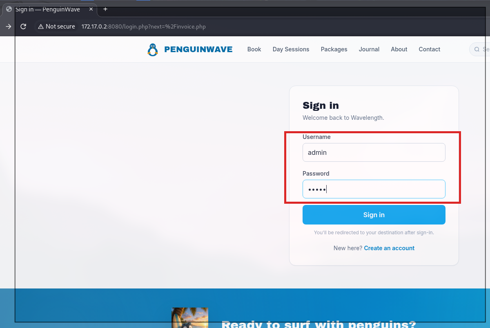
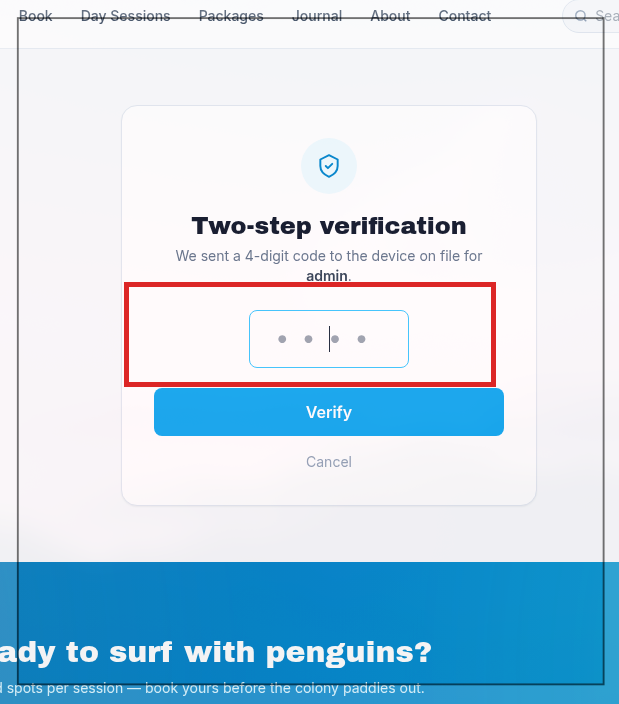
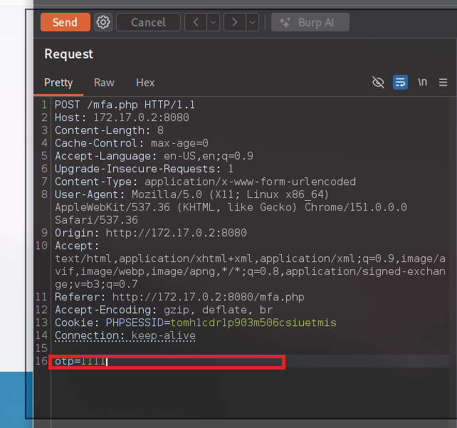

# 🔑 F-002 — Credenciales por defecto válidas (admin/admin)

   

> [!IMPORTANT]
> El usuario `admin` con contraseña `admin` es válido en `login.php`. Es el primer eslabón de la cadena completa de compromiso administrativo — ver [F-009](F-009-cadena-completa-compromiso-admin.md).

## 📖 Contexto

Entre las rutas descubiertas por `ffuf` en la fase de descubrimiento de contenido estaba `login.php`, no enlazada desde el menú visible de la app. Antes de probar nada más sofisticado, lo obvio: credenciales por defecto.

Un detalle previo que conviene anotar: se intentó acceder directamente a `invoice.php` sin sesión, y la app redirigió correctamente a `login.php?next=%2Finvoice.php` — control de acceso presente para ese caso (el parámetro `next` queda anotado como candidato a probar open redirect más adelante).

## 🔬 Explotación paso a paso

1. Navegar a `login.php`.
2. Introducir usuario `admin`, contraseña `admin`.



3. El login se acepta y redirige a `mfa.php`, solicitando un segundo factor:



Se observa en `mfa.php` un código de verificación de **4 dígitos**, con un límite anunciado de **5 intentos**.

4. Se captura la petición del MFA en Burp Suite para tenerla lista para el siguiente paso:



```http
POST /mfa.php HTTP/1.1
Host: 172.17.0.2:8080
Content-Type: application/x-www-form-urlencoded
Cookie: PHPSESSID=<session>

otp=1111
```

## 💥 Impacto

> [!CAUTION]
> Existencia de una cuenta `admin` con credenciales triviales — primer factor de autenticación completamente roto.

Por sí sola, esta credencial queda contenida por el MFA. El problema real es que ese MFA resultó evadible — ver [F-007](F-007-bypass-ratelimit-mfa-xff.md). Combinados, los dos hallazgos dan acceso administrativo completo sin conocer ninguna credencial legítima — cadena completa documentada en [F-009](F-009-cadena-completa-compromiso-admin.md).

## 🛡️ Remediación

- Eliminar o forzar el cambio de credenciales por defecto en el primer login.
- Exigir una política de contraseñas robusta (longitud mínima, sin valores triviales/diccionario).
- Bloqueo de cuenta (no solo de IP) tras un número razonable de intentos fallidos de login.

## Hallazgos relacionados

- [F-007 — Bypass de rate-limit del MFA](F-007-bypass-ratelimit-mfa-xff.md): el segundo factor que debería contener esta credencial trivial.
- [F-009 — 🏆 Cadena completa de compromiso de la cuenta administradora](F-009-cadena-completa-compromiso-admin.md): une este hallazgo con F-007 hasta el acceso administrativo total.

---
⬅ [Volver al índice de writeups](README.md) · [README principal](../README.md) · [Informe técnico (PDF)](../docs/informe-BigShop.pdf)
