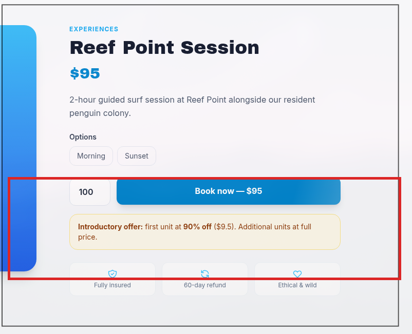
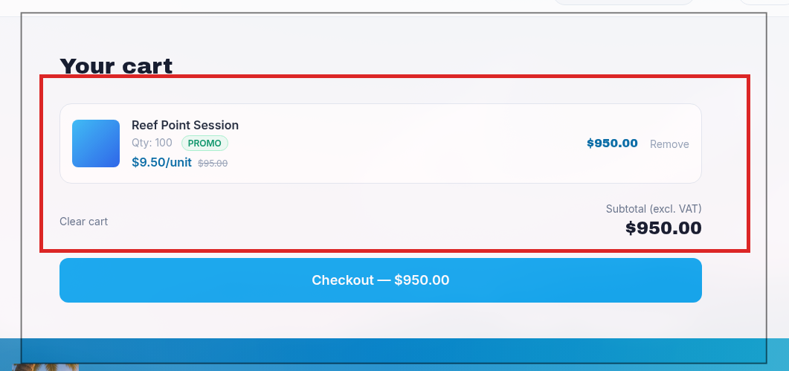
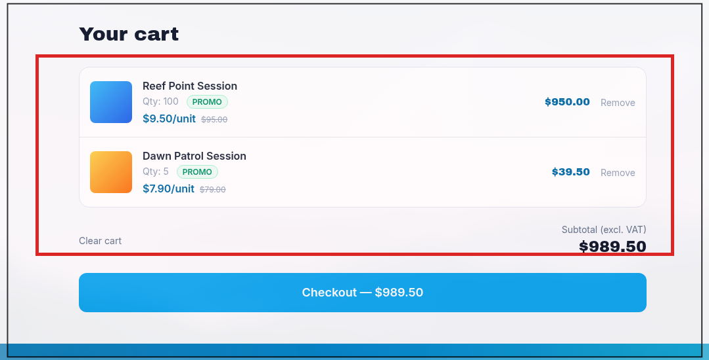

# 💰 F-005 — Manipulación de precio: el descuento "primera compra" se aplica a todo el carrito

   

> [!IMPORTANT]
> El catálogo anuncia "primera unidad al 90% de descuento" por producto. En la práctica, el descuento se aplica a **todas** las unidades, de **todos** los productos distintos que se añadan en la primera compra — sin ninguna técnica avanzada, solo cambiando cantidades en el flujo normal de compra.

## 📖 Contexto

La tienda anuncia una promoción tipo "first unit at 90% off ($9.5). Additional units at full price." por producto. Se probó qué pasaba al llevar esa promesa al límite con el flujo de compra normal.

## 🔬 Explotación paso a paso

1. Acceder a la ficha de "Reef Point Session" (oferta visible: "first unit at 90% off ($9.5). Additional units at full price."), fijar cantidad = **100** y añadir al carrito:



2. Verificar el carrito resultante: **100 unidades a $9.50/unidad = $950.00 total**, en vez de 1×$9.50 + 99×$95.00 = $9.414,50 (el descuento debería limitarse a la primera unidad):



3. Sin vaciar el carrito, añadir un **segundo producto distinto** ("Dawn Patrol Session", $79/unidad, cantidad 5). También recibe el descuento completo en sus 5 unidades:



No se requirió ninguna técnica de concurrencia/race condition — es un fallo de cálculo de precio en servidor, reproducible con el flujo de compra normal.

## 💥 Impacto

> [!CAUTION]
> Pérdida económica directa y sin límite aparente de cantidad ni de número de productos distintos — en el peor caso, permite vaciar el catálogo completo pagando ~10% de su valor real en un único pedido.

Cálculo correcto esperado (descuento limitado a 1 unidad, en un único producto):

```
Reef Point Session:   1 × $9.50  +  99 × $95.00  = $9.414,50
Dawn Patrol Session:  1 × $7.90  +   4 × $79.00  =   $323,90
                                           TOTAL  = $9.738,40
```

Importe real cobrado (carrito completo): **$989,50** → diferencia de **$8.748,90** en un único pedido de prueba, con solo 2 productos y cantidades modestas (100 y 5). No se observó límite de cantidad por producto ni límite de número de productos distintos — el abuso escala libremente.

## 🛡️ Remediación

- Calcular el descuento en servidor aplicando la promoción únicamente a **una unidad, de un único producto, una única vez por cuenta de cliente** — nunca a "todo lo que haya en el carrito".
- Validar también el precio final en el paso de checkout, sin confiar en el precio calculado en un paso anterior del flujo.
- Añadir límites razonables de cantidad por producto/pedido.

## Hallazgos relacionados

Ninguno directamente encadenado — es un fallo de lógica de negocio independiente del resto de la cadena de compromiso de cuentas.

---
⬅ [Volver al índice de writeups](README.md) · [README principal](../README.md) · [Informe técnico (PDF)](../docs/informe-BigShop.pdf)
