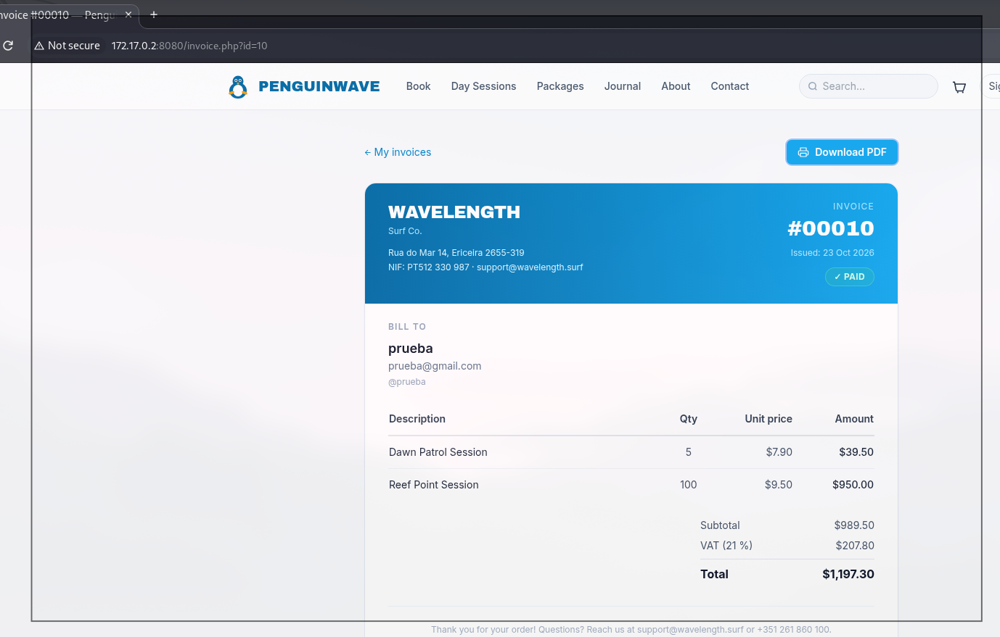
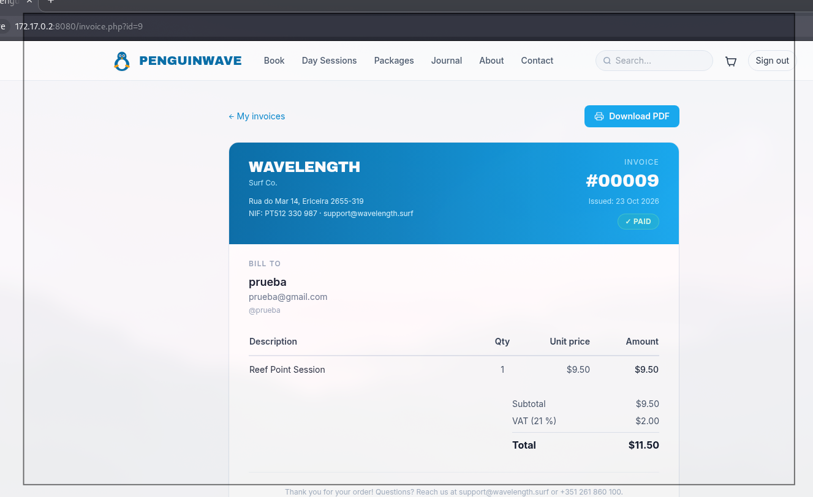
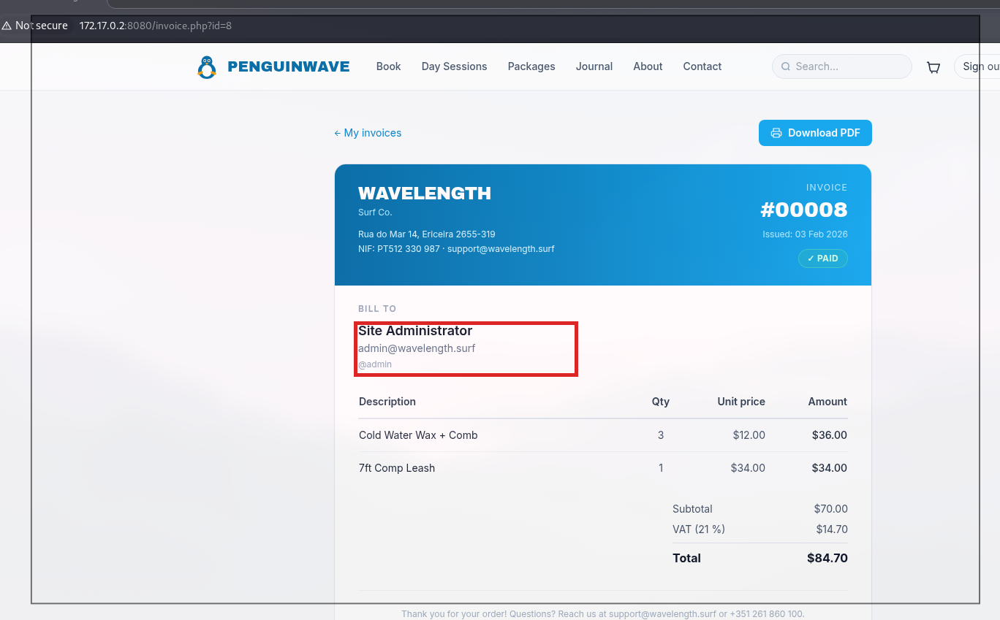

# 🔓 F-006 — IDOR en facturas (invoice.php)

   

> [!IMPORTANT]
> `invoice.php` identifica la factura mediante un `id` numérico y secuencial, sin comprobar que pertenezca al usuario autenticado. Con una cuenta de cliente normal se pudo enumerar el histórico completo de facturación de la plataforma — incluida la factura de la cuenta administradora.

## 📖 Contexto

**Endpoint afectado:** `http://172.17.0.2:8080/invoice.php?id=<N>`

Logueado como el usuario de pruebas `prueba`, se revisaron primero las facturas propias para establecer una línea base antes de probar IDs ajenos.

## 🔬 Explotación paso a paso

1. Facturas propias, para establecer la línea base (ambas con "Bill to: prueba / prueba@gmail.com"):

`invoice.php?id=10`:

`invoice.php?id=9`:

2. Bajando el `id` a 8, sin cambiar de sesión, se accede a una factura que **no** es de `prueba`:

`invoice.php?id=8` → "Bill to: **Site Administrator**, **admin@wavelength.surf**, **@admin**".

3. Enumerando el rango completo (`id=1` a `id=11`) se confirma: solo la última (`id=11`, la cuenta `prueba`) es legítima — las **10 restantes pertenecen a otras cuentas** y son accesibles íntegramente sin ningún control de autorización.

## 💥 Impacto

> [!CAUTION]
> Se puede volcar el histórico completo de pedidos de la plataforma con un simple bucle sobre el parámetro `id`.

- Exposición de PII y datos de facturación de cualquier usuario, sin autorización — enumeración trivial (`id=1`, `2`, `3`...).
- Se filtró el **correo electrónico y el nombre de usuario reales de la cuenta administradora** (`admin@wavelength.surf` / `@admin`), confirmando que la cuenta `admin` ([F-002](F-002-credenciales-por-defecto-admin-admin.md)) es la administradora real del sitio.
- Enumeración completa confirmada: 10 de 11 facturas totales pertenecen a otras cuentas y son accesibles sin control alguno.

## 🛡️ Remediación

- Verificar en servidor que la factura solicitada pertenece al usuario autenticado (comprobar `user_id` de la sesión contra el propietario de la factura); devolver 403/404 en caso contrario.
- Usar identificadores no secuenciales/no adivinables (UUID) como defensa en profundidad adicional — no sustituye el control de acceso, solo dificulta la enumeración.

## Hallazgos relacionados

- [F-002 — Credenciales por defecto (admin/admin)](F-002-credenciales-por-defecto-admin-admin.md): este hallazgo confirma el email/usuario real de la cuenta `admin` filtrada aquí.
- [F-009 — 🏆 Cadena completa de compromiso de la cuenta administradora](F-009-cadena-completa-compromiso-admin.md): con acceso admin, este IDOR da acceso íntegro al histórico de facturación de la plataforma.

---
⬅ [Volver al índice de writeups](README.md) · [README principal](../README.md) · [Informe técnico (PDF)](../docs/informe-BigShop.pdf)
