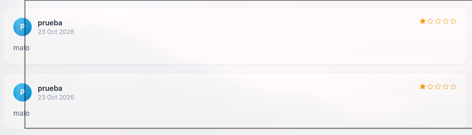

# 🌧️ F-008 — Reviews ilimitadas: spam y manipulación de reputación

   

> [!IMPORTANT]
> El sistema de reviews no limita cuántas valoraciones puede dejar un mismo usuario sobre un mismo producto. Sin verificación de compra ni límite de frecuencia, el sistema de reviews no es una señal de confianza fiable para los clientes — y además amplifica el impacto del XSS almacenado de [F-003](F-003-xss-almacenado-reviews.md).

## 📖 Contexto

**Endpoint afectado:** formulario de reviews en `product.php?id=<producto>`.

Tras confirmar el XSS almacenado en reviews ([F-003](F-003-xss-almacenado-reviews.md)), se probó un control relacionado pero independiente: ¿cuántas reviews puede dejar el mismo usuario sobre el mismo producto?

## 🔬 Explotación paso a paso

1. Logueado como `prueba`, enviar una review de 1 estrella ("malo") sobre un producto.
2. Sin ninguna restricción, enviar otra review al mismo producto con la misma cuenta.
3. Repetir varias veces: no hay bloqueo ni error, todas las reviews quedan publicadas y visibles.

Dos reviews de 1 estrella ("malo") enviadas por el mismo usuario `prueba` sobre el mismo producto, sin ninguna restricción.

## 💥 Impacto

- **Manipulación de reputación (rating bombing):** un competidor, un cliente descontento o cualquier usuario malicioso puede destrozar la valoración media de un producto enviando decenas o cientos de reviews de 1 estrella, sin haber comprado nunca el producto.
- **Amplifica [F-003](F-003-xss-almacenado-reviews.md):** sin límite de reviews, un atacante puede inundar la página de producto con el payload de XSS repetido, aumentando la probabilidad de que cualquier visitante lo dispare.
- Sin verificación de compra (`verified purchase`) ni límite de frecuencia, el sistema de reviews no es fiable como señal de confianza para los clientes.

## 🛡️ Remediación

- Restringir a una review por usuario y producto (actualizable, no duplicable), idealmente vinculada a compra verificada.
- Añadir control de frecuencia/anti-spam adicional (rate limiting, CAPTCHA en casos sospechosos) como defensa en profundidad.

## Hallazgos relacionados

- [F-003 — XSS almacenado en reviews](F-003-xss-almacenado-reviews.md): la ausencia de límite de reviews amplifica directamente su alcance.

---
⬅ [Volver al índice de writeups](README.md) · [README principal](../README.md) · [Informe técnico (PDF)](../docs/informe-BigShop.pdf)
