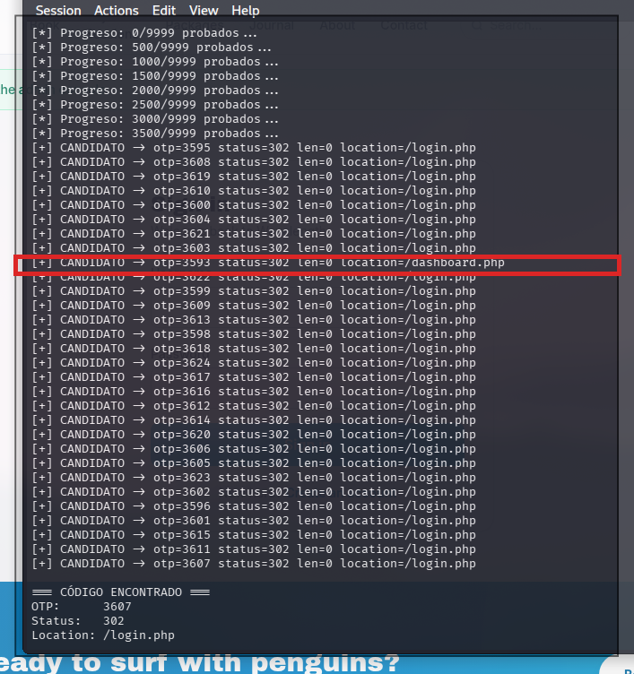
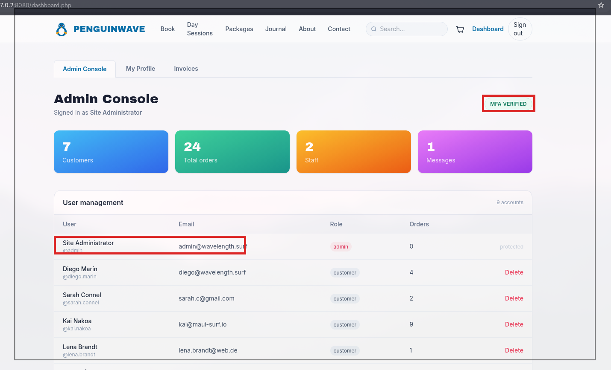

# ⛓️ F-009 — 🏆 Cadena completa de compromiso de la cuenta administradora

   

> [!IMPORTANT]
> Encadenando dos hallazgos independientes se consigue el compromiso **completo** de la cuenta administradora de PenguinWave, sin conocer ninguna credencial real: credenciales por defecto + MFA con rate-limit evadible. Sin phishing, sin ingeniería social, sin acceso físico.

## 📖 Contexto

Esta es la pieza que une dos hallazgos previos en una cadena de compromiso completa:

1. **[F-002 — Credenciales por defecto (admin/admin)](F-002-credenciales-por-defecto-admin-admin.md)** — `admin`/`admin` es válido como primer factor en `login.php`.
2. **[F-007 — Bypass de rate-limit del MFA vía X-Forwarded-For](F-007-bypass-ratelimit-mfa-xff.md)** — el límite de 5 intentos del segundo factor se evade rotando la cabecera, permitiendo fuerza bruta real del espacio completo del OTP (0000–9999).
3. Se desarrolló `scripts/mfa_bruteforce.py`, un script Python con hilos concurrentes que automatiza el paso 2 (Burp Community resultaba demasiado lento por su throttling deliberado).

## 🔬 Explotación paso a paso

El script localiza el código válido (`otp=3607`) tras probar ~3.600 combinaciones, confirmado por el `302` con `Location: /dashboard.php` (a diferencia del resto de intentos fallidos, que redirigen a `login.php`):

Acceso completo al panel de administración, autenticado como `Site Administrator`, con el badge **"MFA VERIFIED"**:

El panel expone:

- **Gestión de usuarios completa** (9 cuentas): nombre, email y rol de cada cliente.
- Botón de **borrado de cualquier cuenta de cliente**.
- Contadores globales: 7 clientes, 24 pedidos totales, 2 staff, 1 mensaje.
- Pestañas adicionales: **My Profile**, **Invoices**.

## 💥 Impacto

> [!CAUTION]
> Compromiso administrativo total de la plataforma, obtenido íntegramente mediante fallos de la propia aplicación — sin phishing, sin ingeniería social, sin acceso físico.

- Visibilidad y control sobre **todas las cuentas de clientes** (email, rol, nº de pedidos) y capacidad de **eliminarlas**.
- Acceso a la gestión completa del negocio desde el rol administrador.
- Combinado con [F-006 — IDOR en facturas](F-006-idor-facturas-invoice.md), acceso íntegro al histórico de facturación de la plataforma.
- Demuestra que **ninguna de las dos capas de autenticación** (contraseña + MFA) ofrece protección real en su estado actual.

## 🛡️ Remediación

- Remediar **ambos hallazgos de origen** es condición necesaria para cerrar esta cadena: credenciales robustas forzadas ([F-002](F-002-credenciales-por-defecto-admin-admin.md)) + control de rate-limit del MFA basado en sesión/cuenta, no en cabeceras controlables por el cliente ([F-007](F-007-bypass-ratelimit-mfa-xff.md)).
- Reforzar el panel de administración con controles de autorización independientes (p. ej. reautenticación para acciones destructivas como borrar usuarios).

## Hallazgos relacionados

- [F-002 — Credenciales por defecto (admin/admin)](F-002-credenciales-por-defecto-admin-admin.md): primer eslabón de esta cadena.
- [F-007 — Bypass de rate-limit del MFA](F-007-bypass-ratelimit-mfa-xff.md): segundo eslabón de esta cadena.
- [F-006 — IDOR en facturas](F-006-idor-facturas-invoice.md): con este acceso admin, se vuelve íntegro el histórico de facturación.

---
⬅ [Volver al índice de writeups](README.md) · [README principal](../README.md) · [Informe técnico (PDF)](../docs/informe-BigShop.pdf)
