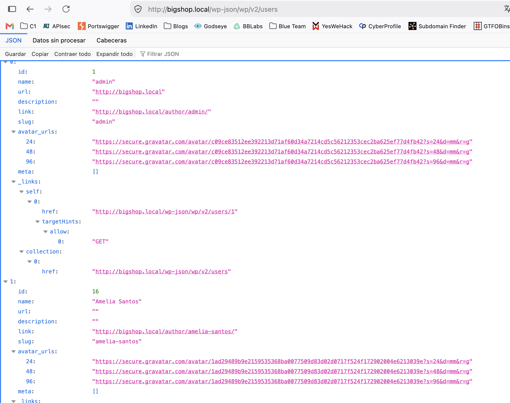

# 👥 F-019 — Enumeración masiva de usuarios sin autenticación (29 cuentas)

   

> [!IMPORTANT]
> WordPress expone por defecto dos vías para listar usuarios reales sin ninguna autenticación — combinándolas se obtuvo un diccionario de **29 cuentas**, incluida `admin`, sin adivinar ni un solo nombre.

## 📖 Contexto

Tras confirmar que `bigshop.local` es un sitio real distinto del vhost por defecto de Apache (ver reconocimiento en [`auditoria/wordpress/`](../auditoria/wordpress/README.md)), el siguiente paso natural fue probar las rutas de reconocimiento "clásicas" de WordPress antes de lanzar ningún escáner automatizado.

## 🔬 Explotación paso a paso

**1. API REST — `/wp-json/wp/v2/users`.** Endpoint público por defecto, sin autenticación, que devuelve id, nombre y slug de cada usuario con contenido publicado:

```
GET http://bigshop.local/wp-json/wp/v2/users
```



Primeros resultados: `admin` (id 1) y `Amelia Santos` (id 16) — ya con esto, un nombre de administrador real confirmado sin esfuerzo.

**2. Generador RSS.** Los feeds de WordPress incluyen el nombre completo del autor de cada entrada publicada:

```
GET http://bigshop.local/feed/
GET http://bigshop.local/comments/feed/
```

**3. Automatizado con WPScan**, combinando ambas técnicas (output completo en [`scans/wpscan-bigshop-puerto80.txt`](../scans/wpscan-bigshop-puerto80.txt)):

```bash
wpscan --url http://bigshop.local -e u --random-user-agent
```

Resultado: **29 cuentas identificadas**, sin ninguna credencial:

```
admin, Jack Osei, Luna De La Cruz, William Ferro, Harper Lemos, Amelia Santos,
James Moreau, Charlotte King, Ethan Walsh, ava-thompson, charlotte-king,
emma-castillo, ethan-walsh, harper-lemos, isabella-dubois, jack-osei,
james-moreau, kelly-rincon, liam-okafor, lucas-fischer, luna-delacruz,
mateo-silva, mia-nakamura, noah-bennett, oliver-reyes, sofia-marino, william-ferro
```

> [!NOTE]
> WPScan también reportó `Salt &amp; Stoke Surf Co.` como "usuario" vía oEmbed — es el nombre del sitio, no una cuenta real. Falso positivo del propio detector, descartado del recuento.

## 💥 Impacto

> [!CAUTION]
> Un atacante obtiene un diccionario completo de usuarios válidos —incluida la cuenta `admin`— sin adivinar ni uno solo. Esto hace mucho más eficiente cualquier fuerza bruta o *credential stuffing* posterior (solo falta la contraseña), y facilita *phishing* dirigido con nombres reales. No se probó fuerza bruta de contraseñas contra estas cuentas — fuera del alcance de esta fase de reconocimiento.

## 🛡️ Remediación

- Restringir `/wp-json/wp/v2/users` a usuarios autenticados (plugin de hardening o filtro `rest_endpoints` personalizado).
- Evitar que el nombre de usuario de login coincida con el `display_name` público mostrado en autoría de posts y feeds.
- Complementar con un control real de intentos de login ligado a la cuenta/sesión, no a cabeceras controlables por el cliente (ver el mismo patrón de fallo, pero explotado hasta el final, en [F-007](F-007-bypass-ratelimit-mfa-xff.md) de PenguinWave).

---

⬅ [Volver al índice de writeups](README.md) · [README principal](../README.md) · [Informe técnico (PDF)](../docs/informe-BigShop.pdf)
