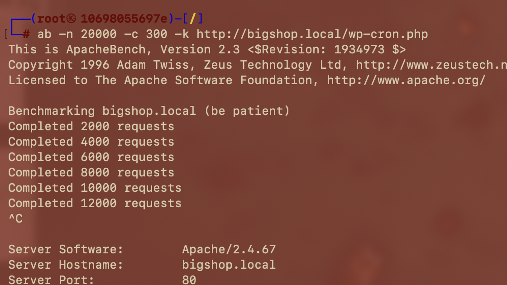

# 🔥 F-020 — Denegación de servicio parcial vía wp-cron.php

   

> [!IMPORTANT]
> `wp-cron.php` se ejecuta en **cada visita** al sitio, no en segundo plano — una sola máquina con `ab` basta para degradar notablemente el tiempo de respuesta del servidor, sin necesidad de botnet.

## 📖 Contexto

WordPress no usa el cron real del sistema operativo por defecto: simula uno disparando `wp-cron.php` cada vez que alguien visita la web, para comprobar tareas pendientes (publicar posts programados, buscar actualizaciones, etc.). Es una ruta pública, sin rate-limit ni autenticación — un objetivo clásico de denegación de servicio. WPScan lo confirma y referencia directamente el módulo de Metasploit `auxiliary/dos/http/wordpress_xmlrpc_dos`.

## 🔬 Explotación paso a paso

**Primera prueba**, volumen moderado — sin efecto perceptible, el sitio siguió respondiendo con normalidad:

```bash
ab -n 5000 -c 50 -k -H "Accept-Encoding: gzip, deflate" http://bigshop.local/wp-cron.php
```

**Segunda prueba**, con mayor intensidad — el avance se ralentizó notablemente frente a la primera, se interrumpió manualmente con `Ctrl+C` tras completar 12.000 de las 20.000 peticiones:

```bash
ab -n 20000 -c 300 -k http://bigshop.local/wp-cron.php
```



> [!NOTE]
> Nota de alcance: al interrumpirse con `Ctrl+C`, `ab` no llegó a imprimir las estadísticas finales (peticiones/segundo, tiempos de respuesta agregados) — la evidencia de impacto aquí es **cualitativa** (ritmo de avance mucho más lento que en la primera prueba), no una cifra exacta de degradación.

No se escaló la intensidad más allá de esta segunda prueba. En un compromiso real el DoS suele estar fuera de alcance o fuertemente limitado por las reglas de contratación, precisamente por el riesgo de escalada descontrolada — y en este laboratorio en particular el mismo host aloja las otras 3 aplicaciones auditadas (PenguinWave, PixelForge y StreamWave). Tras la prueba, el laboratorio se reinició para restaurar el servicio con normalidad.

## 💥 Impacto

> [!CAUTION]
> Con una sola máquina y herramientas estándar se consigue una degradación notable del tiempo de respuesta, sin infraestructura distribuida. No se confirmó caída total (HTTP 5xx/timeout generalizado) en las pruebas realizadas, pero el patrón de ralentización progresiva al aumentar la concurrencia (50→300) indica que el servicio sí está expuesto a un ataque de disponibilidad escalable — con mayor concurrencia sostenida, más tiempo de ataque, o combinándolo con el vector de amplificación de `xmlrpc.php` (`system.multicall`), es razonable esperar una caída completa.

## 🛡️ Remediación

- Deshabilitar el cron disparado por visita: `define('DISABLE_WP_CRON', true);` en `wp-config.php`.
- Sustituirlo por un cron real del sistema operativo llamando a `wp-cron.php` vía CLI a intervalos fijos, sin exponerlo públicamente.
- Como mínimo, aplicar rate-limiting a nivel de servidor web/WAF sobre esa ruta específica.

---

⬅ [Volver al índice de writeups](README.md) · [README principal](../README.md) · [Informe técnico (PDF)](../docs/informe-BigShop.pdf)
