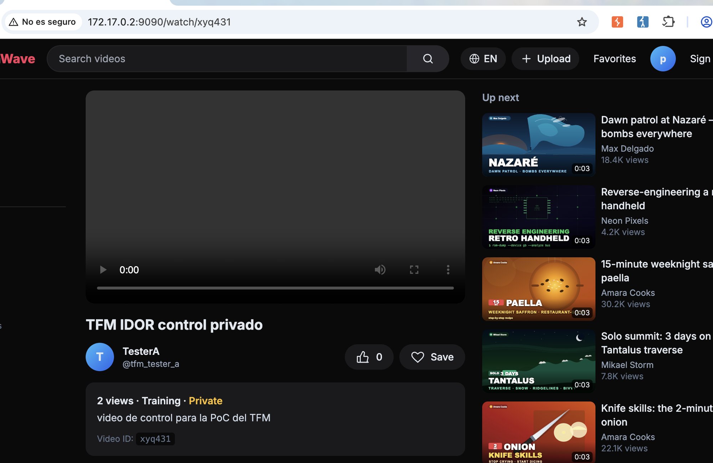
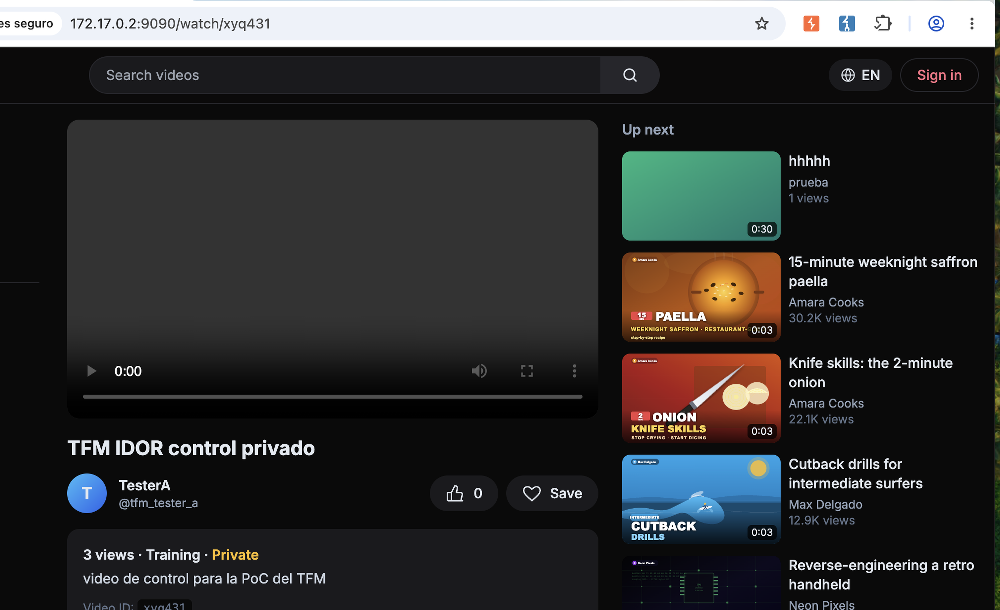
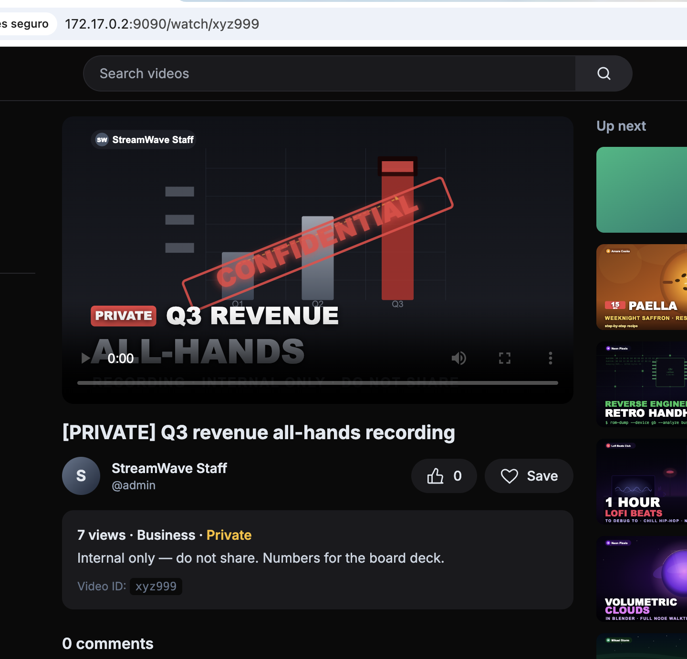
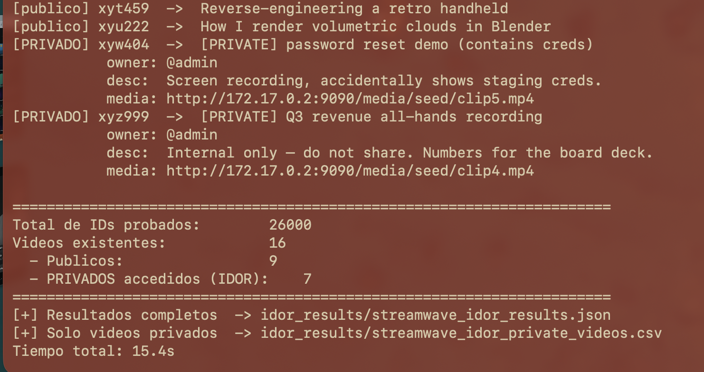

# 🔓 F-026 — IDOR en StreamWave: vídeos "privados" visibles por cualquiera

   

> [!IMPORTANT]
> `/watch/{id}` no comprueba en ningún momento si el visitante está autenticado ni si es el propietario del vídeo. Un vídeo marcado "Private — only people with the link" se sirve completo a una petición 100% anónima. Combinado con un ID corto y predecible (`xy` + letra + 3 dígitos, 26.000 combinaciones), el espacio completo se enumera en ~20 segundos, exponiendo el **100 % de los vídeos privados de la plataforma**.

## 📖 Contexto

**Endpoint afectado:** `http://172.17.0.2:9090/watch/{id}`

StreamWave permite subir vídeos con visibilidad `public` o `private`. La UI de subida describe explícitamente la opción privada como "only people with the link" — el modelo de seguridad depende enteramente de que el ID sea difícil de adivinar.

## 🔬 Explotación paso a paso

Se sube un vídeo de control marcado `private` con una cuenta de prueba → ID `xyq431`. Logueado como propietario, la página muestra correctamente la etiqueta `Private`:



El mismo enlace, **sin ninguna sesión iniciada** (nótese el botón "Sign in", sin usuario logueado):



Se reproduce exactamente igual. **IDOR confirmado.**

Probando un ID al azar dentro del mismo patrón, sin sesión, se encuentra directamente un vídeo privado **ajeno**, propiedad de `admin`:



### Automatización — barrido completo del espacio de IDs

El patrón de ID (`xy` + 1 letra + 3 dígitos = 26.000 combinaciones) es trivialmente fuerza-bruteable. Script propio: [`scripts/streamwave_idor_watch_scan.py`](../scripts/streamwave_idor_watch_scan.py).

```bash
python3 scripts/streamwave_idor_watch_scan.py --base-url http://172.17.0.2:9090
```

El script hace, siempre con peticiones **anónimas**:
1. `HEAD /watch/{id}` contra las 26.000 combinaciones → localiza qué IDs existen.
2. `GET /watch/{id}` sobre cada uno existente → clasifica público/privado y extrae título, descripción, owner y URL del vídeo.

Reproducido también desde una segunda máquina atacante independiente (Kali en un contenedor Docker separado, `172.17.0.3`):



```
Total de IDs probados:        26000
Videos existentes:            16
  - Publicos:                 9
  - PRIVADOS accedidos (IDOR):    7
```

**Los 7 vídeos privados existentes, los 7 accedidos sin autenticación:**

| ID | Título | Owner | Descripción |
|---|---|---|---|
| `xyd377` | `<u>hola</u>` | `@prueba` | prueba |
| `xyg250` | [PRIVATE] raw drone footage (client review) | `@trailmik` | "Unlisted client review cut, NDA covered." |
| `xyi918` | asasasa | `@prueba` | prueba |
| `xyp013` | [PRIVATE] unlisted — birthday surprise edit | `@chefamara` | "For the family group only, do not publish yet." |
| `xyq431` | TFM IDOR control privado | `@tfm_tester_a` | vídeo de control |
| `xyw404` | [PRIVATE] password reset demo (contains creds) | `@admin` | contiene credenciales reales — ver [F-027](F-027-secretos-expuestos-streamwave.md) |
| `xyz999` | [PRIVATE] Q3 revenue all-hands recording | `@admin` | "Internal only — do not share." |

Resultados completos en [`scans/streamwave-idor-full-scan.json`](../scans/streamwave-idor-full-scan.json) y [`scans/streamwave-idor-private-videos.csv`](../scans/streamwave-idor-private-videos.csv).

## 💥 Impacto

> [!CAUTION]
> El 43,75 % de todo el catálogo de StreamWave (7 de 16 vídeos) es "privado" — y el 100 % de ese contenido privado es accesible sin ningún tipo de autenticación.

- Exposición de contenido explícitamente confidencial: material bajo NDA, un reporte financiero interno marcado "do not share", y datos personales/familiares.
- No hace falta robar ningún enlace: basta fuerza bruta sobre un espacio de 26.000 combinaciones, factible en menos de un minuto.
- Es el **vector de acceso** que hace explotable [F-027 — Secretos expuestos](F-027-secretos-expuestos-streamwave.md): sin este IDOR, el vídeo con credenciales filtradas no sería alcanzable sin cuenta.

## 🛡️ Remediación

- Control de autorización server-side en `GET /watch/{id}`: comprobar sesión autenticada y propiedad del vídeo antes de servirlo; `403`/`404` en caso contrario.
- No depender del ID como control de acceso — si se mantiene "enlace privado", usar IDs de alta entropía (UUID v4), aunque eso no sustituye la comprobación de autorización.
- Auditar si el mismo patrón corto de ID se usa en otros endpoints (comentarios, favoritos) y corregir igual.

## Hallazgos relacionados

[F-027 — Secretos expuestos en contenido privado de StreamWave](F-027-secretos-expuestos-streamwave.md) — este IDOR es el vector que hace alcanzable, sin autenticación, un vídeo que filtra credenciales reales.

---
⬅ [Volver al índice de writeups](README.md) · [README principal](../README.md) · [Informe técnico (PDF)](../docs/informe-BigShop.pdf)
