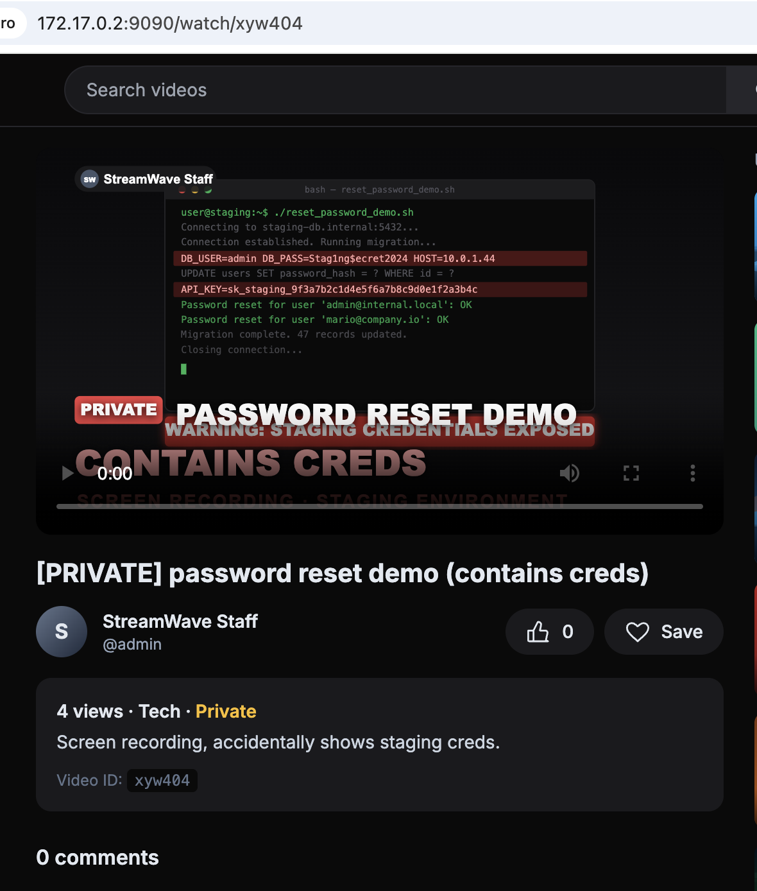

# 🔑 F-027 — Secretos expuestos en contenido "privado" de StreamWave

   

> [!IMPORTANT]
> El vídeo `xyw404` ("password reset demo") contiene en su propio fotograma — visible sin ni siquiera reproducirlo — credenciales reales de un entorno staging: usuario/contraseña de base de datos, host interno y una API key completa. Es un hallazgo independiente del IDOR ([F-026](F-026-idor-streamwave-watch.md)): aunque el control de acceso funcionara perfectamente, el problema de fondo seguiría existiendo — ese contenido nunca debió grabarse ni subirse con secretos reales visibles.

## 📖 Contexto

**Vídeo afectado:** `http://172.17.0.2:9090/watch/xyw404` — "[PRIVATE] password reset demo (contains creds)", subido por `@admin`.

Encontrado al enumerar el catálogo privado de StreamWave vía [F-026](F-026-idor-streamwave-watch.md). El propio título ("contains creds") y descripción ("accidentally shows staging creds") de quien lo subió ya reconocen el problema.

## 🔬 Explotación paso a paso

Accediendo al vídeo (sin autenticación, vía el IDOR de F-026), el fotograma inicial ya muestra una terminal con secretos en claro:



```
user@staging:~$ ./reset_password_demo.sh
Connecting to staging-db.internal:5432...
Connection established. Running migration...
DB_USER=admin DB_PASS=Stag1ng$ecret2024 HOST=10.0.1.44
UPDATE users SET password_hash = ? WHERE id = ?
API_KEY=sk_staging_9f3a7b2c1d4e5f6a7b8c9d0e1f2a3b4c
Password reset for user 'admin@internal.local': OK
Password reset for user 'mario@company.io': OK
Migration complete. 47 records updated.
```

### Verificación de reutilización de credenciales

Por rigor, no nos quedamos en "parece grave" — se intentó comprobar si eran reutilizables contra algo real dentro del laboratorio:

```bash
# El host del video no resuelve ni es alcanzable en esta red:
getent hosts staging-db.internal        # no resuelve
# 10.0.1.44 esta fuera del rango 172.17.0.0/16 de los contenedores del lab

# Se probo igualmente contra la unica BD real del lab (MariaDB local):
mysql -h 127.0.0.1 -u admin -p'Stag1ng$ecret2024' -e 'SELECT current_user();'
# ERROR 1045 (28000): Access denied for user 'admin'@'localhost' (using password: YES)

mysql -h 127.0.0.1 -u root -p'Stag1ng$ecret2024' -e 'SELECT 1;'
# ERROR 1698 (28000): Access denied for user 'root'@'localhost'
```

**Resultado: acceso denegado en ambos casos.** El host/credenciales del vídeo son contenido "de atrezzo" del escenario de laboratorio, no apuntan a un servicio vivo en este entorno concreto. Se documenta el resultado negativo con el mismo rigor que uno positivo — sobreestimar el impacto sin comprobarlo no es buena práctica de reporting.

## 💥 Impacto

> [!CAUTION]
> Independientemente de que la cadena hacia otro sistema no se haya podido confirmar **en este laboratorio concreto**, el fallo real y demostrado es que cualquier visitante no autenticado puede leer una credencial de base de datos y una API key completas. En un cliente real, esa misma práctica (grabar/subir contenido con secretos reales) sí puede dar acceso a sistemas vivos.

- Exposición de `DB_USER`/`DB_PASS`/`HOST` y de una API key completa, sin autenticación, sin reproducir el vídeo.
- Evidencia de un problema de **higiene de secretos** más amplio que la propia app: grabar demos con credenciales reales es una práctica de riesgo en sí misma, independiente de dónde se suba después.
- Encadenado con [F-026](F-026-idor-streamwave-watch.md): sin ese IDOR, este vídeo solo sería visible para `admin` o quien tuviera el enlace directo.

## 🛡️ Remediación

- Rotar inmediatamente cualquier credencial que haya aparecido en una grabación, tratarla como comprometida desde el momento de grabarse, no desde el momento de detectarse.
- Nunca usar credenciales reales (ni de staging) en demos o material de formación — usar siempre valores claramente ficticios.
- Escaneo automático de contenido subido (OCR sobre vídeo/imagen, o al menos metadatos) en busca de patrones de credenciales antes de publicar.

## Hallazgos relacionados

[F-026 — IDOR en StreamWave](F-026-idor-streamwave-watch.md) — es el vector de acceso que hace explotable este hallazgo sin necesitar cuenta ni ser el propietario.

---
⬅ [Volver al índice de writeups](README.md) · [README principal](../README.md) · [Informe técnico (PDF)](../docs/informe-BigShop.pdf)
