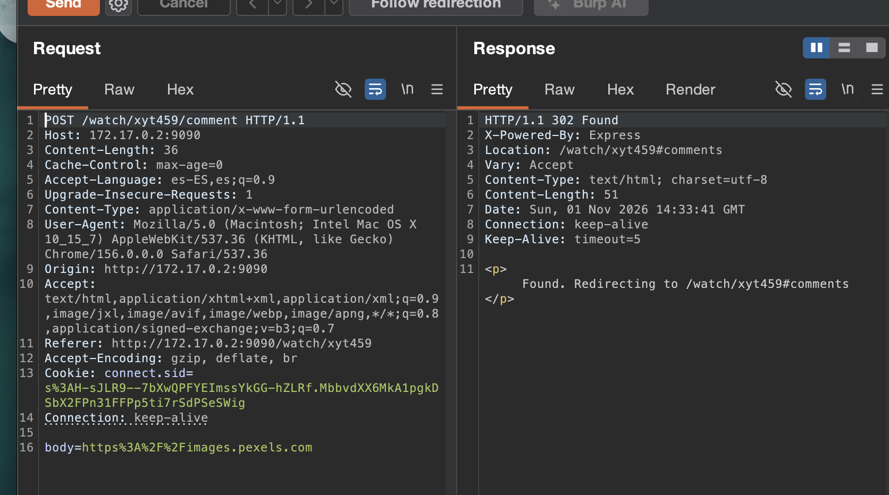
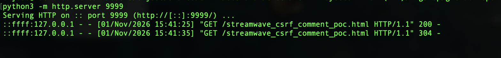

# 🧪 F-031 — CSRF en comentarios: probado en navegador real, no explotable

  

> [!NOTE]
> `POST /watch/{id}/comment` no lleva token anti-CSRF — mismo patrón que [F-010 de PenguinWave](F-010-csrf-envio-reviews.md), que sí fue explotable. Aquí se probó el mismo PoC en un navegador real y **no funcionó**: la cookie de sesión de StreamWave no tiene `SameSite` explícito, y el `Lax` por defecto de los navegadores modernos bloquea el envío de la cookie en el POST cross-site. Se documenta el resultado negativo con el mismo rigor que uno positivo.

## 📖 Contexto

| App | Cookie | `SameSite` | ¿CSRF explotable? |
|---|---|---|---|
| PenguinWave (8080) | `PHPSESSID` | `None` (explícito) | Sí — [F-010](F-010-csrf-envio-reviews.md) |
| StreamWave (9090) | `connect.sid` | ausente → `Lax` por defecto | **No** |

## 🔬 Prueba realizada

Formulario sin ningún campo de token:



PoC servido desde un origen distinto (`python3 -m http.server 9999`), con sesión real activa en el navegador:

```html
<form id="csrf" action="http://172.17.0.2:9090/watch/xyt459/comment" method="POST">
  <input type="hidden" name="body" value="CSRF-POC-forzado-sin-mi-cuenta">
</form>
<script>document.getElementById('csrf').submit()</script>
```



El navegador cargó el PoC (log del servidor atacante lo confirma), pero el comentario **no apareció** en `/watch/xyt459` — la cookie no viajó en la petición cross-site.

## 🧾 Conclusión

No se consiguió explotar en un navegador actualizado. Se documenta igualmente porque es una protección **de facto**, no un control deliberado de la aplicación — frágil ante navegadores antiguos o futuros endpoints que acepten `GET`.

## 🛡️ Remediación (preventiva)

- Token anti-CSRF explícito por sesión/formulario, validado en servidor, en todas las acciones de estado (`/comment`, `/like`, `/unlike`, `/upload`).
- Fijar `SameSite=Lax`/`Strict` explícitamente en `Set-Cookie` de `connect.sid`, sin depender del valor por defecto del navegador.

---
⬅ [Volver al índice de writeups](README.md) · [README principal](../README.md) · [Informe técnico (PDF)](../docs/informe-BigShop.pdf)
